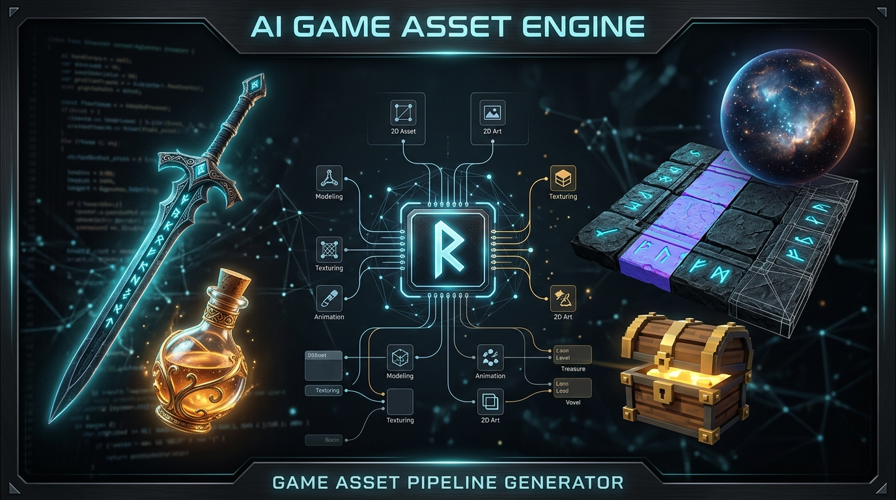
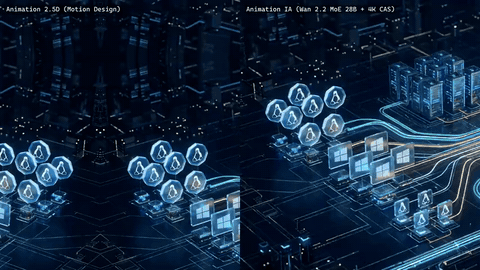
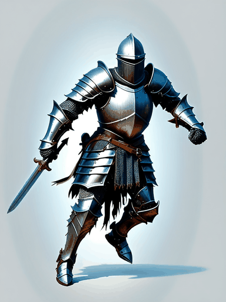

<div align="center">



# ⚔️ Generator Assets

### The 100% Local AI Media Factory — Video, 3D, Music, Voices & Sprites
**Zero CUDA • Zero PyTorch • Zero Cloud • Pure C++ Vulkan & GGUF for AMD Radeon, Intel Arc & NVIDIA**

[](https://www.python.org/)
[](https://godotengine.org/)
[](https://www.blender.org/)
[](https://www.vulkan.org/)
[](#-2-ai-video--cinematics)
[](#-3-music-voice--audio-design)
[](#-workflow-catalog-by-domain)
[](#-built-in-ai-agent-skill-agentsskillsgenerator-assets)
[](LICENSE)

<p align="center">
  <a href="#why-generator-assets">Why This Factory?</a> •
  <a href="#visual-showcase">Visual Showcase</a> •
  <a href="#workflow-hub">Workflow Catalog</a> •
  <a href="#quickstart">Quickstart in 3 Steps</a> •
  <a href="#web-and-agents">Web & Agent Interfaces</a> •
  <a href="#documentation">Full Documentation</a>
</p>

<p align="center">
  <a href="https://www.youtube.com/watch?v=AkIu3s0KQv0">
    <br/>
    <b>▶️ Watch the 100% Local Vulkan Pipeline in Action</b> (Godot 4 &amp; Blender Asset Generation)
  </a>
</p>

</div>

---

<span id="why-generator-assets"></span>
## ⚡ Why Generator Assets?

Most AI generation frameworks (ComfyUI, Automatic1111) rely on heavy Python stacks, multi-gigabyte PyTorch runtimes, CUDA locks, and unmanaged VRAM bloat.  
`generator-assets` is built as an **industrial, headless local media factory** designed to produce engine-ready game and video assets in seconds:

| The Problem with Traditional AI Tools | The Generator Assets Solution |
| :--- | :--- |
| ❌ **Locked to NVIDIA CUDA** (requires 15+ GB CUDA SDK) | ✅ **100% Vulkan & GGUF**: runs natively on **AMD Radeon** (RX 6000/7000/8000), **Intel Arc**, and NVIDIA with zero CUDA lock-in. |
| ❌ **PyTorch memory leaks & GPU driver crashes** | ✅ **Zero PyTorch runtime**: powered by ultra-optimized pure C++ engines (`sd-cli`, `audio.cpp`, `llama.cpp`, `trellis.cpp`). |
| ❌ **Outputs raw images requiring manual shader setup** | ✅ **Engine-native formats**: exports `.tres` (PBR ORM), `.glb` 3D meshes with baked textures, `.gdshader` files, and loop-ready `.ogg` streams. |
| ❌ **Heavy Web-UI overhead slowing generation** | ✅ **Sequential VRAM isolation**: LLM art directors and audio engines terminate and free 100% of VRAM before diffusion starts. |
| ❌ **Cloud subscriptions & data privacy risks** | ✅ **100% Local & Free forever**: zero network dependencies, zero API keys, runs completely offline on your workstation. |

---

<span id="visual-showcase"></span>
## 🎨 Visual Showcase: What the Factory Produces

### 1. 🎬 AI Video Generation & Camera Cinematics
Generate fluid, high-frame-rate cinematic shots natively with **Wan 2.2 MoE**, **LTX-2.5** (with native synchronized stereo sound), and **MiniMax-H3**:

| Wan 2.2 MoE I2V (Fluid 3D Dynamics) | 2.5D Parallax vs True AI 3D Space (Split-Screen) |
| :---: | :---: |
|  |  |
| *True AI volumetric dynamics without repetition — [Download 1080p MP4](docs/exemples/videos/video_wan22_i2v_scene01_1080p.mp4)* | *Static parallax (left) vs true continuous AI geometry (right) — [Download MP4](docs/exemples/videos/video_comparatif_2.5d_vs_wan22.mp4)* |

| LTX-2.5 Distilled (Native Synchronized Stereo Audio) | Pose-Controlled Character Run (ControlNet + IP-Adapter) |
| :---: | :---: |
|  |  |
| *8 steps, 22B DiT + native audio synthesis — [Download MP4](docs/exemples/videos/video_ltx25_dragon_audio.mp4)* | *Locked identity + rig skeletal control frame-by-frame* |

---

### 2. 🧱 3D Game Meshes & PBR Materials
Full PBR material channels (Albedo, DeepBump Normal, Roughness, Height, AO) automatically packed into Godot `.tres` resources and Blender `.glb` meshes:

| Albedo Texture | DeepBump Normal Map | Godot ORM Channel Pack | Seamless 3×3 Tile Verification |
| :---: | :---: | :---: | :---: |
|  |  |  |  |
| *1024×1024 Base Color* | *Relief from 2D via Neural ONNX* | *Red=AO, Green=Roughness, Blue=Metal* | *Zero-seam repeating tile* |

| AI 3D Mesh (TRELLIS.2 / Pixal3D Multi-View) | Parametric Prop (`mesh3d --shape pillar`) | 360° Equirectangular Skybox (`skybox`) |
| :---: | :---: | :---: |
|  |  |  |
| *Volumetric closed 3D model (.glb) with PBR atlas* | *Blender quad geometry with embedded PBR* | *2:1 spherical sky + Godot IBL environment* |

---

### 3. 🎵 AI Music Loops & Sound Design
Generate bar-aligned, seamless background music loops at **-30 LUFS** with automated ducking recipes, full songs with vocals, and expressive voice-overs:

| Seamless Audio Loop Waveforms (48 kHz Stereo, Δ0.1–0.4 dB Seams) |
| :---: |
|  |
| *Zero-crossing alignment + automatic ffmpeg sidechain ducking command behind voice-overs — [Preview MP3 ×3](docs/exemples/musique/boucle_tech_cand1_95bpm.mp3)* |

---

### 4. 🎨 2D Sprites, Pixel Art & 4K AI Upscaling
Isolate game items with zero white halos, quantize to classic retro palettes, and upscale 4× without edge bleed:

| Clean Cutout (`generate`) | 4K ESRGAN Super-Resolution (`upscale`) | Retro Pico-8 Pixel Art (`pixelart`) | Expandable 9-Patch Frame (`ui_9slice`) |
| :---: | :---: | :---: | :---: |
|  |  |  |  |
| *Neural background removal* | *Sharp 4096px, intact alpha* | *16-color authentic palette* | *Scales with zero corner distortion* |

---

<span id="workflow-hub"></span>
## 📦 Workflow Catalog by Domain

The engine ships **64 autonomous workflows**. Every workflow accepts natural language, enforces strict VRAM constraints, and outputs production assets:

```bash
uv run python main.py -w <workflow_name> [options]
```

### 🧱 1. 3D Meshes & Materials
| Workflow | What it does | 1-Line Example | Reference |
| :--- | :--- | :--- | :---: |
| **`material3d`** | Complete PBR texture pack (Albedo, Normal, ORM, Height) + Godot `.tres` | `uv run python main.py -w material3d "ancient gothic stone tile" -s 1024` | [Specs](docs/workflows_reference.md#11-material3d--production-pbr-texture-pack) |
| **`mesh3d`** | Parametric 3D meshes (`tile`, `cube`, `pillar`, `sphere`, `card`, `cutout`) via headless Blender | `uv run python main.py -w mesh3d "iron treasure chest" --shape cube` | [Specs](docs/workflows_reference.md#12-mesh3d--textured-3d-meshes-glb-via-headless-blender) |
| **`mesh_ia`** | **AI 2D image → volumetric closed 3D model (.glb)** via TRELLIS.2 / Pixal3D (Vulkan) | `uv run python main.py -w mesh_ia -i casque.png --res 512 --faces-cible 30000` | [Specs](docs/workflows_reference.md#17-mesh_ia--ai-volumetric-3d-objects-from-image-or-prompt-trellis2-gguf-vulkan) |
| **`skybox`** | 360° panoramic equirectangular sky + Godot `WorldEnvironment.tres` (IBL) | `uv run python main.py -w skybox "purple cosmic nebula starfield"` | [Specs](docs/workflows_reference.md#14-skybox--360-equirectangular-panoramic-environments) |
| **`voxel3d`** | Discretizes 2D sprites into 3D voxel models (.glb) with vertex colors | `uv run python main.py -w voxel3d -i potion.png --grid-size 32` | [Specs](docs/workflows_reference.md#13-voxel3d--discretized-3d-voxel-meshes-glb) |
| **`turnaround3d`** | Calibrated Front + Side orthogonal modeling sheets for Blender modeling | `uv run python main.py -w turnaround3d "dwarven warrior in plate armor"` | [Specs](docs/workflows_reference.md#15-turnaround3d--calibrated-orthogonal-modeling-sheets) |
| **`flowmap`** | Procedural vector velocity flowmaps + Godot 4 water/lava `.gdshader` | `uv run python main.py -w flowmap "molten lava river" --angle 45` | [Specs](docs/workflows_reference.md#16-flowmap--vector-velocity-flowmaps--waterlava-shaders) |
| **`asset_blendkit`** | Pulls CC0 assets from BlendKit: light Godot props (.glb) or Cycles décor plates | `uv run python main.py -w asset_blendkit --query "wooden barrel" --index 0` | [Specs](docs/workflows_reference.md#18-asset_blendkit--cc0-stock-assets-from-blendkit-godot-ready-props--youtube-compositing-plates) |

---

### 🎬 2. AI Video & Cinematics
| Workflow | What it does | 1-Line Example | Reference |
| :--- | :--- | :--- | :---: |
| **`monoplan_ia`** 🏆 | Single-take cinematic shot (LTX-2.5 + slow-mo + anti-jitter zoom + title card + **4K UHD**) | `uv run python main.py -w monoplan_ia "dolly-in fortress on cliff" -i scene.png --4k` | [Specs](docs/workflows_reference.md#410-monoplan_ia--single-take-cinematic-shot-from-a-still-image-ltx-25--slow-motion--designed-zoom-) |
| **`video`** | Hardware-accelerated T2V, I2V, and First-and-Last Frame (Wan 2.2, LTX-2.5) | `uv run python main.py -w video "waterfall cascading in jungle" --frames 33` | [Specs](docs/workflows_reference.md#48-video--native-hardware-accelerated-video-generation-webm) |
| **`video_multishot`** 🏆 | Multi-cut video with continuous audio across cuts in a SINGLE generation pass | `uv run python main.py -w video_multishot -p "Shot 1. A hard cut to Shot 2..."` | [Specs](docs/workflows_reference.md#49c-video_multishot--multi-cut-video--continuous-soundtrack-in-one-generation-ltx-25-native-multishot) |
| **`h3_ref2va`** ⚡ | Video & sound continuation via MiniMax-H3 Ref2VA (**turbo 8-step mode: ~38 min**) | `uv run python main.py -w h3_ref2va -i intro.mp4 -p "dragon roars" --turbo` | [Specs](docs/workflows_reference.md#49-h3_ref2va--videoaudio-continuation-via-minimax-h3-ref2va-webm-with-sound) |
| **`video_vace`** | Motion-locked video: reference image + control frames (Wan 2.1 VACE distilled) | `uv run python main.py -w video_vace -i ref.png --control-video frames_dir/` | [Specs](docs/workflows_reference.md#49b-video_vace--motion-locked-video-reference-image--control-frames-wan-21-vace-lightx2v-distilled) |
| **`rife_interp`** | AI frame rate multiplication up to 60 FPS preserving alpha transparency | `uv run python main.py -w rife_interp -i spritesheet.png --factor 2` | [Specs](docs/workflows_reference.md#47-rife_interp--ai-frame-rate-multiplication-60-fps) |

---

### 🔊 3. Music, Voice & Audio Design
| Workflow | What it does | 1-Line Example | Reference |
| :--- | :--- | :--- | :---: |
| **`music_bg`** | Seamless AI music loops (−30 LUFS bed + automatic sidechain ducking command) | `uv run python main.py -w music_bg "minimal techno groove, no vocals" --duration 20` | [Specs](docs/workflows_reference.md#43-music_bg--ai-music-loops-as-background-beds-minimax-music3--ace-step-15-gguf-vulkan) |
| **`chanson`** | Complete sung songs with French/English lyrics and musical structure tags | `uv run python main.py -w chanson lyrics.txt --duration 180 -o song` | [Specs](docs/workflows_reference.md#410-chanson--full-songs-with-lyrics-ace-step-15-xl-turbo-vulkan) |
| **`musique_adn`** | Generates new music imposing the exact detected BPM and key of a reference | `uv run python main.py -w musique_adn "gothic rock" -i ref.mp3 --duration 45` | [Specs](docs/workflows_reference.md#411-musique_adn--new-music-with-a-references-dna-auto-bpm--key-imposed-on-the-planner) |
| **`voix_off`** | Expressive AI voice-over with voice cloning (Qwen3-TTS / VoxCPM2 / Drama 3, −16 LUFS) | `uv run python main.py -w voix_off "Welcome!" --voix-ref speaker.wav` | [Specs](docs/workflows_reference.md#49-voix_off--expressive-ai-voice-over-with-voice-cloning-qwen3-tts--voxcpm2--fish-s2-pro--drama-3-gguf-vulkan) |
| **`voix_perso`** | Character voice lines with pitch shift, whisper filter, or hollow void effects | `uv run python main.py -w voix_perso "Halt!" --kokoro-voice am_onyx --hollow` | [Specs](docs/workflows_reference.md#417-voix_perso--english-character-voice-kokoro-preset-or-qwen3-voicedesign--validated-post-chains) |
| **`voix_robot`** | Metallic robot assistant voice (Kokoro + 120 Hz ring modulation) | `uv run python main.py -w voix_robot "System online. Initiating scan."` | [Specs](docs/workflows_reference.md#414-voix_robot--english-robot-voice-kokoro-82m--ring-modulation) |
| **`retrait_voix`** | Vocal removal & 4-stem separation (drums, bass, other, vocals) via HTDemucs | `uv run python main.py -w retrait_voix -i track.mp3 -o instrumental` | [Specs](docs/workflows_reference.md#412-retrait_voix--vocal-removal--stem-separation-htdemucs-gguf-vulkan) |
| **`sfx`** | AI sound effect generation (Stable Audio 3) or procedural waveform synthesis | `uv run python main.py -w sfx "heavy sword slash metal impact" --duration 1.2` | [Specs](docs/workflows_reference.md#41-sfx--ai--procedural-sound-effects-synthesis) |
| **`audio_ambience`**| Procedural seamless ambient soundscapes (dungeon, forest, storm) + Godot bus | `uv run python main.py -w audio_ambience "dark subterranean dungeon"` | [Specs](docs/workflows_reference.md#42-audio_ambience--procedural-seamless-looping-ambient-soundscapes) |

---

### 👤 4. Humanoid 3D Characters (MakeHuman / MPFB2)
| Workflow | What it does | 1-Line Example | Reference |
| :--- | :--- | :--- | :---: |
| **`character3d`** | 2D portrait → rigged 3D body (.blend & .glb) with UV makeup, clothes & 4 studio renders | `uv run python main.py -w character3d --portrait face.png --character hero` | [Specs](docs/pipeline_personnages_3d.md) |
| **`makehuman_clothes`** | Generates modular quad wardrobe (.mhclo) adapting automatically to body morphology | `uv run python main.py -w makehuman_clothes "dark leather armor" --parts torso,pants` | [Specs](docs/pipeline_personnages_3d.md) |
| **`outfit`** | PBR retexturing of existing clothing meshes preserving 100% of sewing UV patterns | `uv run python main.py -w outfit --character hero --top "rough burlap tunic"` | [Specs](docs/pipeline_personnages_3d.md) |
| **`pose_control`** | Character sprite conditioned on OpenPose skeleton + rigged Godot scene (.tscn) | `uv run python main.py -w pose_control "dark knight" --pose slash_attack` | [Specs](docs/workflows_reference.md#25-pose_control--openpose-skeleton-guidance--rigged-godot-scenes) |
| **`animal_godot`** | Rigged animated animal pack (.blend) → Godot-ready `.glb` with verified `AN_*` clips | `uv run python main.py -w animal_godot -i wolf_rig.blend -o wolf_godot.glb` | [Specs](docs/workflows_reference.md#416-animal_godot--game-ready-animated-animal-pack-blend--glb-for-godot) |

---

### 🎨 5. 2D Sprites, Tiles & UI
| Workflow | What it does | 1-Line Example | Reference |
| :--- | :--- | :--- | :---: |
| **`generate`** | Isolated 2D game items with neural background removal and Godot anchor centering | `uv run python main.py -w generate "gold shield with lion crest" --upscale` | [Specs](docs/workflows_reference.md#31-generate--standard-isolated-2d-game-asset) |
| **`qwen_image`** | Photorealistic text-to-image with text rendering & product compositing (`--qwen-turbo`) | `uv run python main.py -w qwen_image "tavern wooden sign 'Dragon'" --qwen-turbo` | [Specs](docs/workflows_reference.md#39-qwen_image--qwen-image-21-photorealistic-text-to-image-and-compositing-research-license) |
| **`spritesheet`** | 4-angle aligned character perspective sheet + Godot JSON frame atlas | `uv run python main.py -w spritesheet "undead skeleton warrior" --columns 4` | [Specs](docs/workflows_reference.md#32-spritesheet--multi-angle-character-sprite-sheet) |
| **`autotile_pack`** | 47-tile Wang / minimal 3×3 autotile atlas + pre-configured Godot 4 `TileSet.tres` | `uv run python main.py -w autotile_pack --biome-a "grass" --biome-b "dirt"` | [Specs](docs/workflows_reference.md#33-autotile_pack--47-tile-minimal-3x3-wang-autotile-atlas) |
| **`pixelart`** | Downsamples and quantizes sprites into retro hardware palettes (Pico-8, GameBoy) | `uv run python main.py -w pixelart -i item.png --palette pico8 --grid-size 64` | [Specs](docs/workflows_reference.md#35-pixelart--retro-palette-color-quantization--downsampling) |
| **`ui_9slice`** | Generates expandable UI frames/dialog boxes + Godot 4 `StyleBoxTexture.tres` | `uv run python main.py -w ui_9slice "golden fantasy dialog frame" --margin 32` | [Specs](docs/workflows_reference.md#37-ui_9slice--expandable-9-patch-frames--buttons) |
| **`rembg`** | Neural background removal (RMBG / BiRefNet ONNX) with zero white fringes | `uv run python main.py -w rembg -i sprite.png -o sprite_clean` | [Specs](docs/workflows_reference.md#38-rembg--high-precision-neural-background-removal) |
| **`upscale`** | 4K AI Super-Resolution (ESRGAN Vulkan) with 100% alpha transparency preservation | `uv run python main.py -w upscale -i item.png --factor 4` | [Specs](docs/workflows_reference.md#52-upscale--4k-ai-super-resolution-esrgan-vulkan) |

---

### 🧩 6. Craft Suite Integration (12 Headless Rust Apps)
15 workflows driving the open-source [Craft App Suite](https://getartcraft.com/apps) headless via CLI and MCP:
- **`miniature`** : YouTube thumbnails (1280×720) with gradient band and real typography (PhotoCraft).
- **`carte_fin`** : YouTube end cards with dark veil and centered CTA typography (PhotoCraft).
- **`icone_jeu`** : Scale-free flat vector icons in SVG + PNG for Godot UI (VectorCraft).
- **`rapport_deck`** : Benchmark measures → PDF deck with column charts (DeckCraft).
- **`doc_texte`** / **`classeur_donnees`** : Markdown to styled PDF (WordCraft) and CSV/JSON to XLSX (GridCraft).
- **`ocr_pdf`** : Text layer extraction & OCR fallback for scanned documents (PdfCraft).
- *See the [Craft Suite Reference](docs/workflows_reference.md#6-craft-suite-integration--12-headless-rust-apps) for the full list.*

---

<span id="quickstart"></span>
## ⚡ Quickstart in 3 Steps

### Step 1: One-Command Installation
Clone the repository and run the setup script for your OS (installs `uv`, syncs packages, and downloads pinned official Vulkan binaries):

```bash
git clone https://github.com/votre-compte/generator-assets.git
cd generator-assets

# Windows (PowerShell):
powershell -ExecutionPolicy Bypass -File scripts\install_windows.ps1

# Linux / macOS (bash):
bash scripts/install_unix.sh
```

### Step 2: Download the Core Models
Download the lightweight base pack (~10 GB: Flux.1 Dev Q6_K, CLIP-L, T5-XXL, VAE, LFM2.5 Art Director):
```bash
uv run python scripts/download_models.py --pack base
```
*(Need video or music? Run `--pack video`, `--pack upscalers`, or see the [Model Download Guide](docs/installation.md#3-download-the-ai-models)).*

### Step 3: Produce Your First Asset!
```bash
# Generate a complete PBR material ready for Godot:
uv run python main.py -w material3d "runic ancient dungeon stone floor" -s 1024

# Or launch the Web Console in your browser:
uv run python -m server    # → Opens http://127.0.0.1:8765
```

---

<span id="web-and-agents"></span>
## 🖥️ Web Console & AI Agent Interfaces

### 🌐 The Full-Python Web Console
Prefer a visual dashboard over the CLI? Run `uv run python -m server`:
- Built with **FastAPI + Jinja2 + HTMX** (zero Node.js, zero npm, zero React bloat).
- Automatically inspects all 64 workflows and generates interactive forms.
- Features a **serialized GPU run queue** with automatic system load checks.
- Live log streaming (SSE), media gallery, and model inventory.

<span id="skill-ia"></span>
### 🤖 Built-in AI Agent Skill (`.agents/skills/generator-assets/`)
This repository is natively understood by AI coding agents (**ZCode, Claude Code, Gemini, Antigravity**):
- When an agent opens this workspace, it automatically loads `.agents/skills/generator-assets/SKILL.md`.
- You can prompt your agent in plain language: *"Generate a dark ambient music loop for my level and create a PBR stone material"*.
- The skill handles workflow routing, safety guardrails (VRAM load gate, English prompt formatting, fixed seeds), and output verification autonomously.

---

<span id="documentation"></span>
## 📚 In-Depth Documentation

To keep this landing page fast and readable, technical deep-dives have been organized into dedicated documentation modules:

- 📦 **[Complete Workflow Technical Reference](docs/workflows_reference.md)** — Exhaustive processes, inputs/outputs, and mathematical specs for all 64 pipelines.
- ⚡ **[Installation & System Setup Guide](docs/installation.md)** — OS requirements, Vulkan drivers, model pack tables, and environment variables.
- 🔄 **[Vulkan Engines Update & Build Manual](docs/guide_moteurs_vulkan.md)** — Automated builders, CMake scripts, backups, and rollbacks for `sd-cli` and `llama.cpp`.
- 🎬 **[Video Generation & 4K Mastering Architecture](docs/architecture_video.md)** — DiT architectures (Wan 2.2, LTX-2.5, H3), AMD AMF hardware encoder, and overnight rendering.
- 👤 **[Canonical 3D Character Pipeline](docs/pipeline_personnages_3d.md)** — MakeHuman / MPFB2 anatomical facial extraction, hm08 UV mapping, and wardrobe compilers.
- 🎮 **[Godot 4 Integration Guide](docs/workflows_reference.md#godot-4-integration)** — How to import `.tres`, `.glb`, and `.gdshader` files directly into your scenes.
- 🧠 **[Operational Memory Bank](docs/MEMORY_BANK.md)** — Hardware-measured benchmarks, validated recipes, and project lessons learned.

---

## 📂 Project Structure

```text
generator-assets/
├── core/                   # Engine core: config, CLI orchestrators, LLM enrichers, PBR generators
├── workflows/              # 64 autonomous media generation workflow implementations
├── godot_assets/           # Default output directory for engine-ready game assets
├── output/                 # Output directory for video renders, audio tracks, and contact sheets
├── scripts/                # Specialized helper utilities, downloaders, and Vulkan builders
├── data/                   # JSON registries, clothes catalogs, and color palettes
├── loras/                  # Local directory for SDXL and Flux LoRA models
├── docs/                   # Dedicated documentation modules, visual diagrams, and benchmarks
└── main.py                 # Unified CLI entrypoint and interactive shell
```

---

## 📄 License
This project is open-source under the **[MIT License](LICENSE)**.  
Model weights (Flux.1, Wan 2.2, LTX-2.5, MiniMax, Qwen) remain subject to their respective upstream licenses.
