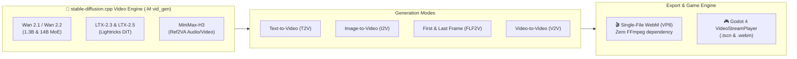

# 🎬 Video Generation Architecture & SOTA Flagships

> Native C++ video generation via stable-diffusion.cpp (-M vid_gen), Wan 2.1/2.2, LTX-2.5, MiniMax-H3, AMD AMF 4K mastering, and overnight batch rendering.
> Back to main: [README.md](../README.md)

---



### 1. 🎥 Native Video Generation Engine (`-M vid_gen`)

* **Advanced Video Synthesis Modes** :
  - **T2V (Text-to-Video)**: generates animated video sequences directly from a text description (e.g. waterfalls, torch flames, nebulae, moving characters).
  - **I2V (Image-to-Video)**: brings an existing still image to life (`--init-img` or `-i`) preserving structure and style with natural motion.
  - **FLF2V (First & Last Frame to Video)**: generates a continuous, fluid video transition linking a start image (`--init-img`) and an end image (`--end-img`).
  - **V2V (Video-to-Video Control)**: style transfer and temporal guidance driven by a directory of video frames (`--control-video`).
* **Standalone WebM Container Export** :
  - The `sd-cli.exe` executable natively embeds `libwebm` and `libwebp` (VP8 compression). It directly produces compact, lightweight `.webm` files without depending on an FFmpeg installation.
  - Also compatible with animated WebP and numbered image sequences (`%03d.png`).

---

### 2. 🧠 Supported Latest-Generation Video Models

| Model Family | Variants | Strengths & Specifics |
| :--- | :--- | :--- |
| **Alibaba Wan 2.1 & 2.2** | `1.3B`, `14B`, `Wan 2.2 MoE` | Cutting-edge DiT architecture. The 1.3B version runs on consumer GPUs (8 GB VRAM). Wan 2.2 supports dual High-Noise / Low-Noise diffusion (`--high-noise-diffusion-model`). Wan VACE guidance support (`--vace-strength`). |
| **Lightricks LTX-2.3 & 2.5** | `LTX-2.3`, `LTX-2.5` | Ultra-fast transformers designed for real-time video. Use the Google Gemma 3 and Gemma 4 encoders. Support the audio VAE (`--audio-vae`), connector embeddings and the latent spatial upscaler. |
| **MiniMax-H3** | `Day-1 Support` | Ref2VA multimodal architecture enabling combined conditioning by image, video and WAV soundtrack (`--ref-video`, `--ref-audio`, `--ref-video-audio`). |
| **HunyuanVideo 1.5 & LingBot** | `HunyuanVideo`, `LingBot-Video` | Large-format video diffusion models with high temporal coherence. |

---

### 3. ⚡ Hardware & Vulkan Optimizations

* **Flash Attention (`--diffusion-fa`)** :
  Drastically optimizes attention matrix computation for DiT (Diffusion Transformer) models, cutting VRAM requirements by 30% to 50% and speeding up rendering.
* **Temporal VAE Tiling (`--temporal-tiling`)** :
  Splits video VAE decoding into spatio-temporal tiles (`--extra-tiling-args temporal_tile_frames=4,temporal_tile_overlap=3`). Enables decoding long videos without video memory overflow.
* **Adjustable Flow Shift (`--flow-shift`)**:
  Precise sampling control for Flow Matching-based models (Wan 2.1, SD3.5).
* **Hybrid CPU Offload (`--offload-to-cpu`)**:
  Dynamically swaps inactive tensors into system RAM, allowing 14B models to run even with modest VRAM.
* **Native FP8 Vulkan Compute**:
  Direct execution of matrix multiplications in FP8 on Vulkan-compatible GPU tensor cores without costly upfront conversion.

---

### 4. 🎨 New Image Architectures (2025/2026)

Beyond video, `stable-diffusion.cpp` has extended compatibility to latest-generation image architectures:
* **FLUX.2-dev & FLUX.2-klein**: new Black Forest Labs flagships with improved prompt adherence and text rendering.
* **Qwen-Image & Qwen-Image-Edit (2509 series)**: precise contextual retouching and natural-language-guided image editing.
* **Z-Image, Krea2, Ideogram4, Lens, PiD**: models specialized in graphic design, illustration and typographic rendering.
* **Embedded Web Server (`sd-server.exe`)**: ready-to-use interactive web UI and server API.

---

### 🎮 Using the Video Workflow in Generator Assets

You can directly leverage these new capabilities through the unified `video` workflow:

```bash
# 1. Text-to-Video cinematic generation at 832x480 (24 FPS, 33 frames)
uv run python main.py -w video "cinematic waterfall cascading into glowing purple crystal pool in fantasy jungle" --frames 33 --fps 24 -o waterfall

# 2. Animating an existing asset or portrait Image-to-Video (I2V)
uv run python main.py -w video -i godot_assets/heros_portrait.png -p "character breathing, gentle wind blowing through hair and fog" --frames 25 -o heros_idle

# 3. Fluid transition between two images First-and-Last-Frame (FLF2V)
uv run python main.py -w video -i godot_assets/sol_herbe.png --end-img godot_assets/sol_lave.png -p "ground slowly cracking and transforming into molten lava" --frames 33 -o transition_sol
```

Each generation produces:
1. The standalone video file: `godot_assets/<nom>.webm`.
2. A ready-to-use Godot 4 scene: `godot_assets/<nom>_player.tscn` configured with a `VideoStreamPlayer` node for immediate in-game integration.

---

### 🏆 5. Cinema Flagship Models & Autonomous Overnight Rendering

For uncompromising cinematic visual quality, the suite integrates the SOTA flagship models and a hardware-accelerated video rendering pipeline:

#### 👑 5.1. LTX-2.5 Distilled (22B Audio + Video SOTA Validated)
* **Hybrid Vulkan / CPU Architecture (`diffusion=vulkan0,te=cpu,vae=cpu`)** :
  * **DiT Diffusion (22B)**: 14.05 GB VRAM on the AMD Radeon RX 6950 XT (100% stable).
  * **Gemma 4 Text Encoder (12B)**: runs in CPU RAM via AVX2 instructions (Q5_K_M precision).
  * **Stereo Audio VAE**: simultaneous decoding of the native 48 kHz PCM stereo soundtrack.
* **Record Performance** :
  * DiT sampling (8 distilled Lightricks steps): **1 min 24s flat** on the Vulkan GPU (~10.5s/step)!
  * **3.5× faster than Wan 2.1** thanks to CFG 1.0 (a single pass per step).
  * Render validated in superior production (fangs, horns, wings and gold scales).
* **Dedicated Script** (`scripts/generate_ltx25_8steps.py`) :
  ```bash
  python scripts/generate_ltx25_8steps.py
  ```

#### 👑 5.2. Wan 2.1 14B (Reference Monolithic Model)
* **Hybrid Vulkan/CPU Memory Architecture (`diffusion=vulkan0,te=cpu`)** :
  - **Diffusion Transformer (14B)**: 100% allocated in GDDR6 VRAM on the AMD Radeon RX 6950 XT (14.05 GB max).
  - **T5XXL Encoder**: runs in system RAM (6.66 GB) in pure FP32 precision. Completely eliminates numeric overflows (black frames / CFG blowout).
  - **VAE Decoder**: 242 MB in VRAM with native spatial and temporal tiling.
* **Dedicated Cinema Generation** (`scripts/generate_14b_cinema.py`) :
  ```bash
  python scripts/generate_14b_cinema.py <steps> <frames>
  ```

#### 🌙 Batch Overnight Rendering Pipeline (`scripts/run_overnight_batch.py`)
Chains a suite of complex cinematic generations overnight without human intervention:
* Queue of prompts and models (Wan 2.1 14B, Wan 2.2 MoE, MiniMax-H3, LTX-2.5).
* Sequential processing with automatic memory release between each shot.
* Automatic high-resolution preview frame extraction (`_preview.png`).
* Automatic conformance to **YouTube Full HD 1080p (1920×1080 @ 60 FPS, CBR 20 Mbps)** via the AMD AMF hardware encoder (`h264_amf`).
```bash
python scripts/run_overnight_batch.py
```

#### 📺 Hardware YouTube Full HD Conformance (`scripts/conform_youtube_hd.py`)
Instantly turns raw WebM/VP8 files into Full HD 1080p MP4 videos ready to upload to YouTube:
* Ultra-fast AMD AMF hardware encoding (`h264_amf`).
* Lossless-sharp Lanczos 1080p scaling interpolation.
* Renders in under 1 second per clip.
```bash
python scripts/conform_youtube_hd.py input.webm output_1080p.mp4
```

---

