# 📦 Complete Workflow Technical Reference

> Exhaustive reference manual for all 64 autonomous workflows: process details, mathematical specifications, inputs, engines, outputs, and CLI options.
> Back to main: [README.md](../README.md)

---

```text
📋 Quick Category Map:
  • 3D Geometry & PBR Textures     : material3d, mesh3d, mesh_ia, voxel3d, skybox, turnaround3d, flowmap, asset_blendkit
  • Game-Ready Animals (Godot)     : animal_godot
  • Humanoid 3D Characters & Outfits: character3d, character_makeup, makehuman_clothes, outfit, pose_control, rpg_portrait
  • 2D Sprites, Tiles & UI         : generate, qwen_image, moss_image, spritesheet, autotile_pack, tileable, pixelart, variations, ui_9slice, rembg
  • Audio, Voice, VFX & Video      : sfx, audio_ambience, music_bg, voix_off, voix_perso, lfm3_tts, voix_conversion, chanson, musique_adn, musique_essence, acestep_cover, retrait_voix, tts_dialogue, vfx_flipbook, anim_loop, rife_interp, video, video_vace, video_multishot, h3_ref2va, monoplan_ia, open_water
  • Style Consistency & Utilities  : ip_adapter, ocr_image, upscale, batch
  • Craft Suite (headless Rust apps): miniature, carte_fin, icone_jeu, titre_anime, prepa_i2v, filigrane_batch, doc_texte, classeur_donnees, rapport_deck, planche_pdf, maquette_ui, photo_develop, son_convertir, ocr_pdf, projet_montage
```

---

### 🧱 1. 3D Geometry & PBR Textures

#### 1.1. `material3d` — Production PBR Texture Pack
* **Process**:
  1. Accepts either a textual concept (e.g., *"dungeon stone runes"*) or an existing 2D texture (`-i texture.png`).
  2. If prompt-based, generates a 1024×1024 diffuse albedo texture via Flux.1 Dev Vulkan.
  3. Feeds the albedo into DeepBump ONNX neural network to estimate physically accurate OpenGL normal, roughness, displacement height, and ambient occlusion maps (falls back to Sobel spatial gradients if `--pbr-engine sobel`).
  4. Packs AO (Red), Roughness (Green), and Metallic (Blue) into a unified Godot-standard ORM texture.
  5. Computes a 3×3 repeating grid to verify seamless tiling borders.
  6. Automatically writes a native Godot 4 `StandardMaterial3D` (`.tres`) linking all maps with correct UV channels.
* **Inputs**: `prompt` or `-i, --input`, `-s, --size` (512, 1024, 2048), `--pbr-engine` (`auto`, `deep`, `sobel`), `--normal-strength` (default: 3.5).
* **Engines**: Flux.1 Dev GGUF, DeepBump ONNX, PIL, NumPy.
* **Outputs**: `_albedo.png`, `_normal.png`, `_roughness.png`, `_height.png`, `_ao.png`, `_orm.png`, `_material.tres`, `_preview3x3.png`.

##### 🖼️ PBR Illustrations & Variations
| PBR Channel | Runic Stone Floor (`sol_runique`) | Ancient Worn Leather (`cuir_ancien`) | Weathered Planks (`old_cracked_wood`) | Seamless 3×3 Check |
| :---: | :---: | :---: | :---: | :---: |
| **Albedo** |  |  |  |  |
| **Normal Map (DeepBump)** |  |  |  | *Repeating Tile Verification* |
| **Godot ORM** |  |  |  | *R=AO, G=Roughness, B=Metal* |

* **Example**:
  ```bash
  uv run python main.py -w material3d "ancient gothic stone tile with purple runes and moss" -s 1024 -o runic_stone
  ```

#### 1.2. `mesh3d` — Textured 3D Meshes (.GLB) via Headless Blender
* **Process**:
  1. Executes the `material3d` pipeline first to produce a complete PBR texture pack (Albedo, Normal, ORM, Height).
  2. Launches Blender 5.x in headless CLI mode (`--background --python-expr`) without opening any GUI window.
  3. Constructs parametric 3D quad geometry according to `--shape` (`tile` = beveled floor slab, `cube` = chest/crate with chamfered edges, `pillar` = octagonal dungeon column, `sphere` = magic orb, `card` = 2.5D standee, `cutout` = extruded silhouette).
  4. Automatically constructs a `Principled BSDF` material node graph with normal mapping and roughness reflections hooked up to the generated textures.
  5. Packs all textures directly into a binary `.glb` container optimized for Godot 4 `MeshInstance3D`.
* **Inputs**: `prompt` or `-i, --input`, `--shape` (`tile`, `cube`, `pillar`, `cylinder`, `sphere`, `card`, `cutout`).
* **Engines**: Flux.1 Dev GGUF, DeepBump ONNX, Blender 5.x CLI (`bpy`).
* **Outputs**: `_3d_<shape>.glb` (self-contained with embedded textures), plus all underlying PBR map files.

##### 🖼️ Parametric Geometry Variations (`--shape`)
| `--shape tile` (Beveled Floor Slab) | `--shape pillar` (Octagonal Pillar) | `--shape card` (2.5D Standee) | `--shape cutout` (Extruded Relief) |
| :---: | :---: | :---: | :---: |
|  |  |  |  |
| *Runic floor (`sol_runique_3d_tile.glb`)* | *Dungeon pillar (`pilier_runique_3d.glb`)* | *Potion standee (`potion_3d_card.glb`)* | *Potion cutout (`potion_3d_cutout.glb`)* |

* **Example**:
  ```bash
  uv run python main.py -w mesh3d "ornate ancient iron wrought chest" --shape cube -o chest_3d
  ```

#### 1.3. `voxel3d` — Discretized 3D Voxel Meshes (.GLB)
* **Process**:
  1. Accepts an input 2D sprite or generates a high-contrast item sprite with clean silhouette.
  2. Discretizes the 2D image into a 3D occupancy volume grid (NumPy array of shape `[grid_size, grid_size, voxel_depth]`).
  3. Computes voxel relief depth based on perceived luminance and silhouette boundaries.
  4. Executes aggressive internal face culling: scans adjacent voxel neighbors and strips all occluded interior quad faces, drastically reducing polycount.
  5. Launches Blender headless to build the optimized mesh, assigns sRGB Vertex Colors to vertices, and exports a lightweight `.glb` ready for Godot 4 `GridMap`.
* **Inputs**: `-i, --input` or `prompt`, `--grid-size` (e.g., 16, 32, 64), `--voxel-depth` (default: 4), `--voxel-scale` (default: 0.05).
* **Engines**: PIL, NumPy 3D Volume Array, Blender Headless CLI (`bpy`).
* **Outputs**: `_voxel.glb` with optimized vertex colors.

##### 🖼️ 2D Sprite to Voxel 3D Model (.GLB with Vertex Colors)
| 2D Source Sprite (`casque.png`) | Voxel 3D Model (`casque_voxel.glb`) | 2D Source Sprite (`potion_diablo.png`) | Voxel 3D Model (`potion_voxel.glb`) |
| :---: | :---: | :---: | :---: |
|  | 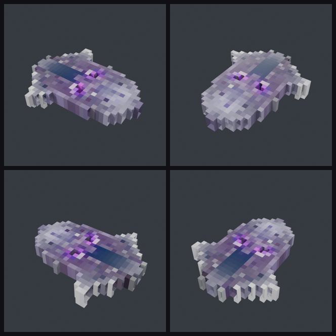 |  | 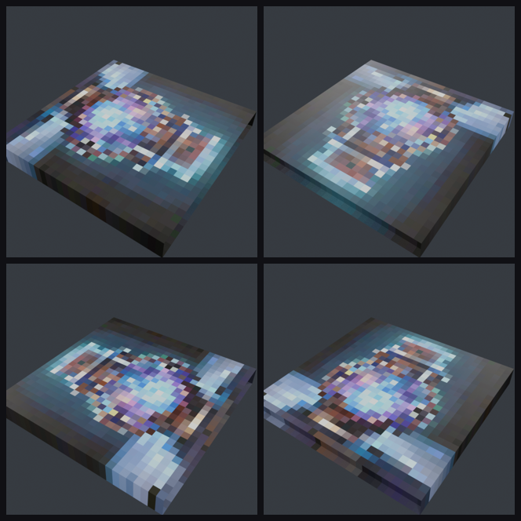 |
| *Clean alpha cutout* | *1013 active voxels, interior faces culled* | *Dark fantasy potion icon* | *2381 active voxels, sRGB colors* |

* **Example**:
  ```bash
  uv run python main.py -w voxel3d -i godot_assets/casque.png --grid-size 32 --voxel-depth 4 -o helmet_voxel
  ```

#### 1.4. `skybox` — 360° Equirectangular Panoramic Environments
* **Process**:
  1. Accepts a celestial or environment description (space nebula, stormy sky, fantasy dungeon vault).
  2. Injects equirectangular spherical horizon anchors into the prompt with seamless horizontal wrap conditioning.
  3. Renders a 2:1 widescreen spherical texture (e.g. 2048×1024 or 4096×2048) with Flux.1 Dev or SDXL + 360 LoRAs.
  4. Automatically formats and exports a Godot 4 `Environment.tres` resource configured with `PanoramaSkyMaterial`, `BackgroundSky` mode, tone mapping, and ambient Image-Based Lighting (IBL).
* **Inputs**: `prompt`, `-s, --size` / `--width` & `--height` (default: 2048×1024), `-l, --lora` (e.g., `360RedmondResized:1.0`).
* **Engines**: Flux.1 Dev / SDXL Vulkan, Godot Resource Serializer.
* **Outputs**: `_sky.png`, `_sky_env.tres`.

##### 🖼️ 360° Equirectangular Panoramic Texture (2:1 Ratio & Godot 4 IBL)
| 2048×1024 Equirectangular Spherical Texture (`_sky.png`) |
| :---: |
|  |
| *Cold grey-wind dawn — seamless 360° wrapped horizon, ready for `WorldEnvironment.tres` and ambient IBL* |

* **Example**:
  ```bash
  uv run python main.py -w skybox "purple cosmic galaxy nebula with glowing starlight" -o space_skybox
  ```

#### 1.5. `turnaround3d` — Calibrated Orthogonal Modeling Sheets
* **Process**:
  1. Formulates synchronized prompts for orthogonal Front (T-pose / A-pose) and Right-Side profile views.
  2. Enforces a fixed random seed and anatomical anchor constraints so character height, head proportions, and limb ratios match identically between perspectives.
  3. Removes background artifacts and crops each view to a calibrated bounding box.
  4. Assembles a unified side-by-side modeling card with horizontal alignment guideline overlays (crown, eyes, chin, shoulders, waist, knees, ground) for direct viewport loading in Blender.
* **Inputs**: `prompt`, `-s, --size` (default: 512 per view), `--seed`.
* **Engines**: Flux.1 Dev / SDXL, PIL canvas compositing.
* **Outputs**: `_front.png`, `_side.png`, `_model_sheet.png`.

##### 🖼️ Calibrated Orthogonal Modeling Sheet with Horizontal Guides
| Front & Side Alignment Sheet (`_model_sheet.png`) |
| :---: |
| 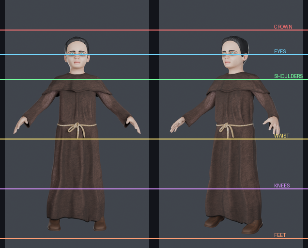 |
| *Calibrated horizontal guides (Crown, Eyes, Shoulders, Waist, Knees, Feet) for direct Blender viewport import* |

* **Example**:
  ```bash
  uv run python main.py -w turnaround3d "dwarven warrior with heavy runic plate armor" -o dwarf_sheet
  ```

#### 1.6. `flowmap` — Vector Velocity Flowmaps & Water/Lava Shaders
* **Process**:
  1. Calculates a 2D directional vector field based on `--angle` (degrees) and adds procedural Curl Noise turbulence.
  2. Encodes directional velocity into RGB color space: Red = X vector, Green = Y vector, Blue = flow magnitude.
  3. Generates a seamless repeating flowmap texture.
  4. Writes a custom Godot 4 `.gdshader` script utilizing dual-sample phase-shifted time offsets to eliminate texture pulsing or visible resetting.
  5. Exports a pre-configured `ShaderMaterial` (`.tres`) ready to drop onto water planes, rivers, or lava channels in 2D or 3D.
* **Inputs**: `prompt`, `--angle` (degrees, default: 90 = downwards), `--flow-type` (`river`, `vortex`, `radial`, `optical`), `--turbulence` (0.0 to 1.0), `--mode-2d`.
* **Engines**: NumPy procedural vector field generator, Godot shader compiler.
* **Outputs**: `_flowmap.png`, `_water.gdshader`, `_material.tres`.

##### 🖼️ Vector Flowmap Variations (`--flow-type`)
| `--flow-type river` (Directional Flow) | `--flow-type vortex` (Whirlpool / Vortex) | `--flow-type radial` (Radial Shockwave) |
| :---: | :---: | :---: |
|  |  |  |
| *R=X vector, G=Y vector, B=magnitude* | *Rotating centripetal velocity field* | *Centrifugal expansion vectors* |

* **Example**:
  ```bash
  uv run python main.py -w flowmap "molten volcanic lava river" --angle 45 --turbulence 0.4 -o lava_flow
  ```

#### 1.7. `mesh_ia` — AI Volumetric 3D Objects from Image or Prompt (TRELLIS.2 GGUF, Vulkan)
* **Process**:
  1. **Source image — two linked paths** (chained on our own `generate` workflow):
     - **From a prompt** (no `-i`): `mesh_ia` **automatically chains the `generate` workflow** — Flux.1 Vulkan renders the prompt as a 1024² image, then RMBG/BiRefNet cleanly cuts out and centers the object. The resulting transparent PNG is the ideal TRELLIS input (a pre-matted image keeps its alpha, so no BiRefNet cutout is needed inside trellis).
     - **From an existing image** (`-i`): any sprite/icon produced by our 2D workflows (`generate`, `variations`, `spritesheet` cell, `upscale` output, `pixelart`…) or an external photo. If it still has a background, trellis's built-in BiRefNet handles it (`--bg-removal auto`, default; `--dump-bg` writes the cutout for inspection).
     - **Tips for a good source**: one single object, centered, plain or transparent background, object fully visible (not cropped), ~512-1024 px. To iterate on the 2D image alone first: `uv run python main.py -w generate "..." -t prop`, then pass `-i` once satisfied — same engine, same look.
  2. Runs **TRELLIS.2-4B** (4B flow-matching transformer, Microsoft, MIT) through `trellis.cpp` — a C++/GGML runtime with Vulkan backend, same philosophy as sd-cli/audio.cpp (zero PyTorch, no CUDA). Stages: DINOv3 conditioning → sparse-structure flow → shape SLAT flow → FlexiDualGrid mesh decode (hole filling) → texture SLAT flow + PBR decode → QEM decimation + xatlas UV atlas.
  3. **Optional game-ready decimation** (`--faces-cible N`, default: off — the full-quality master is kept): headless Blender Decimate (collapse, UV/SHARP-delimited, PBR textures preserved) exports an additional `<nom>_<res>_jeu.glb` at ~N faces for Godot runtime (measured: 144k → 30k faces, 5.3 → 1.5 MB). **How to pick N — it depends on camera distance and instance count, not visual quality** (textures are untouched): `30000` = close-up hero item (held weapon, equipped helmet) • `10000` = standard scene prop seen at 2-10 m • `2000-3000` = repeated clutter (×50 instances) • keep `≥8000` for highly curved silhouettes (horns, drapes). Ballpark: trellis masters (144k-293k faces) are sculpt-level sources; a whole desktop scene budget is ~1-3M triangles, so 5-30k per prop leaves headroom.
  4. Renders **4 orbital studio views** of the deliverable GLB via headless Blender (EEVEE) and assembles a **2×3 control sheet** (source, 4 views, PBR atlas).
  5. Unlike `mesh3d` (parametric extrusions), produces a **true closed volume inferred by AI** — helmets, statues, creatures, complex props — with PBR textures (basecolor/metallic/roughness) ready for Godot 4 `MeshInstance3D`.
* **Inputs**: `prompt` or `-i, --input`, `--res` (`512` = iteration ~11 min • `1024` = master ~55 min • `1536` = untested, default 512), `--faces-cible` (optional decimation target, e.g. 30000; default 0 = no reduction), `--mesh-moteur` (`trellis` default | `pixal3d` — TRELLIS.2 fine-tune, pixel-aligned projection: flat colors + crisp lettering in ONE pass, no repaint stage; VALIDATED 2026-10-02 « super » on the helmet; 512 ≈ 14 min = +32 % vs trellis, the NAF-upsampler price; weights `vegax87/Pixal3D`, 5 GGUF 11.0 GB in the same models dir), `--fov` (pixal3d only, degrees — default: engine 49.13°; a wrong FOV shows as silhouette drift/thickness, not a crash), `--seed`.
* **Engines**: trellis.cpp v0.6.0 (Vulkan) + TRELLIS.2-4B GGUF f16 (10 files, ~16.4 GB, `C:\Modeles_LLM\trellis2-gguf`), Blender 5.x headless (decimation + control renders).
* **Outputs** (`output/mesh_ia/<nom>/`): `<nom>_<res>.glb` (master, PBR atlas embedded), `<nom>_<res>_jeu.glb` (only with `--faces-cible`), `<nom>_<res>_base.png` (atlas preview), `<nom>_<res>_planche.png` (control sheet), `_vue0-3.png` (orbital renders), `.ply`, `<nom>_<res>_infos.json` (durations, face counts, paths, seed).

##### 🖼️ TRELLIS.2 Multi-View Control Sheets (Orbital Views & PBR Atlas)
| TRELLIS.2 Res 512 (Fast Iteration ~10 min) | TRELLIS.2 Res 1024 (High-Definition Master ~55 min) |
| :---: | :---: |
| 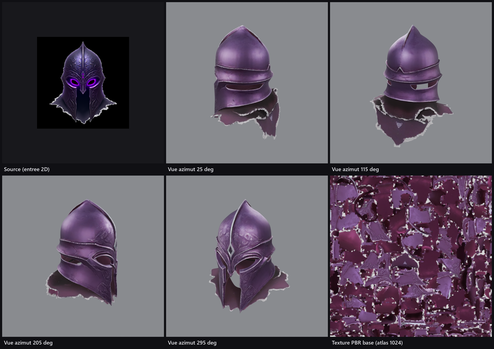 | 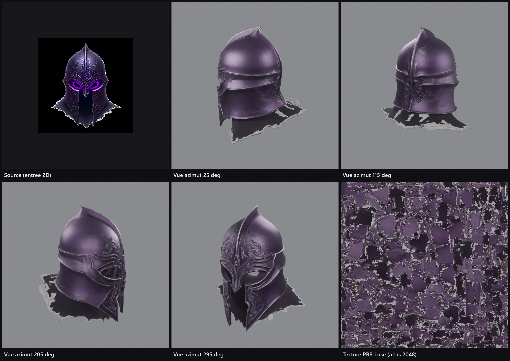 |
| *144k faces, 1024² atlas, 4 control views* | *293k faces, 2048² atlas, armor micro-relief* |

* **Measured generation durations (AMD RX 6950 XT, Vulkan, f16 GGUF)** :

  | Stage | res 512 | res 1024 |
  | :--- | :--- | :--- |
  | TRELLIS.2 generation | **8 min 53 s – 10 min 44 s** (potion / helmet) | **55 min 10 s** (helmet, LR→HR cascade) |
  | Optional decimation `--faces-cible` | ~40 s | ~1-2 min |
  | Blender control renders + sheet | ~1 min | ~1-2 min |
  | **Total** | **~10-12 min** | **~57-60 min** |

  Practical rule: iterate at `--res 512`, master at `--res 1024`. RDNA2 has no Vulkan "matrix cores" (~4-6× slower than the project's Strix Halo benchmarks). Every run logs a per-stage duration recap and writes `<nom>_<res>_infos.json`.
* **Example**:
  ```bash
  # From a plain prompt — generate + mesh_ia chained automatically (image → 3D) :
  uv run python main.py -w mesh_ia "obsidian-carved dragon skull, dark fantasy game prop" --res 1024 --faces-cible 30000
  # Two-step variant — iterate on the 2D image first (same engine), then convert :
  uv run python main.py -w generate "ancient bronze war horn" -t prop -o corne_guerre
  uv run python main.py -w mesh_ia -i godot_assets/corne_guerre.png --res 512
  # From an existing image (fast iteration) :
  uv run python main.py -w mesh_ia -i godot_assets/casque.png --res 512 -o casque
  # Pixal3D engine — one-pass flat colors (stylised assets, crisp lettering) :
  uv run python main.py -w mesh_ia -i godot_assets/casque.png --res 512 --mesh-moteur pixal3d -o casque
  ```
* **Status (2026-09-06)**: ✅ **Validated by user** on the repo's helmet (the README's "impossible via 2.5D extrusion" case study): res 512 = 10 min 44 s (144k faces, atlas 1024²), res 1024 = 55 min 10 s (293k faces, atlas 2048²) on RX 6950 XT. Licence 100 % MIT/Apache. Docs: `C:\trellis\README.md`, MEMORY_BANK §1.14.

#### 1.8. `asset_blendkit` — CC0 Stock Assets from Blendkit: Godot-ready Props & YouTube Compositing Plates

Pulls **CC0 assets from [blendkit.com](https://www.blenderkit.com)** (the library behind the Blender "Blendkit" addon) into the two productions: ready-to-use 3D props for the Godot game (complementing `mesh_ia`/TRELLIS.2 for standard objects), and full 3D sets rendered by Blender as **compositing base plates for the YouTube channel** (user ruling 2026-09-15: human-made origin is NOT a blocker). Anonymous search; downloads authenticate with the Blendkit account logged in inside the Blender GUI (API key read from addon preferences *inside* Blender headless, never logged — MEMORY_BANK §1.23 for the full API recipe and pitfalls).

##### 🖼️ Visual Output Produced by the Workflow

| YouTube Compositing Plate — "Colorful tunnel" (Cycles HIP, 1080p) | Godot Prop — "Wooden barrel" (GLB 2K, 28.7k faces) |
| :---: | :---: |
| 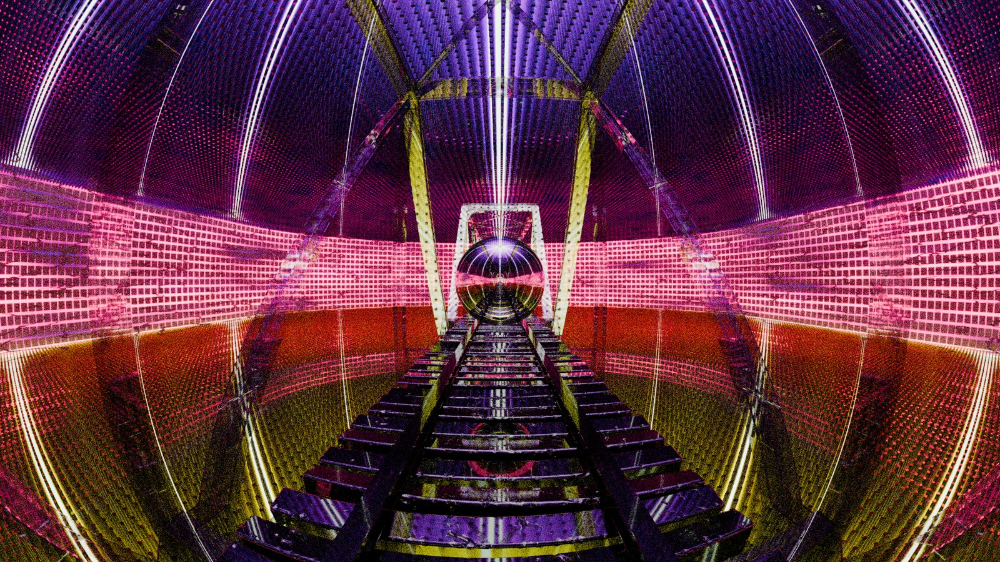 | 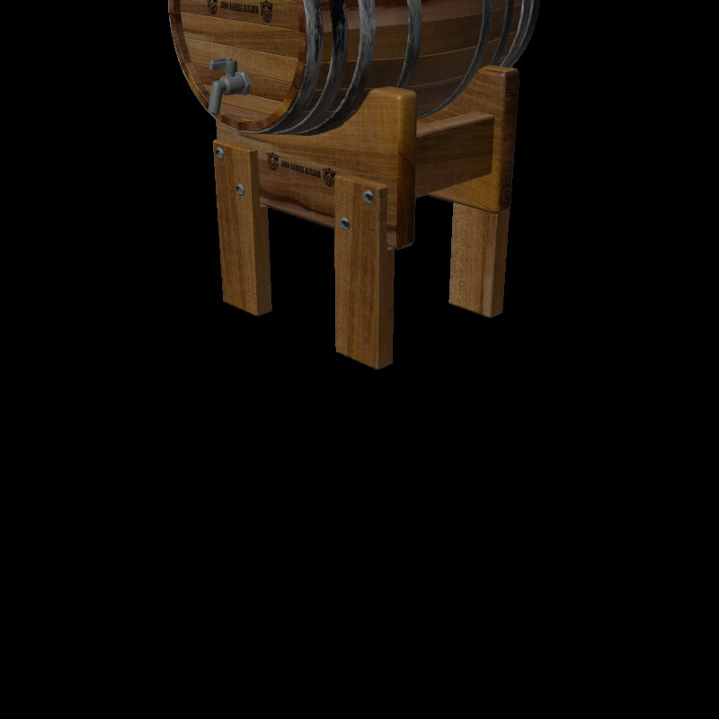 |
| *Free CC0 scene rendered as-is by the workflow — neon look matching the official thumbnail* | *CC0 prop, 9.4 MB GLB @2K textures (vs 58 MB max), Workbench preview* |

* **Modes**:
  - `--mode prop` (default): search → download (.blend, textures variant via `--resolution`, default **2K** ≈ 6× lighter than max) → append → **Godot-ready GLB** + Workbench control preview.
  - `--mode plate`: scene search → download → **Cycles render (GPU HIP on RX 6950 XT)** at the scene's own camera/lights, AgX + exposure −1 (reproduces the official look; EEVEE blows out scenes with strong world lighting — MEMORY_BANK §1.23).
* **Outputs** (`output/blendkit/<asset>/`): `<asset>.glb` + `apercu.png` (prop) or `plaque.png` (plate), plus `source.blend` (download cache — reused on re-runs, `--no-cache` to force).
* **Examples**:
  ```bash
  # List CC0 search results, then pull the chosen one as a light game prop :
  uv run python main.py -w asset_blendkit --query "wooden barrel" --list-assets
  uv run python main.py -w asset_blendkit --query "wooden barrel" --index 4 --resolution 2K

  # YouTube compositing plate: 1080p Cycles plate from a free scene (camera 0) :
  uv run python main.py -w asset_blendkit --query "studio" --mode plate --index 0 --width 1920 --height 1080
  ```
* **Status (2026-09-15)**: ✅ **Validated by user** ("magnifique") on both modes — prop: "Wooden barrel" CC0 (28,692 faces, GLB 9.4 MB @2K vs 58 MB max) ; plate: free scene "Colorful tunnel" (219 objects, neon look matching the official thumbnail, 1080p→6K capable). Licence filter **cc_zero enforced by default** (game redistribution + monetized channel). Requires: Blender (headless) + Blendkit account connected in the GUI once.

---

### 👤 2. Humanoid 3D Characters & Wardrobe (MakeHuman / MPFB2)

#### 2.1. `character3d` / `character_makeup` — 100% Automatic Pipeline: AI Portrait → Blender 3D Body (.blend, .glb, MakeUp, Shaders, Cycles Renders)

This workflow turns a 2D portrait into a complete 3D character for Godot 4 and Blender **automatically, with zero manual retouching**. It enforces the project's fundamental rule: **never paste the 2D portrait onto the mesh** — instead, AI vision extracts the anatomical features and signature of the avatar, paints them onto a layered vector ink layer, then assembles a native MPFB2 body, dressed, rigged and rendered.

##### 🖼️ Visual Output Produced by the Workflow (Use Case: Elian)

| 1. Source 2D Portrait | 2. hm08 UV MakeUp (2048²) | 3. Head Front (Cycles 85mm) | 4. Full Body (Cycles 55mm) |
| :---: | :---: | :---: | :---: |
| 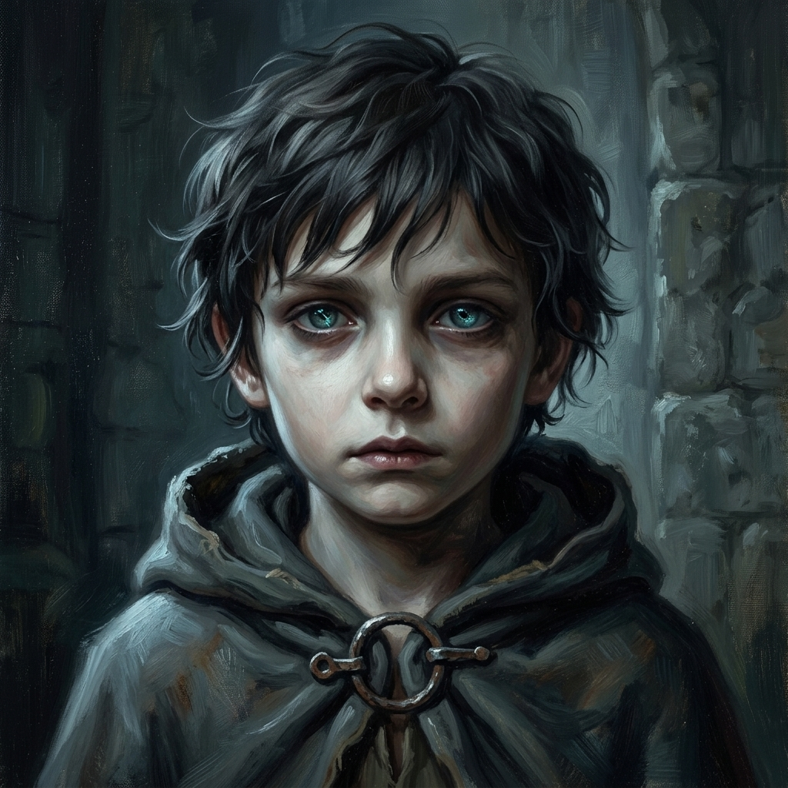 | 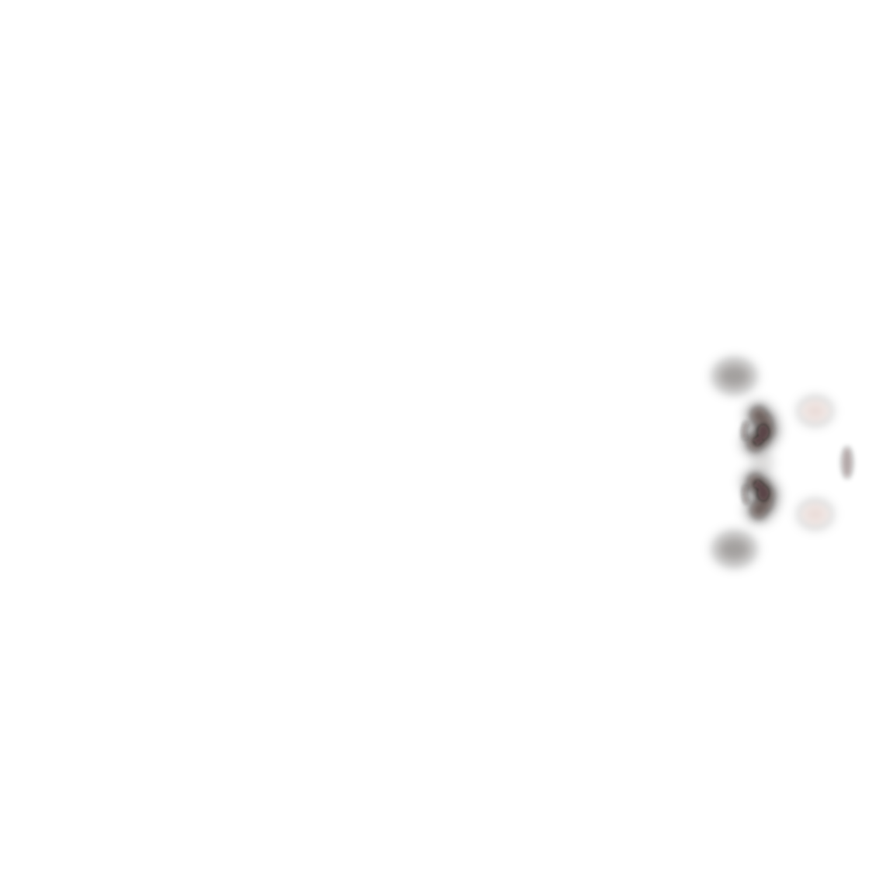 | 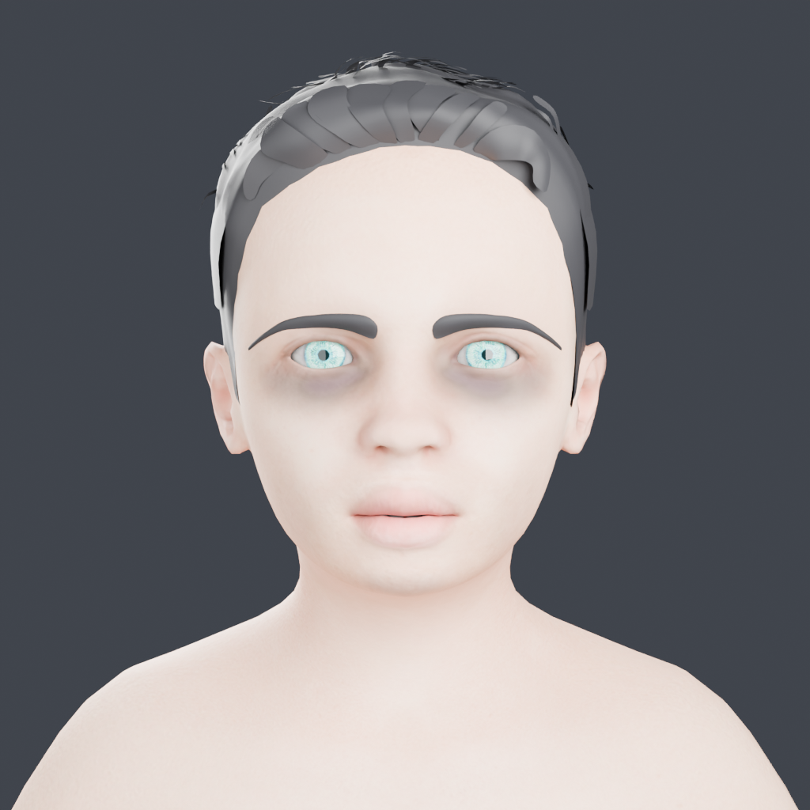 | 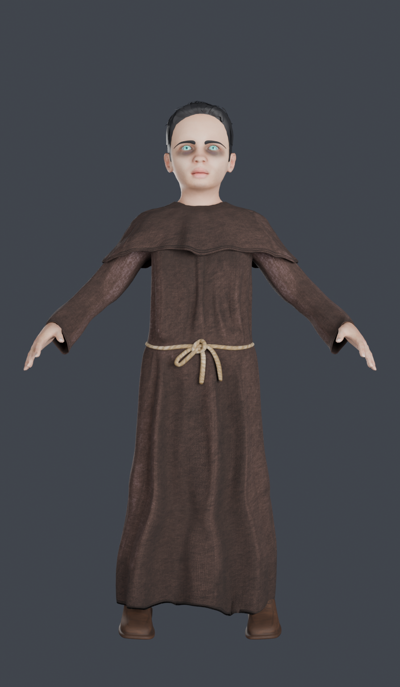 |
| *AI reference portrait (YuNet)* | *Multi-layer SSS vector ink layer* | *Studio render, no jaw bug* | *Full body + Robe + Mixamo rig* |

| 5. Head 3/4 Check (Cycles 85mm) | 6. Full Body 3/4 Check (Cycles 55mm) |
| :---: | :---: |
| 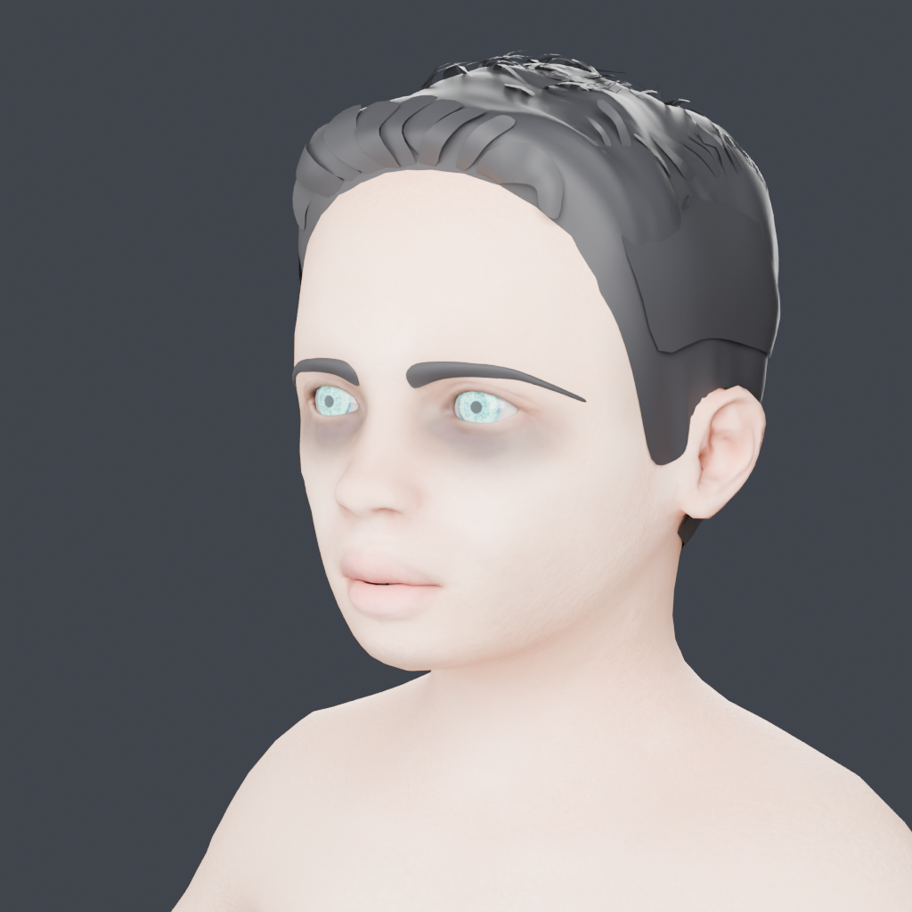 | 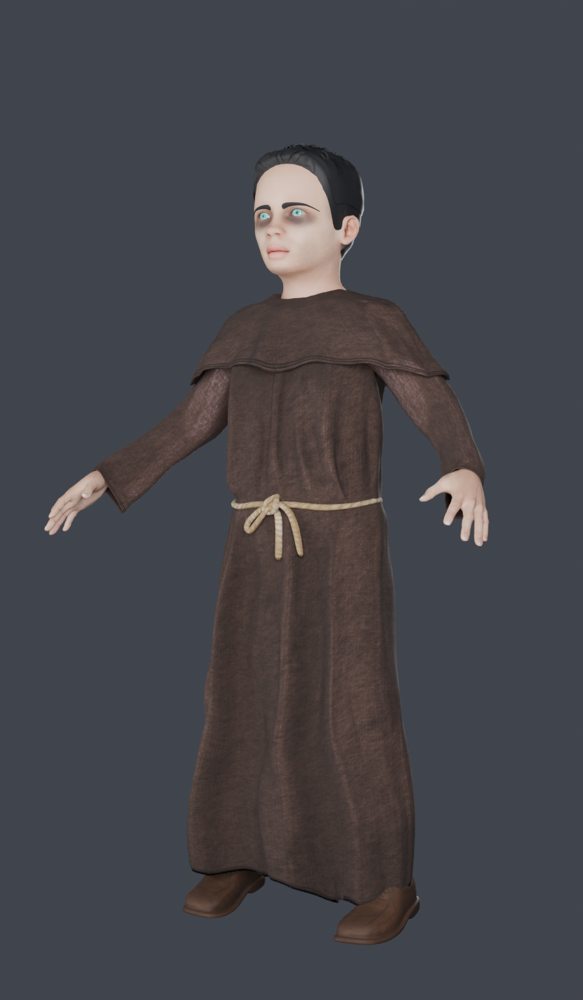 |
| *Orbit, nose-bridge and temple detail* | *Draped 3D silhouette & peasant shoes* |

##### 🔬 Detailed Pipeline Steps (High Precision)

1. **Anatomical & Colorimetric Vision Extraction (YuNet ONNX)**:
   * Detects key facial landmarks (pupils, eye corners, nose bridge and tip, lip corners, bounding box).
   * Computes the inter-pupillary distance (IPD) to calibrate adaptive sampling.
   * Measures under-eye fatigue contrast ($\Delta L^* = 70.6$), the dark-circle/cheek BGR ratio, temple hollowness and lip tint.
2. **Transfer to the 3D Skin Gamut & SSS Compensation**:
   * Cycles' *Subsurface Scattering* spreads the red component ~5× farther than green/blue. To avoid a flayed or flushed render, shadows are cooled and darkened (factor 0.82) with a subtle violaceous/anthracite core.
3. **Multi-Layer Vector Painting on the hm08 UV Map (2048×2048 RGBA)**:
   * Painting on the right facial island ($X \in [1450..2000], Y \in [800..1300]$, axial symmetry at $Y = 1058$):
     - *Layer 1 (Diffuse penumbra)*: orbits, hollow temples, nose bridge, cheek flush (Gaussian blur $\sigma = 14$).
     - *Layer 2 (Orbital crescent)*: intermediate sub-palpebral delineation ($\sigma = 8$).
     - *Layer 3 (Fatigue core)*: tear valley and deep orbital center ($\sigma = 5$).
     - *Layer 4 (Upper hollow)*: shadow under the palpebral arch ($\sigma = 5$).
     - *Layer 5 (Lips)*: soft natural tint ($\sigma = 6$).
   * Automatic generation of the official MPFB2 manifest (`.json`) and ink layer (`.png`) into the project and `%APPDATA%/.../mpfb/data/data/ink_layers/`.
4. **Shader & Eye Texture Customization**:
   * Iris adjustment (e.g. luminescent cyan/turquoise, sharp limbus, 0.06 emission) into `%APPDATA%/.../mpfb/data/data/eyes/materials/`.
5. **Automatic 3D Body Assembly in Blender (Headless `bpy`)**:
   * Instanciates the MPFB2 basemesh with canonical macro-parameters (`--age` and `--gender` exposed on the CLI; `height`, `weight`, `muscle` settable via batch JSON recipe).
   * Applies the `MAKESKIN` skin and immediately grafts the MakeUp ink layer.
   * **Prior grafting of the standard Mixamo armature (`HumanService.add_builtin_rig(human, "mixamo")`)**: mandatory step *before* clothing so MPFB detects the skeleton and automatically generates the `Armature` modifiers and weighted vertex groups on every garment piece.
   * Attaches the official quad assets (`HumanService.add_mhclo_asset`): eyes `low-poly.mhclo`, eyebrows `eyebrow001.mhclo`, tongue, teeth, dark short hair `short01.mhclo`, monk robe and peasant shoes (they automatically inherit the 52 Mixamo bones without tearing).
   * PBR shaders: procedural skin micro-relief (noise scale 180 + bump normal 0.15), charcoal-black eyebrows/hair `(0.015, 0.015, 0.018)`, wet eyes roughness 0.03.
   * Simultaneous export of the native **`.blend`** scene (100% parametric, editable human) and the game-optimized **`.glb`** (100% compatible with Godot's 49 Mixamo animations).
6. **Cycles Studio Check Renders (4 Automated Views)**:
   * Calibrated 3-point lighting (Key, Fill, Rim) with **`TRACK_TO`** constraints automatically aimed at the target.
   * 85mm head framing with **preventive disabling of garment MASK modifiers** (removes the truncated jaw/chin bug).
   * 55mm full-body framing with **exact trigonometric camera setback** from the vertical sensor in 896×1536 portrait ratio ($dist = (H \times 1.28) / (2 \tan \theta)$).
   * Cycles denoising enabled (`use_denoising = True`).

* **Inputs**: `--portrait` (or `-i, --input`), `--character` (name), `--age` (default 0.12), `--gender` (default 0.0), `--eye-color` (`cyan`), `--samples` (default 48).
* **Engines**: OpenCV YuNet ONNX, NumPy / PIL multi-layer raster, MakeHuman / MPFB2, Blender 5.2 Cycles headless.
* **Outputs**: `<character>_mpfb2.blend`, `<character>_mpfb2.glb`, `makeup/<character>_fatigue_ventgris.{png,json}`, `<character>_cyan_eye.png`, 4 `.png` renders (`tete_face`, `tete_tiers`, `perso_face`, `perso_tiers`).
* **Commandes CLI** :
  ```bash
  # 🚀 100% automatic generation: from 2D portrait to complete 3D body + 4 studio renders:
  uv run python main.py -w character3d --portrait "assets/portraits/elian_portrait.png" --character elian

  # Variant: fast generation with 16 Cycles samples:
  uv run python main.py -w character3d --portrait "assets/portraits/elian_portrait.png" --character elian --samples 16

  # Variant: generate the MakeUp ink layer only, without rebuilding the body:
  uv run python main.py -w character_makeup --portrait "assets/portraits/elian_portrait.png" --character elian --makeup-only
  ```

#### 2.3. `makehuman_clothes` — Modular Quad Wardrobe Generator
* **Process**:
  1. Takes a thematic clothing concept (e.g. *"medieval leather rogue armor"*).
  2. Generates pure seamless raw material PBR textures (leather, linen, iron rings) with 4K ESRGAN Vulkan upscaling.
  3. Leverages official MakeHuman helper quad geometries (`helper-tights`, `helper-skirt`) to maintain natural draping, open sleeves, and high boots.
  4. Automatically compiles `.mhclo` (barycentric coordinates), `.obj` (3D geometry), `.mhmat` (material descriptor), and `.thumb` (preview icon) files directly into `%APPDATA%/.../mpfb/data/clothes/`.
  5. Creates a test `.blend` scene with an avatar dressed in the new wardrobe with Cycles lighting.
* **Inputs**: `prompt` (clothing theme), `--parts` (`torso,pants,shoes`), `--mpfb-dir` (custom target path).
* **Engines**: Flux.1 Dev, ESRGAN 4K, MakeHuman barycentric binding compiler, Blender 5.x.
* **Outputs**: `.mhclo`, `.obj`, `.mhmat`, `.thumb` files per clothing item, plus test `.blend`.

##### 🖼️ Generated Quad Wardrobe & PBR Materials
| Tunic Albedo Texture | Shoes Albedo Texture | Dressed Avatar in Blender (Cycles) |
| :---: | :---: | :---: |
|  |  |  |
| *Burlap tunic albedo (PBR)* | *Worn leather shoes (PBR)* | *Avatar wearing robe & shoes (.mhclo)* |

* **Example**:
  ```bash
  uv run python main.py -w makehuman_clothes "dark worn leather ranger armor" --parts "torso,pants,shoes" -o dark_ranger
  ```

#### 2.4. `outfit` — Automated UV Garment Retexturing
* **Process**:
  1. Inspects existing clothing meshes attached to a character in a Blender scene.
  2. Reads the original MakeHuman sewing pattern UV layouts (preserving 100% of seams, pockets, folds, and button placements).
  3. Generates seamless fabric/leather textures (Albedo, Normal, Roughness) via diffusion.
  4. Calls headless Blender to create independent material slots, applies the textures to the garment quad meshes, and updates the `.blend` file.
  5. Re-exports the production `.glb` model and renders an updated 3-point lighting beauty check.
* **Inputs**: `--character` (e.g. `marc_novice`), `--top` (description of top fabric), `--shoes` (description of footwear material).
* **Engines**: Flux.1 Dev Vulkan, Blender Headless CLI (`bpy`), PBR texture synthesis.
* **Outputs**: `godot_assets/textures/<character>/*`, updated `<character>.blend`, updated `<character>.glb`, `<character>_beauty_render.png`.

##### 🖼️ PBR Retexturing on Existing UV Patterns
| Retextured Albedo Pattern | Relief Normal Map | Cycles Studio Check Render |
| :---: | :---: | :---: |
|  |  |  |
| *UV pattern preserving seams and folds* | *Procedural weave relief* | *Marc Novice studio render with the new outfit* |

* **Example**:
  ```bash
  uv run python main.py -w outfit --character marc_novice --top "rough medieval beige burlap tunic" --shoes "dark worn leather boots"
  ```

#### 2.5. `pose_control` — OpenPose Skeleton Guidance & Rigged Godot Scenes
* **Process**:
  1. Queries the 18-point COCO OpenPose coordinate library for the chosen action pose (`idle`, `slash_attack`, `cast_spell`, `shield_block`, `jump`, `walk`).
  2. Renders the OpenPose colored bone skeleton stick-figure card.
  3. Uses the skeleton to guide character diffusion, locking the limbs and torso into the exact target posture.
  4. Removes the background cleanly via RMBG / BiRefNet.
  5. Computes dynamic 2D weapon and effect attachment points (hands, head, feet) from the pose keypoints.
  6. Automatically compiles a Godot 4 `.tscn` scene with a `Sprite2D` and hierarchical `Marker2D` nodes ready for attaching weapons or VFX.
* **Inputs**: `prompt`, `--pose` (`idle`, `slash_attack`, `cast_spell`, `shield_block`, `jump`, `walk`), `-s, --size`.
* **Engines**: OpenPose COCO 18-point mapper, Flux.1 / SDXL, Godot Scene Builder.
* **Outputs**: `_openpose_skeleton.png`, `_character.png`, `_character.tscn`, `_rig.json`.

##### 🖼️ COCO 18-Point Skeleton Pose Variations (`--pose`)
| `--pose idle` | `--pose slash_attack` | `--pose cast_spell` | `--pose shield_block` |
| :---: | :---: | :---: | :---: |
| 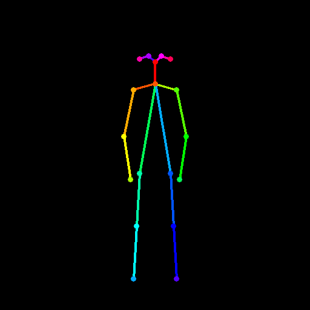 | 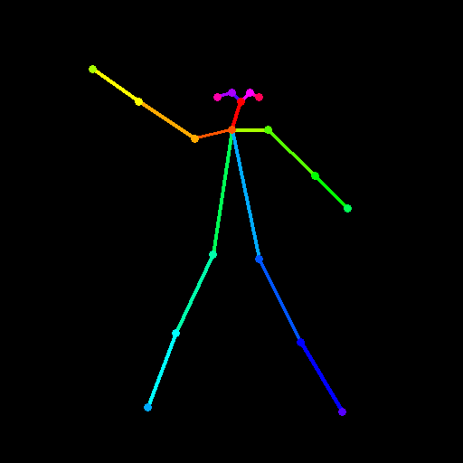 | 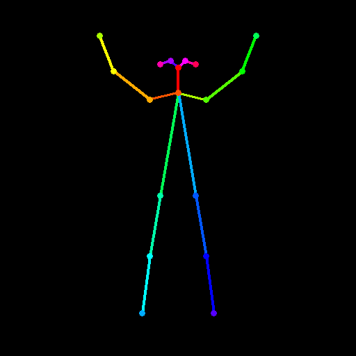 | 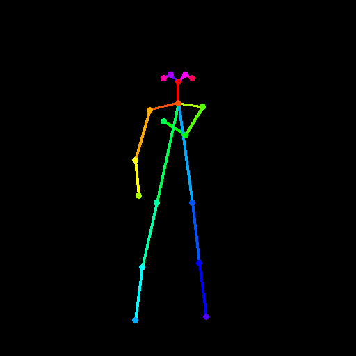 |
| *Neutral idle pose* | *Dynamic sword slash* | *Magic spellcasting* | *Defensive shield stance* |

* **Example**:
  ```bash
  uv run python main.py -w pose_control "shadow knight with a glowing sword" --pose slash_attack -o knight_slash
  ```

#### 2.6. `rpg_portrait` — Multi-Emotion Dialogue Character Sets
* **Process**:
  1. Takes a base character description or portrait image.
  2. Iterates across specified emotional states (*Neutral, Happy, Angry, Sad, Hurt, Surprised*), injecting calibrated emotional micro-descriptors while locking identity seeds.
  3. Removes background halos to isolate the character portraits.
  4. Combines the resulting portraits into a single reference contact sheet (`_portrait_grid.png`).
  5. Writes a Godot dialogue JSON manifest containing paths, emotional tags, and metadata ready for Dialogic or custom dialogue managers.
  6. Inputs: `prompt` or `-i, --input`, `--emotions` (default: `neutral,happy,angry,sad,hurt`), `-s, --size`.
* **Engines**: Flux.1 / SDXL Vulkan, BiRefNet / RMBG ONNX, JSON Manifest Generator.
* **Outputs**: individual emotion `.png` files, `_portrait_grid.png`, `_dialogue_manifest.json`.

##### 🖼️ RPG Multi-Emotion Dialogue Sheet (`_portrait_grid.png`)
| Consistent Expression Gallery (Dialogic / Godot Dialogue Manager) |
| :---: |
| 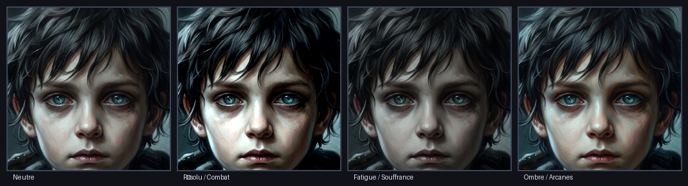 |
| *Expression variants with identity anchoring and JSON tagging for lip-sync and narrative branching* |

* **Example**:
  ```bash
  uv run python main.py -w rpg_portrait "dark sorceress with golden eyes" --emotions "neutral,happy,angry,sad,hurt" -o sorceress
  ```

#### 2.7. 👗 MakeHuman 3D Wardrobe Suite & Bilingual Semantic AI Router
* **Bilingual Semantic Router (177 3D Models)** (`core/clothes_catalog.py`):
  - Automatically indexes **177 MakeHuman 3D community assets** into [`data/clothes_catalog.json`](data/clothes_catalog.json) (monk robes, capes, plate armor, overalls, boots, beards, hairstyles).
  - The `aiguiller_modele_vetement(prompt, category, gender)` function semantically pairs natural language prompts in **English or French** (e.g. *"rustic medieval peasant tunic"*, *"monk robe"*, *"viking beard"*, *"heavy leather boots"*) with the ideal 3D base model.
  ```bash
  uv run python core/clothes_catalog.py
  ```
* **AI Retexturing on Canonical UV Sewing Patterns** (`scripts/retexture_uv_garment.py`):
  - Retextures official MakeHuman UV patterns directly (e.g. `male_worksuit01_diffuse.png`, `shoes01_diffuse.png`) to preserve 100% of underlying geometry, pocket seams, and button coordinates while converting blue denim to weathered burlap or aged leather with normal maps.
  ```bash
  uv run python scripts/retexture_uv_garment.py
  ```
* **External 3D Mesh to MakeClothes Compiler** (`scripts/makeclothes_from_mesh.py`):
  - Converts arbitrary quad meshes (`.obj`, `.glb`, `.fbx`) generated from 3D AI tools or sculpted in Blender into official MakeHuman `.mhclo` garments with automatic barycentric vertex binding.
  ```bash
  uv run python scripts/makeclothes_from_mesh.py --mesh "assets/models/cape.obj" --name "traveler_cape" --category "clothes"
  ```
* **Community Asset Pack Installer** (`scripts/install_asset_packs.py`):
  - Extracts and deploys MakeHuman Community zip archives directly into the active MPFB directory and updates the catalog.
  ```bash
  uv run python scripts/install_asset_packs.py
  ```

#### 2.8. 🗺️ MakeHuman Skin Synthesis & Anatomical Calibration
* **Complete MPFB Skin Pack Pipeline**:
  - Generates 2048×2048 diffuse skin maps (`diffuse.png`), PBR normal maps (`normal.png`), MakeHuman material definitions (`.mhmat`) with calibrated Subsurface Scattering (SSS) parameters, and UI thumbnail previews (`.thumb`).
* **Dedicated Scripts**:
  - `scripts/build_clean_marc_skin.py`: Generates seamless, homogeneous skin textures with dedicated colorimetry (e.g., cold winter complexion for Marc).
  - `scripts/align_marc_portrait_to_uv.py`: Projects 2D anatomical facial features (eyes, eyebrows, scars, lips) accurately onto standard MakeHuman hm08 UV layouts without seam tearing.

##### 🖼️ Canonical Skin Synthesis & Anatomical Detail
| Studio Face Close-Up | hm08 Diffuse Skin Texture (Marc) | Grey-Wind Skin Texture (Elian Child) |
| :---: | :---: | :---: |
|  |  |  |
| *Cycles render with Subsurface Scattering* | *Marc Novice 2048² hm08 UV texture* | *2048² cold grey-wind complexion texture* |
* **Deployment**:
  - Installs skin assets automatically into `%APPDATA%/Blender Foundation/Blender/5.2/mpfb/data/skins/<skin_name>/` and syncs them with Godot asset targets.

---

### 🎨 3. 2D Sprites, Tiles & UI

#### 3.1. `generate` — Standard Isolated 2D Game Asset
* **Process**:
  1. Accepts an item, character, prop, or tile concept.
  2. Optional prompt expansion via local LLM (`--use-llm`) or direct passthrough (default).
  3. Renders the asset on solid contrast background via Flux.1 Dev or SDXL with optional LoRAs (`-l`).
  4. Automatically removes background via flood-fill or AI neural segmentation (`--segmenter birefnet`).
  5. Crops tight bounding box and centers the asset with Godot bottom-center (characters) or exact-center (items) anchor offsets.
  6. Optionally triggers 4K AI ESRGAN upscaling (`--upscale`).
* **Inputs**: `prompt`, `-t, --type` (`item`, `character`, `prop`, `tile`), `-i, --input` (Img2Img), `--upscale`, `-l, --lora`.
* **Engines**: Flux.1 / SDXL, RMBG-1.4 / BiRefNet ONNX, Real-ESRGAN Vulkan.
* **Outputs**: Clean isolated transparent `.png`.

##### 🖼️ Isolated & Cut-Out 2D Assets (Items, Accessories & UI)
| Dark Fantasy Potion (`potion_diablo`) | Armor Helmet (`casque`) | Inventory Bag (`ico_sac`) | Stealth Mode (`ico_furtif`) |
| :---: | :---: | :---: | :---: |
|  |  |  |  |
| *Diablo LoRA + BiRefNet cutout* | *Source PBR equipment sprite* | *128px Godot-centered UI icon* | *Transparent skill icon* |

* **Example**:
  ```bash
  uv run python main.py -w generate "legendary royal gold shield with an engraved lion" --upscale
  ```

#### 3.2. `spritesheet` — Multi-Angle Character Sprite Sheet
* **Process**:
  1. Formulates 4 sequential perspective prompts (Front, Right-Side, Back, Left-Side) with consistent character identity anchors.
  2. Generates all 4 angles on isolated backgrounds.
  3. Performs background removal and automatic dimensional alignment across all frames.
  4. Stitches the frames into a clean horizontal or grid spritesheet atlas.
  5. Generates a Godot JSON frame atlas specifying UV rectangles for `SpriteFrames` / `AnimatedSprite2D`.
* **Inputs**: `prompt`, `-s, --size` (cell size, default: 256), `--columns` (default: 4), `--tolerance`.
* **Engines**: Flux.1 / SDXL, PIL grid compositor, JSON atlas generator.
* **Outputs**: `_spritesheet.png`, individual angle `.png` files, `_atlas.json`.

##### 🖼️ Multi-Angle / Aligned Animation Sheet (`_spritesheet.png`)
| Flight Sequence & Orientations Sheet (Godot JSON Frame Atlas Export) |
| :---: |
| 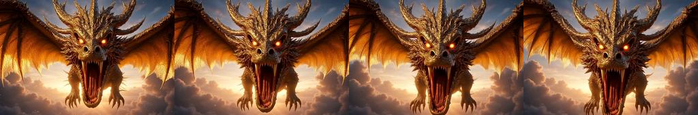 |
| *Aligned frames with automatic UV coordinates for AnimatedSprite2D / SpriteFrames* |

* **Example**:
  ```bash
  uv run python main.py -w spritesheet "undead skeleton warrior with rusted blade" --columns 4 -o skeleton_walk
  ```

#### 3.3. `autotile_pack` — 47-Tile Minimal 3x3 Wang Autotile Atlas
* **Process**:
  1. Generates or loads textures for Biome A (foreground, e.g. green grass) and Biome B (background, e.g. dark dirt).
  2. Programmatically constructs the 47 canonical tiles required by Wang / Minimal 3x3 autotiling: inner corners, outer corners, single edges, islands, and center fills.
  3. Compiles all 47 tiles into an organized 8-column atlas texture.
  4. Automatically constructs a Godot 4 `TileSet.tres` resource with terrain sets, terrain layers, and 3x3 minimal peering bits pre-configured for instant painted tiles.
* **Inputs**: `--biome-a` (prompt or image), `--biome-b` (prompt or image), `-s, --size` (tile resolution, e.g., 64, 128), `--columns` (default: 8).
* **Engines**: Flux.1 Dev, NumPy / PIL bitmask synthesis, Godot TileSet compiler.
* **Outputs**: `_atlas.png`, `_tileset.tres`.

##### 🖼️ 47-Tile Wang / Minimal 3×3 Autotile Atlas & Godot 4 TileSet Resource
| 47-Tile Autotile Atlas (`_atlas.png`) |
| :---: |
| 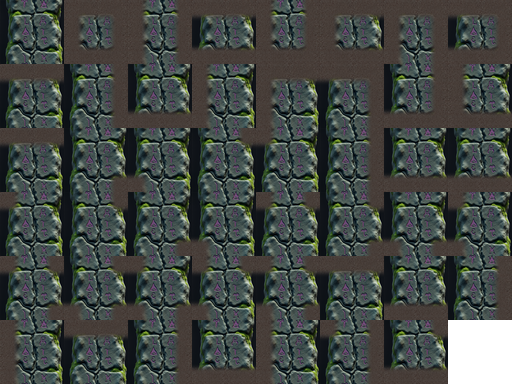 |
| *Runic floor to leather transition — 47 configurations (inner/outer corners, islands, borders) + preconfigured `TileSet.tres`* |

* **Example**:
  ```bash
  uv run python main.py -w autotile_pack --biome-a "lush green grass" --biome-b "dark cracked dirt" --size 64 -o grass_to_dirt
  ```

#### 3.4. `tileable` — Infinite Seamless Repeating Textures
* **Process**:
  1. Takes a terrain or material prompt.
  2. Injects circular padding boundary conditions into the diffusion process so opposite edges (left/right, top/bottom) seamlessly match.
  3. Renders the square tile texture.
  4. Renders a 3×3 tiled verification preview to confirm absence of visible seams or repeating artifacts.
* **Inputs**: `prompt`, `-s, --size` (default: 512), `--no-preview` (optional).
* **Engines**: Flux.1 / SDXL with circular padding kernel, PIL 3x3 tiling verifier.
* **Outputs**: `_tile.png`, `_preview3x3.png`.

##### 🖼️ Infinite Seamless Textures & 3×3 Verification Grids
| Ancient Parchment Texture (3×3 check) | Salt & Burlap Cloth Texture (3×3 check) |
| :---: | :---: |
|  |  |
| *Cyclic edges matched seamlessly* | *Repeating cloth texture without border artifacts* |

* **Example**:
  ```bash
  uv run python main.py -w tileable "mossy dark dungeon cobblestone pattern" -s 512 -o mossy_cobblestone
  ```

#### 3.5. `pixelart` — Retro Palette Color Quantization & Downsampling
* **Process**:
  1. Takes an existing image or generates a new sprite with clean outlines.
  2. Downsamples the image to a low-resolution pixel grid (`--grid-size`, e.g. 32×32, 64×64).
  3. Quantizes each pixel color to the nearest match in a chosen historical hardware palette (Pico-8 16-color, Endesga-32, GameBoy 4-color) using Euclidean distance in Lab color space.
  4. Upscales the resulting pixel art using Nearest-Neighbor interpolation to ensure razor-sharp pixels on modern displays.
* **Inputs**: `-i, --input` or `prompt`, `--palette` (`pico8`, `endesga32`, `gameboy`), `--grid-size` (default: 64), `-s, --size` (export display size).
* **Engines**: PIL ImageOps, NumPy color quantization.
* **Outputs**: `_pixelart_<palette>.png`.

##### 🖼️ Retro Hardware Palette Variations (`--palette`)
| Pico-8 Palette (16 Colors) | Endesga-32 Palette (32 Colors) | GameBoy Palette (4 Shades) |
| :---: | :---: | :---: |
| 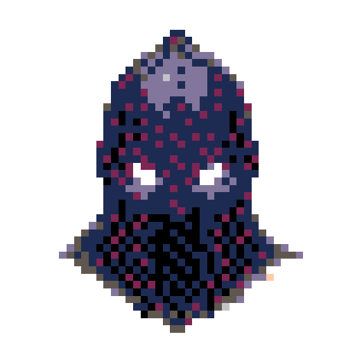 | 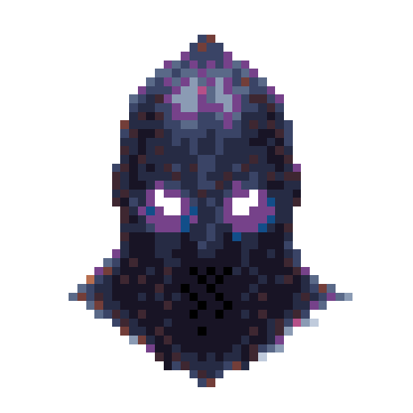 | 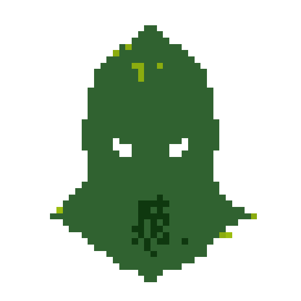 |
| *Lab quantization, 16 vibrant tones* | *Balanced 32-tone palette* | *4-tone monochrome retro aesthetic* |

* **Example**:
  ```bash
  uv run python main.py -w pixelart -i godot_assets/casque.png --palette pico8 --grid-size 64 -o helmet_retro
  ```

#### 3.6. `variations` — Thematic Elemental Asset Variations
* **Process**:
  1. Takes a base item/concept (e.g. *"magic sword"*).
  2. Iterates across specified themes (e.g. Fire, Ice, Poison, Lightning, Void).
  3. Performs guided diffusion with theme-specific descriptors and color harmonies.
  4. Removes backgrounds and centers each variant.
* **Inputs**: `prompt` or `-i, --input`, `--themes` (comma-separated list, e.g. `fire,ice,poison,lightning`), `-s, --size`.
* **Engines**: Flux.1 / SDXL Img2Img, RMBG segmentation.
* **Outputs**: Individual variant `.png` files named `<base>_<theme>.png`.

##### 🖼️ Thematic Elemental Variations (`--themes`)
| Fire / Flames Variant | Ice / Frost Variant | Poison / Toxic Variant | Void / Arcane Variant |
| :---: | :---: | :---: | :---: |
| 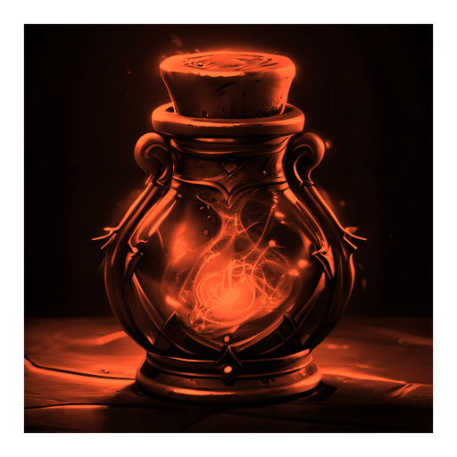 | 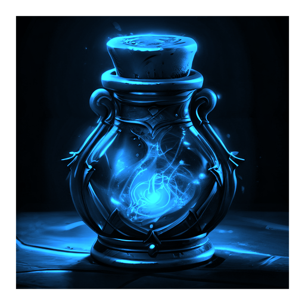 | 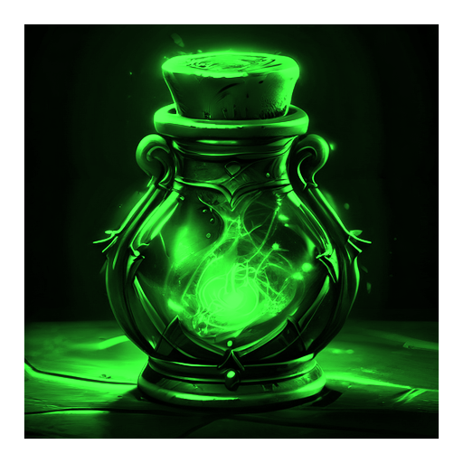 | 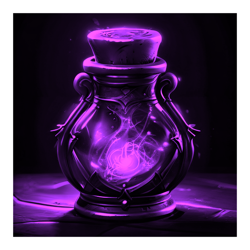 |
| *Incandescent amber and red* | *Crystalline cyan and blue* | *Toxic emerald green* | *Abyssal violet and purple* |

* **Example**:
  ```bash
  uv run python main.py -w variations -i godot_assets/potion_diablo.png --themes "fire,frost,poison,shadow" -o potion_elemental
  ```

#### 3.7. `ui_9slice` — Expandable 9-Patch Frames & Buttons
* **Process**:
  1. Generates an ornamental UI dialog frame, inventory slot, or button border (or loads `-i`).
  2. Performs automatic border detection (`--auto-margin`) or uses a specified pixel margin (`--margin`) to split the frame into 9 slices.
  3. Generates a Godot 4 `StyleBoxTexture` (`.tres`) with top, bottom, left, right margins configured with repeat/stretch axes.
  4. Generates an example Godot 4 `NinePatchRect` scene (`.tscn`).
  5. Exports a stretched test preview demonstrating distortion-free scaling.
* **Inputs**: `prompt` or `-i, --input`, `--margin` (default: 32), `--auto-margin`.
* **Engines**: PIL 9-slice analyzer, Godot Resource Serializer.
* **Outputs**: `.png`, `_stylebox.tres`, `_ninepatch.tscn`, `_preview_stretched.png`.

##### 🖼️ 9-Patch Vector Stretch without Corner Distortion
| Square UI Frame Source | Stretched NinePatchRect (520×240 Panoramic Ratio) |
| :---: | :---: |
|  | 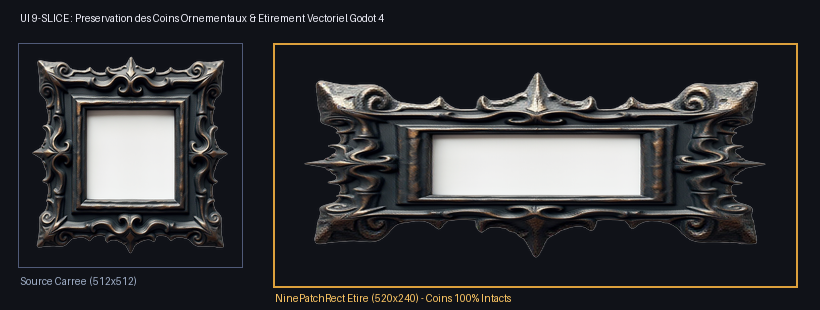 |
| *512² texture with sculpted borders* | *100% intact corners, stretched center & slices per `StyleBoxTexture.tres`* |

* **Example**:
  ```bash
  uv run python main.py -w ui_9slice "ornate fantasy golden dialog box with ruby corners" --margin 32 -o gold_dialog
  ```

#### 3.8. `rembg` — High-Precision Neural Background Removal
* **Process**:
  1. Loads an existing 2D asset image with complex edges (hair, fur, semi-transparent glass, weapons).
  2. Runs ONNX neural segmentation (RMBG-1.4 or BiRefNet).
  3. Computes a continuous alpha matte, completely removing solid or noisy backgrounds without white fringes.
  4. Automatically centers the sprite and tightens transparent margins.
* **Inputs**: `-i, --input` (required), `-s, --size` (optional resize, keep original dimensions by default) — segmentation model selected automatically (BiRefNet / RMBG-1.4), overridable via batch JSON recipe (`segmenter_model`).
* **Engines**: BiRefNet ONNX / RMBG-1.4 ONNX, NumPy, PIL.
* **Outputs**: `_rembg.png`.

##### 🖼️ BiRefNet / RMBG-1.4 Neural Cutout (Zero White Fringe)
| Raw Background vs Clean Alpha Cutout Comparison (`_rembg.png`) |
| :---: |
| 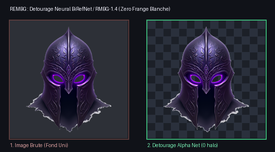 |
| *Complete background removal without losing fine tips or leaving residual white halos* |

* **Example**:
  ```bash
  uv run python main.py -w rembg -i godot_assets/casque.png -o casque_transparent
  ```

#### 3.9. `qwen_image` — Qwen-Image-2.1 Photorealistic Text-to-Image AND Compositing (Research License)
* **Process**:
  1. Renders free-form natural-language prompts with Qwen-Image-2.1 (7B DiT GGUF, Vulkan) — strengths: reliable **in-image text rendering**, **RGBA transparency driven by the prompt** (start with `This is an RGBA image with transparency.`), high-fidelity photorealism up to 2048².
  2. System-load pre-check runs automatically before the launch (busy machine = aborted).
  3. Text encoder (Qwen3-VL-8B Q4_K_M) runs from system RAM, diffusion from VRAM (`--offload-to-cpu`).
  4. **Compositing mode** (`-i` + `-l`, validated 2026-10-05 night A/B): a product CUTOUT pasted onto a background photo gets consistent lighting, specular highlights and a natural contact shadow via the RunningHubAI compositing LoRA (`Qwenimag21_c2-st2000`, sd-cli applies 448/448 tensors). The paste MUST be a white-keyed cutout — a pasted WHITE BOX survives img2img even at strength 0.90. Start the prompt with the LoRA trigger word `pengyu`, keep `--strength 0.65` (validated; steps snap 40→24 in img2img). Recipe: white-key threshold ~18 + 1 px feather, PIL alpha paste.
* **Inputs**: `prompt`, `-n/--negative-prompt` or `--negative-prompt-file`, `--width/--height` (**multiples of 32**, default 1152×640 = exact 16:9), `--steps` (default 40; 24 in img2img), `--cfg-scale` (default 6.0 — lower silently disables the negative prompt), `--seed`, `-i/--input` (init image → img2img compositing mode), `--strength` (img2img denoise, default 0.65 for this workflow), `-l/--lora` (`name:weight`, repeatable), `--lora-dir`, `--qwen-turbo` (8-step distilled turbo checkpoint — see below; `--turbo` itself is taken by `h3_ref2va`).
* **Turbo mode** (`--qwen-turbo`, USER VALIDATED 2026-10-11 "Atomic très bien"): switches to the official **8-step distilled checkpoint** (`Qwen-Image-2.1-Turbo`, AtomicChat sd.cpp-native Q8_0 quant, same TE + VAE) with its single validated schedule forced (8 steps, CFG 1.0, custom sigma schedule — do not pass `--steps`/`--cfg-scale` with it). Measured **~2 min/image** (123 s at 1152×640) vs ~16 min base — 7.8× faster with the typography quality kept (verified on the night matrix and the workflow smoke render). ⚠️ Avoid the unsloth quant of the same checkpoint: its mixed-precision layout costs 876-1352 s on diffusion step 1 of EVERY run (measured). Compositing (`-i`/`-l`) is mechanically compatible but its 8-step quality is untested. Same RESEARCH license ceiling.
* **Engine**: sd-cli master-908+ (`qwen_image21` architecture, PRs #2032/#2035) + dedicated VAE (`qwen_image_2.1_vae_bf16` — NOT interchangeable with Qwen-Image 1.0 / Wan 2.2).
* **⚠️ License**: Qwen **RESEARCH** — renders are for **personal / non-commercial use ONLY** (no monetized channel, no game shipping). Production paths stay on Chroma1-HD / `generate` (Apache-2.0). No model-level NSFW filter; the user is responsible for the content (adults only).
* **Performance** (measured, RX 6950 XT): ~23.6 s/step at 1152×640 → **~16 min/image at 40 steps** (~8× slower than Chroma1-HD). Use `--steps 30` for ~12 min. Compositing img2img leg (24 steps, strength 0.65 → 16 effective): **~6.8 min/image**.
* **Outputs**: `output/<name>_qwen21.png`.
* **Example**:
  ```bash
  # Text-to-image (base, 40 steps)
  uv run python main.py -w qwen_image "a vintage tavern sign that reads 'The Sleeping Dragon', night, lantern light" --seed 42
  # Text-to-image TURBO (8-step distilled, ~2 min, same typography quality)
  uv run python main.py -w qwen_image "a vintage tavern sign that reads 'The Sleeping Dragon', night, lantern light" --qwen-turbo --seed 42
  # Compositing: blend a product cutout into a backdrop (RESEARCH license)
  uv run python main.py -w qwen_image "pengyu Apply consistent lighting to the product or object, enhance specular highlights, front-back spatial relationship, add natural contact shadow, and blend it seamlessly into the background"     -i composite_cutout.png -l "Qwenimag21_c2-st2000:1.0" --seed 42
  ```

---

#### 3.10. `moss_image` — MOSS-Image-SFT Text-to-Image (Apache-2.0, In-Image Text Rendering)
* **Process**:
  1. Renders free-form natural-language prompts with MOSS-Image-SFT (OpenMOSS 5.1B DiT flow-matching GGUF, Vulkan) — headline strength: **reliable in-image text rendering** (storefront signs, labels, headlines) and clean layout composition.
  2. System-load pre-check runs automatically before the launch (busy machine = aborted).
  3. Everything resident in VRAM (11.4 GB on the 16 GB card): diffusion + Qwen3.5-9B-Q8_0 text encoder + flux2 VAE. Do NOT add `--offload-to-cpu` — with the weights filling the card the pinned-pool streaming path cannot allocate (pinned-memory failure measured 2026-10-24).
  4. Model files live on `D:\Modeles_LLM` (USB 3.0 HDD): cold load ≈ 24-33 min at the measured 4-8 MB/s (MEMORY_BANK lesson 10-11). Repoint via env `MOSS_IMAGE_MODEL_PATH` / `MOSS_IMAGE_LLM_PATH` / `MOSS_IMAGE_VAE_PATH` / `MOSS_IMAGE_TOKENIZER_PATH` (e.g. to the C: NVMe) without code edits.
* **Inputs**: `prompt`, `--width/--height` (**multiples of 32**, default 1024×1024), `--steps` (default 50 — validated recipe), `--cfg-scale` (default 3.0 — validated recipe), `--seed`, `--output-dir`, `-o/--output` (basename).
* **Engine**: sd-cli master-973+ (`moss_image` architecture, PRs #2148/#2160) + `Qwen3.5-9B-Q8_0.gguf` text encoder + external `tokenizer.json` + `flux2` VAE (unsloth packaging, MD-verified at download).
* **License**: **Apache-2.0** — commercial use OK (unlike the Qwen-Image RESEARCH path). No model-level NSFW filter; the user is responsible for the content.
* **Performance** (measured 2026-10-24, RX 6950 XT): **42.5-43.0 s/step at 1024², 50 steps ≈ 36 min/image + load** — the arch is new on Vulkan (kernels still young; `conv2d/conv3d direct` probes fail and fall back to im2col). Re-evaluate on future sd-cli releases.
* **Known weakness**: small secondary text garbles (documented base limitation — keep small text out of prompts or crop it away).
* **Outputs**: `output/<name>_moss.png`.
* **Example**:
  ```bash
  uv run python main.py -w moss_image 'a storefront sign that says "MOSS" in bold clean letters, daytime, sharp focus' --seed 42
  ```

---

### 🔊 4. Audio, Voice & VFX

#### 4.1. `sfx` — AI & Procedural Sound Effects Synthesis
* **Process**:
  1. Accepts a sound effect description — free English prompt for the AI engine (`heavy rain on window glass, distant thunder rumble`), or a fixed category for the procedural engine (`sword_slash`, `magic_potion`, `explosion`, `coin_pickup`, `spell_cast`).
  2. **AI engine (default, validated 2026-09-09)**: Stable Audio 3 Small SFX via audio.cpp (Vulkan, RTF ~0.2 — fastest audio engine on this machine), 44.1 kHz stereo. Name the *content* of the sound ("dense patter with natural splashes"), not the ambience ("distant thunder rumble" yields a bass-heavy muffled texture). Structural edge fades are auto-trimmed, and level treatment adapts: transient SFX are peak-normalized to −0.9 dBFS; low-loudness textures (< −20 LUFS) get linear gain to −16 LUFS with a peak ceiling limiter that leaves the texture untouched.
  3. **Procedural engine** (`--sfx-engine procedural`): multi-oscillator audio waveforms (sine, saw, noise bursts, resonant low-pass filter sweeps, pitch envelopes), 44.1 kHz 16-bit PCM, dynamic range compression and smooth attack/release envelopes.
  4. Exports both lossless WAV (PCM 16-bit) and compressed OGG Vorbis (via ffmpeg) formats optimized for Godot's `AudioStreamPlayer`.
* **Inputs**: `prompt` (sound description or category), `--duration` (in seconds), `--seed`, `--sfx-engine` (`ia` default | `procedural`).
* **Engines**: Stable Audio 3 Small SFX GGUF (audio.cpp, `core/sfx_ia.py`) | NumPy synthesizer (legacy).
* **Outputs**: `_sfx.wav`, `_sfx.ogg`.

##### 🖼️ Waveforms & Procedural Synthesis (`_sfx.wav` / `_sfx.ogg`)
| Multi-Oscillator Procedural Synthesis (Healing Potion) |
| :---: |
| 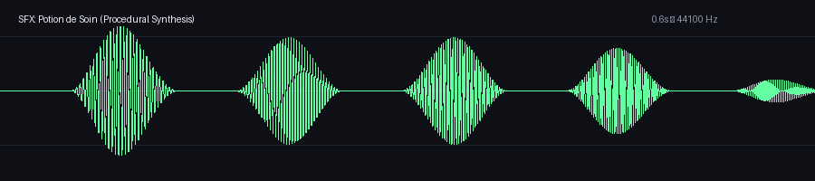 |
| *44.1 kHz 16-bit PCM sfx without clipping, soft ADSR envelope and OGG Vorbis conversion for Godot* |

* **Example**:
  ```bash
  # AI engine (default) — free English prompt:
  uv run python main.py -w sfx "heavy sword slash metal impact" --duration 1.2 -o sword_strike
  # Legacy procedural synthesis:
  uv run python main.py -w sfx sword_slash --duration 1.2 --sfx-engine procedural -o sword_strike
  ```

#### 4.2. `audio_ambience` — Procedural Seamless Looping Ambient Soundscapes
* **Process**:
  1. Accepts an environmental theme (`dungeon`, `forest`, `storm`, `space`, `tavern`, `campfire`).
  2. Synthesizes multi-layered procedural audio tracks (e.g. for dungeon: subterranean rumble, resonant water drops, wind gusts, dark binaural drones).
  3. Applies seamless circular crossfading so the beginning and end of the audio loop match phase without any clicks or gaps.
  4. Generates a Godot 4 `AudioBusLayout.tres` resource featuring configured Reverb and low-shelf filter buses.
  5. Exports an `AudioStreamPlayer` scene (`.tscn`) pre-configured with autoplay and loop flags.
* **Inputs**: `prompt` (ambience preset or description), `--duration` (seconds, default: 8.0).
* **Engines**: NumPy procedural audio synthesizer, SoundFile encoder, Godot bus serializer.
* **Outputs**: `_ambience.wav`, `_ambience.ogg`, `_bus_layout.tres`, `_player.tscn`.

##### 🖼️ Procedural Perfect-Loop Soundscapes (`_ambience.wav`)
| Underground Dungeon Ambience (8.0s Infinite Loop) |
| :---: |
| 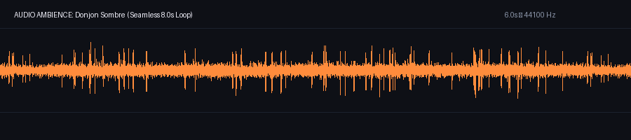 |
| *Immersive bed with zero phase seam, shipped with an `AudioBusLayout.tres` resource (reverb & filters)* |

* **Example**:
  ```bash
  uv run python main.py -w audio_ambience "dark subterranean dungeon with distant water drops" --duration 8.0 -o dungeon_ambience
  ```

#### 4.3. `music_bg` — AI Music Loops as Background Beds (MiniMax-Music3 / ACE-Step 1.5 GGUF Vulkan)

* **Process**:
  1. Generates several music candidates from an English style description via **ACE-Step 1.5 Turbo bf16 GGUF** (default — user-validated as the better-sounding engine on 2026-09-05, ~36× faster, MIT licence, native 48 kHz) or **MiniMax-Music3 GGUF** (`--moteur music3`) running on **audio.cpp** with the **Vulkan** backend (AMD GPU accelerated, CPU fallback) — same GGUF/Vulkan philosophy as `sd-cli` and `llama.cpp`. Fully instrumental conditioning (`lyrics=[Instrumental]` / empty lyrics for ACE-Step, explicit per-candidate seeds). ACE-Step can also take **imposed BPM / key / time signature** (`--force-bpm`, `--tonalite`, `--mesure`) enforced by its LM planner — bar-aligned loops by construction instead of post-hoc BPM estimation.
  2. Builds a **seamless loop** from each candidate: BPM estimation by onset-envelope autocorrelation, then **best-loop-point search** — among all windows of a whole number of bars (≥ target duration), picks the one whose head/tail energies match across 50–500 ms windows (the model composes song structures with intros/breaks/outros even in 23 s). Ends snapped to zero crossings + 20 ms equal-power micro-crossfade. Ambient mode: 1 s equal-power crossfade.
  3. Applies **voice-over bed post-processing**: 80 Hz high-pass + −3 dB presence dip at 2.8 kHz so the loop stays discrete behind a (male) voice-over.
  4. Validates each candidate (seam continuity, clipping, LUFS) and **finalizes every candidate**: bed normalized to −30 LUFS (ffmpeg 2-pass loudnorm), MP3, plus an `ECOUTE_cand<N>_boucle_x3.mp3` listening preview (loop ×3 at −16 LUFS). Best seam promoted to `output/music_bg/` root.
  5. Writes a ready-to-use **ffmpeg ducking recipe** (`sidechaincompress` + `amix`) that loops the bed to the voice duration and automatically attenuates it whenever the voice speaks. Optional Music Flamingo QA (`--analyse`).
* **Inputs**: `prompt` (English music description), `--moteur` (`acestep` default|`music3`), `--variante` (`turbo` default|`xl-turbo` 4B|`xl-sft` 4B+CFG, ACE-Step only), `--duration` (loop seconds, default 12), `--candidats` (default 3), `--lufs` (bed target, default −30), `--loop-mode` (`percussive`|`ambient`), `--music-backend` (`vulkan`|`cpu`), `--force-bpm`/`--tonalite`/`--mesure` (ACE-Step only), `--seed`, `--analyse` (Music Flamingo QA).
* **Engines**: audio.cpp v0.9.2 (`audiocpp_cli`, Vulkan) + ACE-Step 1.5 Turbo bf16 GGUF (~9.4 Gio monolithic package incl. LM planner + text encoder + VAE, `C:\Modeles_LLM\ACE-Step1.5-GGUF`, ~42 s per 28 s generation on RX 6950 XT) or MiniMax-Music3-GGUF Q4_0/Q8_0 (~8.5 GB, `C:\Modeles_LLM\MiniMax-Music3-GGUF`, ~25 min per 23 s generation), NumPy/SciPy DSP, ffmpeg 9 (`C:\ffmpeg\dist\bin\ffmpeg.exe`), optional llama.cpp + Music Flamingo GGUF.
* **Outputs** (`output/music_bg/`): `<name>_full.wav` (48 kHz PCM16 loop), `<name>_bed.wav` (−30 LUFS bed), `<name>.ogg`, `<name>_preview.mp3`, `recette_mixage_voix.txt` (ducking command), `candidats/` (every candidate: raw WAV + loop + bed + MP3), `ECOUTE_cand<N>_boucle_x3.mp3` (listening previews).

##### 🖼️ AI Music Loops — Waveforms & Seam Energy
| Normalized Waveforms (48 kHz Stereo — Candidate Loops) |
| :---: |
| 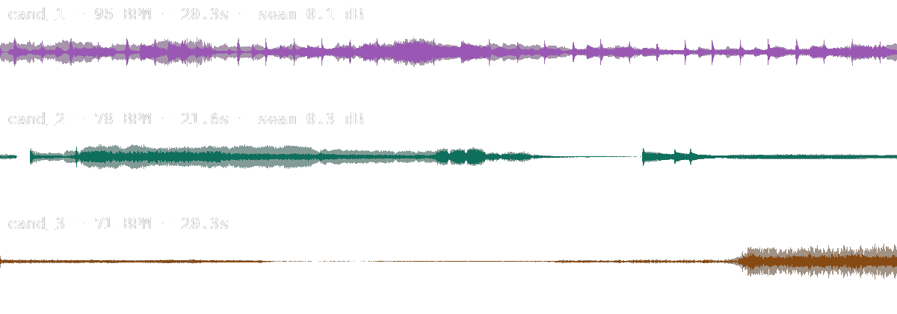 |
| *Zero-crossing alignment (seam Δ0.1–0.4 dB), −30 LUFS voice-over mix and automatic ffmpeg ducking* |

* **Helpers**: `scripts/download_music3_gguf.py` (engine + models), `scripts/download_acestep15_gguf.py [turbo|xl-turbo|xl-sft|tout]` (ACE-Step 1.5, XL via ModelScope mirror), `scripts/telecharger_gros_fichier_parallele.py <url> <dest>` (parallel segmented downloader — bypasses HF CDN single-connection throttling, ~10× faster), `scripts/generer_chanson_acestep.py paroles.txt` (**full songs with lyrics**, 50+ languages, structure tags), `scripts/download_music_flamingo.py` (optional QA model), `scripts/generer_boucles_music_bg_batch.py N [moteur]` (**resilient batch** — one candidate per process, resumes from existing files, survives AMD GPU driver resets), `scripts/finaliser_boucles_music_bg.py` (re-finalize raw WAVs), `scripts/ecoute_candidat_music_bg.py N` (listening preview).
* **Example**:
  ```bash
  # Default = ACE-Step 1.5 (free BPM, estimated in post-processing) :
  uv run python main.py -w music_bg "subtle minimal techno groove, soft pulsing analog synth bass, muffled kick, no vocals" --duration 20 --candidats 3 -o tech_loop_minimal
  # BPM/key imposed on the ACE-Step planner :
  uv run python main.py -w music_bg "subtle minimal techno groove, soft pulsing analog synth bass, muffled kick, no vocals" --duration 20 --candidats 3 --force-bpm 126 -o tech_loop_minimal_126
  # XL 4B variant (larger DiT, ~2.2x slower, packages on ModelScope :
  # uv run python scripts/download_acestep15_gguf.py xl-turbo) :
  uv run python main.py -w music_bg "subtle minimal techno groove, soft pulsing analog synth bass, muffled kick, no vocals" --duration 20 --candidats 3 --variante xl-turbo -o tech_loop_minimal_xlturbo
  # Legacy MiniMax-Music3 engine (~25 min/candidate) :
  uv run python main.py -w music_bg "subtle minimal techno groove, soft pulsing analog synth bass, muffled kick, no vocals" --duration 20 --candidats 3 --moteur music3 -o tech_loop_minimal_music3
  # Resilient batch (recommended for large volumes) :
  uv run python -u scripts/generer_boucles_music_bg_batch.py 10
  ```
* **Status (2026-09-06)**: ✅ **ACE-Step 1.5 promoted to default engine** after an A/B comparison on the same tech prompt (3 candidates each): user found it clearly better-sounding, seams ≤ 3 dB (0.4 dB on the promoted loop), ~42 s per 28 s generation on Vulkan (vs ~25 min for Music3), native 48 kHz. ✅ **XL Turbo 4B variant validated** (`--variante xl-turbo`, ~92 s per 28 s candidate, seams 2.0 dB on the promoted loop — "rythmé très propre"). ✅ **Full songs with French lyrics validated** (2 complete 4 min songs from the user's Vent-Gris universe, structure tags respected, xl-turbo, ~15 min per 4 min song). ✅ Music3 generator also validated (3 tech loops 20-22 s, seam ≤ 0.3 dB). ⚠️ **Not yet tested**: Music Flamingo QA (`--analyse`), ducking recipe on a real voice-over, `--loop-mode ambient`, `--force-bpm`/`--tonalite`/`--mesure`, `xl-sft` variant, edit routes (repaint/cover/lego/extract). Known pitfalls (ACE-Step's long fade-out → loop search restricted to the stable-energy zone; HF CDN throttling → parallel downloader; soundfile OGG stack overflow → use ffmpeg; AMD GPU watchdog resets → resilient batch) documented in `docs/MEMORY_BANK.md` §1.11.
* **Licence**: MiniMax-Music3 community licence (MIT-style, commercial OK below $20M revenue; disclose AI-generated music in the video description: *« Musique : générée par IA (MiniMax-Music3) »*). ACE-Step 1.5: **MIT** (no attribution constraint).

#### 4.4. `tts_dialogue` — Emotional Character Voice & Lip-Sync
* **Process**:
  1. Accepts a character name, a list of emotions (`neutral,happy,angry,sad,hurt`), and voice pitch tuning.
  2. Generates spoken voice lines with intonation, timbre, and cadence modified according to each emotional state.
  3. Extracts real-time phonetic visemes (A, E, I, O, U, consonants, silence) mapped with precise timecodes.
  4. Exports individual `.wav` and `.ogg` audio files for each emotion line.
  5. Generates a consolidated dialogue manifest (`.json`) ready for Godot 4 dialogue engines (Dialogic, DialogueManager) to animate 2D or 3D mouths.
* **Inputs**: `prompt` (character name), `--emotions` (comma-separated), `--pitch` (fundamental pitch in Hz, default: 160.0).
* **Engines**: Kokoro TTS / Python audio synthesizer, viseme alignment engine.
* **Outputs**: `<emotion>.wav`, `<emotion>.ogg`, `_dialogue_manifest.json`.

##### 🖼️ Voice Synthesis & Phonetic Viseme Alignment (Lip-Sync)
| Viseme Time Mapping (JSON Export for Dialogic / Godot) |
| :---: |
| 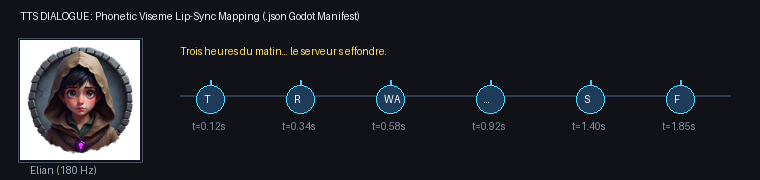 |
| *Phonetic viseme sync over the audio line with adjustable voice pitch* |

* **Example**:
  ```bash
  uv run python main.py -w tts_dialogue "dark_sorceress" --emotions "neutral,happy,angry,hurt" --pitch 180 -o sorceress_voice
  ```

#### 4.5. `vfx_flipbook` — 4x4 Animated Particle Sheets (.tscn)
* **Process**:
  1. Takes an effect concept (`explosion`, `fire`, `lightning`, `portal`, `slash`, `aura`).
  2. Generates a 4×4 grid (16 chronological animation frames) of the evolving particle simulation with alpha transparency.
  3. Writes a Godot 4 `StandardMaterial3D` or `CanvasItemMaterial` with `particles_anim_h_frames = 4` and `particles_anim_v_frames = 4`.
  4. Writes a `ParticleProcessMaterial.tres` with velocity, lifetime, and color ramp settings.
  5. Writes a complete `GPUParticles3D` / `GPUParticles2D` scene (`.tscn`) ready to instantiate in your game level.
* **Inputs**: `prompt`, `--vfx-type` (`explosion`, `fire`, `lightning`, `portal`, `slash`, `aura`), `--mode-2d`.
* **Engines**: Flux.1 Dev / SDXL, PIL grid compositor, Godot particle resource generator.
* **Outputs**: `_flipbook.png`, `_vfx_material.tres`, `_particles_process.tres`, `_vfx.tscn`.

##### 🖼️ 4×4 Particle Animation Sheets & Godot Scenes (.tscn)
| Sword Slash VFX (`vfx_slash`) | Mystic Aura VFX (`vfx_aura`) | Void Well VFX (`vfx_vide`) | Friction VFX (`vfx_friction`) |
| :---: | :---: | :---: | :---: |
|  |  |  |  |
| *4×4 grid + GPUParticles3D* | *Evolving magic aura* | *Animated abyssal vortex* | *Spark & friction particles* |

* **Example**:
  ```bash
  uv run python main.py -w vfx_flipbook "purple arcane void explosion" --vfx-type explosion -o arcane_explosion
  ```

#### 4.6. `anim_loop` — Seamless Animated Loop Shaders
* **Process**:
  1. Accepts an effect or texture animation prompt (portal vortex, flowing waterfall, flickering fire).
  2. Synthesizes a periodic keyframe sequence where frame N connects seamlessly back to frame 0.
  3. Stitches the frames into an animation atlas spritesheet.
  4. Exports a custom Godot 4 `.gdshader` with time-offset dual sampling to eliminate looping seams.
  5. Exports a pre-configured `ShaderMaterial` (`.tres`) and `AnimatedTexture` (`.tres`) for UI and CanvasItem nodes.
* **Inputs**: `prompt`, `--frames` (default: 16), `--fps` (default: 12.0), `--columns` (default: 4), `--mode-2d`.
* **Engines**: Periodic circular phase generator, PIL atlas builder, Godot shader writer.
* **Outputs**: `_spritesheet.png`, `_loop.gdshader`, `_loop_material.tres`, `_animated_tex.tres`.

##### 🖼️ Circular Dual-Sample Time Offset (Zero Stutter)
| Cyclic Phase Shift 0° to 270° (Godot 4 `.gdshader`) |
| :---: |
| 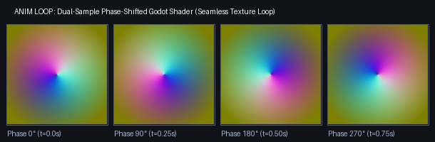 |
| *Continuous phase-shifted interpolation guaranteeing an infinite loop without visible reset* |

* **Example**:
  ```bash
  uv run python main.py -w anim_loop "swirling cosmic void portal" --frames 16 --fps 12 -o void_portal
  ```

#### 4.7. `rife_interp` — AI Frame Rate Multiplication (60 FPS)
* **Process**:
  1. Takes an existing linear spritesheet (e.g. a 4-frame walk cycle or 8-frame attack).
  2. Slices the sheet into separate discrete sequential image frames.
  3. Employs RIFE v4 ONNX optical flow neural network to interpolate intermediate in-between motion frames (2x or 4x multiplication).
  4. Preserves 100% of alpha transparency across interpolated frames.
  5. Reassembles the new smooth sequence into a continuous high-framerate spritesheet.
* **Inputs**: `-i, --input` (source spritesheet path), `--columns` (number of frames), `--factor` (2 or 4).
* **Engines**: RIFE v4 ONNX optical flow model, PIL frame sequencer.
* **Outputs**: `_rife_<factor>x.png`.

##### 🖼️ Frame Multiplication by Optical Flow (RIFE v4 ONNX)
| 24 FPS to 60 FPS Interpolation (Source Frame N -> RIFE Intermediate -> Frame N+1) |
| :---: |
| 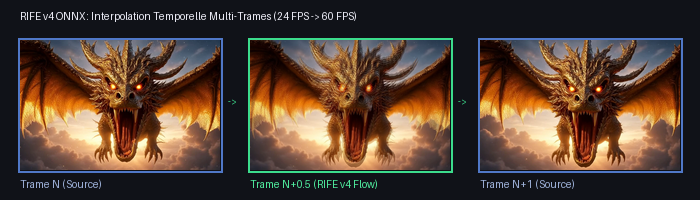 |
| *Intermediate frame reconstruction preserving alpha and edge sharpness* |

* **Example**:
  ```bash
  uv run python main.py -w rife_interp -i godot_assets/spritesheet.png --columns 4 --factor 2 -o anim_60fps
  ```

#### 4.8. `video` — Native Hardware-Accelerated Video Generation (.webm)
* **Process**:
  1. Harnesses `stable-diffusion.cpp` native video inference mode (`-M vid_gen`) with full hardware acceleration under Vulkan.
  2. Supports 4 generation paradigms:
     - **T2V (Text-to-Video)** : Generates animated video clips from a descriptive prompt (cascading waterfalls, flickering campfire, drifting nebulae).
     - **I2V (Image-to-Video)** : Animates an existing still image (`-i, --input`) with natural fluid motion.
     - **FLF2V (First & Last Frame)** : Interpolates seamless motion between a starting keyframe (`--input`) and an ending keyframe (`--end-img`).
     - **V2V (Video-to-Video)** : Applies video style transfer using a directory of guidance frames (`--control-video`).
  3. Supports state-of-the-art video models: **Wan 2.1 / Wan 2.2** (1.3B, 14B MoE High/Low noise), **LTX-2.3 & LTX-2.5** (Lightricks DiT, Gemma 3/4 text encoders, audio VAE), and **MiniMax-H3**.
  4. Encodes and packages video directly into a single lightweight `.webm` container (VP8 / `libwebm`) without external FFmpeg dependencies.
  5. Automatically writes a ready-to-use Godot 4 `VideoStreamPlayer` scene (`.tscn`) configured with loop and autoplay parameters.
* **Inputs**: `prompt`, `-i, --input` (init image), `--end-img` (final image), `--control-video` (frame directory), `--frames` (default: 33), `--fps` (default: 24), `--flow-shift` (default: 3.0), `-o, --output`.
* **Engines**: stable-diffusion.cpp Vulkan (`-M vid_gen`), Wan 2.1 / Wan 2.2 / LTX-2.5 GGUF/Safetensors, libwebm.
* **Outputs**: `_vid.webm`, `_player.tscn` (Godot 4 VideoStreamPlayer scene).

##### 🖼️ SOTA Video Generation & 4K Master Rendering
| LTX-2.5 Distilled Master Render (Native Audio) | Wan 2.2 MoE I2V Animation (Nexus Scene) | CAS 0.75 Sharpness Comparison |
| :---: | :---: | :---: |
| 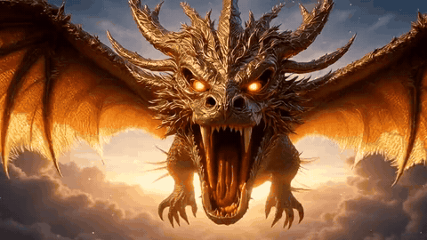 |  | 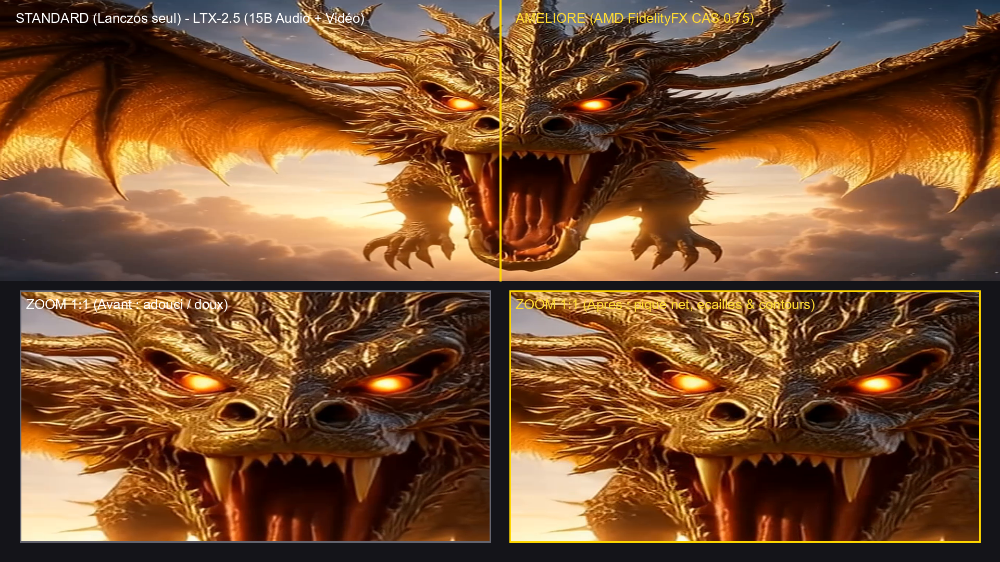 |
| *8 steps, 22B DiT + stereo audio* | *Dual-DiT MoE, fluid micro-dynamics* | *AMF hardware CAS filter, Lanczos* |

* **Example**:
  ```bash
  # Text-to-Video (T2V)
  uv run python main.py -w video "mystical glowing waterfall in ancient overgrown jungle" --frames 33 --fps 24 -o waterfall

  # Image-to-Video (I2V)
  uv run python main.py -w video -i godot_assets/heros_portrait.png -p "character breathing and blinking with atmospheric fog" --frames 25 -o heros_idle
  ```

* **📥 SOTA Video Model Download Guide (`C:\Modeles_LLM`)** :
  All video models are stored in `C:\Modeles_LLM\` (and its `upscalers\` subfolder).  
  *(See the exhaustive guide with direct links and HuggingFace sources in [`docs/guide_telechargement_modeles_video.md`](../docs/guide_telechargement_modeles_video.md))*

  | Model & Role | Required Files (`C:\Modeles_LLM`) | Size | Automated Download Command |
  | :--- | :--- | :--- | :--- |
  | **LTX-2.5 Distilled** 👑<br>*(22B Audio + Video)* | `LTX-2.5-Distilled-Q4_K_M.gguf`<br>`gemma4-12b-with-proj-ltx-2.5-Q5_K_M.gguf`<br>`ltx-2.5-video-vae-conv-bf16.safetensors`<br>`ltx-2.5-audio-vae-bf16.safetensors` | ~25.7 GB | `python scripts/download_ltx25.py`<br>`python scripts/download_gemma4_gguf.py`<br>`python scripts/download_ltx25_vaes.py` |
  | **Wan 2.1 14B & 1.3B**<br>*(3D Geometry & Isometry)* | `wan2.1-t2v-14b-Q4_K_M.gguf`<br>`umt5-xxl-encoder-Q4_K_M.gguf`<br>`wan_2.1_vae.safetensors` | ~13.8 GB | `.\scripts\download_video_models.ps1 -Model 14b` |
  | **Wan 2.2 MoE (T2V)**<br>*(Absolute Photorealism Dual-DiT)* | `Wan2.2-T2V-A14B-LowNoise-Q4_K_M.gguf`<br>`Wan2.2-T2V-A14B-HighNoise-Q4_K_M.gguf`<br>`umt5-xxl-encoder-Q4_K_M.gguf` | ~23.1 GB | `python scripts/download_wan22_official.py` |
  | **Wan 2.2 MoE (I2V)** 👑<br>*(Image-to-Video Animation)* | `Wan2.2-I2V-A14B-LowNoise-Q4_K_M.gguf`<br>`Wan2.2-I2V-A14B-HighNoise-Q4_K_M.gguf`<br>`clip_vision_h.safetensors` | ~19.3 GB | `python scripts/download_wan22_i2v_models.py` |
  | **MiniMax-H3**<br>*(Hailuo 32B DiT + Sound)* | `minimax_h3_fl2va_pruned-Q4_K_M.gguf` (T2VA/I2VA)<br>`minimax_h3_ref2va_pruned-Q4_K_M.gguf` (Ref2VA)<br>`minimax_h3_video_vae_fp16.safetensors`<br>`minimax_h3_audio_vae_fp32.safetensors`<br>`qwen3vl_32b_minimax_h3-Q2_K_M.gguf` | ~30.5 GB | `python scripts/download_minimax_h3.py`<br>*(ref2va: HF `leejet/MiniMax-H3-GGUF`, parallel downloader)* |
  | **4K Super-Resolution**<br>*(YouTube Sharpness ESRGAN)* | `upscalers/4x-UltraSharp.pth` | 64 MB | Included in the repo or via HuggingFace `Kim2091/4x-UltraSharp` |

  > [!TIP]
  > **One-command global download**: fetch the entire video suite with automatic resume on network cuts:
  > ```powershell
  > python scripts/download_all_sota_models.py
  > ```

#### 4.9b. `video_vace` — Motion-Locked Video: reference image + control frames (Wan 2.1 VACE LightX2V distilled)

> 🏆 **Validated 2026-10-01** ("très bien"): the distilled LightX2V route (8 steps) renders a 13-frame 832×480 I2V+VACE clip in **~28 min — 4× faster than the plain 14B VACE 20-step recipe, and better judged** (the 20-step render was rejected "nul" the same day).

* **Principle**: VACE variants of Wan follow control frames (skeletons/pose/depth) while the reference image (`-i`) locks the appearance — motion-locked shots without frame-by-frame flicker (upstream PR #819).
* **Usage**: `uv run python main.py -w video_vace -i <ref.png> --control-video <frames_dir> -p "<motion description>" [-o <name>]`
  — defaults = validated recipe (13 frames @ 16 fps, 832×480, 8 steps, cfg 1.0, euler, seed 42); `--frames/--fps/--width/--height/--steps/--cfg-scale/--seed` overridable. Models: `Wan2.1_14B_LightX2V_StepCfgDistill_VACE-Q3_K_S` + umt5 Q4_K_M + wan 2.1 VAE (constants `DEFAULT_VACE_*`, env-overridable). Memory placement on 16 GB is baked in: `--offload-to-cpu --vae-on-cpu` (the GPU VAE decode alone requests ~19.4 GB), no temporal tiling, no flow-shift, plain `vulkan` backend. Control frames: preprocessed PNG folder (see MEMORY_BANK §1.28 for the COCO-skeleton recipe).

#### 4.9c. `video_multishot` — Multi-Cut Video + Continuous Soundtrack in ONE Generation (LTX-2.5 native multishot)

> 🏆 **Validated 2026-10-02** ("super"): the 65-frame lighthouse two-shot — the named hard cut lands where the prompt asks for it, the keeper's appearance holds across the cut, and the model generates the soundtrack (crashing waves, thunder, cello) as a continuous bed over the cut. This reopens multi-shot sequences, previously rejected in the §1.17 chaining tests (content seams at every I2V cut): the cut is now NATIVE, in one pass.

* **Principle**: LTX-2.5 native multishot — one T2V generation renders several named shots with audio continuity across the cuts. Frame rule: 1 + a multiple of 8 (default 65 @ 24 fps, 832×480 — the validated envelope, resolution not exposed; GPU ceiling ~81 frames, §1.17).
* **Prompting rules** (docs.ltx.io, adopted 2026-10-01): describe each shot in order, name the cut explicitly ("A hard cut transitions to…"), and include the audio bed — the model generates the soundtrack from that block (4-8 sentences total work well).
* **Usage**: `uv run python main.py -w video_multishot -p "<shot 1>. A hard cut transitions to <shot 2>. The ambience continues across the cut, with <sound description>" [-o <name>]` — `--frames/--fps/--seed` overridable (defaults 65/24/42).
* **Engines**: sd-cli vid_gen on the pinned LTX binary (`DEFAULT_SD_CLI_LTX`, master-841 `6b3edaa` — the main build cannot fit LTX-2.5 on 16 GB, #1976): DiT Q4_K_M + video VAE + **audio VAE** + Gemma4 (te/vae on CPU), 8 steps official distilled sigmas, euler_a, cfg 1.0, `--max-vram 10`, **no negative prompt** (as validated). ~10 min for 65 frames.
* **Outputs**: `.webm` (VP8 + PCM — generated soundtrack included).

  ```bash
  uv run python main.py -w video_multishot \
    -p "A weathered lighthouse keeper in a navy wool coat stands on a storm-battered stone pier at dusk, waves exploding against the rocks below as he lifts a battered brass lantern. A hard cut transitions to a close-up of the lantern: the flame trembles in the wind, sea spray drifting past his grey beard as he stares out at the dark water. The storm ambience continues across the cut, with crashing waves, distant thunder and a low mournful cello." \
    -o phare_multishot
  ```

#### 4.9. `h3_ref2va` — Video+Audio Continuation via MiniMax-H3 Ref2VA (webm with sound)

> 🏆 **Jackpot speed (validated 2026-09-09)**: the turbo distilled LoRA (`--turbo`) renders a 22-frame chunk in **~38 min instead of ~70 min** (sampling −64 %), with reference continuity and audio quality **≥ the validated baseline** — judged "très bonne qualité, son très bien" by the user. Same seed + same recipe otherwise, so A/B is trivial.

* **Process** (validated 2026-09-09, recipe in [`docs/MEMORY_BANK.md`](../docs/MEMORY_BANK.md) §1.16 — CLI counterpart of ComfyUI's *HR Endless Sampler* chunk mechanism):
  1. Extracts the **reference tail** from a source video (last N frames @ 24 fps + paired WAV, via FFmpeg) — or accepts a raw frame directory directly.
  2. Runs MiniMax-H3 **Ref2VA** through sd-cli Vulkan: the reference conditions the DiT as `<Video 1>` / `<Audio 1>` (mention them in the prompt), producing a new chunk that continues character, scene **and sound**.
  3. Mandatory memory placement on 16 GB VRAM / 32 GB RAM: DiT on GPU capped by `--max-vram` (graph-cut), Qwen3-VL 32B and video VAE on CPU.
* **Inputs**: `-i <source video | frame dir>` (required), `prompt` (describe the continuation), `--ref-frames` (default 12), `--ref-audio`, `--frames` (H3 grid 17k+5 → 22/39/56, default 22), `--steps` (default 20, or 8 with `--turbo`), `--turbo` (distilled LoRA 8 steps — validated 2026-09-09, ~2× faster, quality & reference continuity ≥ baseline), `--max-vram` (default 10), `-o`.
* **Engines**: sd-cli Vulkan `-M vid_gen` (MiniMax-H3 ref2va DiT Q4_K_M + video/audio VAEs + Qwen3-VL 32B Q2, turbo LoRA `lightx2v/Minimax-h3-Turbo` with `--turbo`), FFmpeg.
* **Outputs**: `.webm` (VP8 + PCM 32 kHz stereo — **generated audio track included**), `<name>_ref/` (extracted reference).
* ⚠️ **Heavy**: ~70 min for 22 frames @ 864×480 on RX 6950 XT (VAE/Qwen on CPU), **~38 min with `--turbo`**; system-load pre-check refuses to start on a busy machine. Single chunk only — multi-chunk endless looping not validated yet. Experimental chunk-loop scaffolding (unvalidated): `scripts/proto_endless_h3.py` (+ [`docs/proto_endless_h3.md`](../docs/proto_endless_h3.md)), with A/B knobs for the seam-quality levers (`--ref-audio-sec` rolling audio window, `--ref-frames 5` seam-exact reference, `--ref-scale` downscaled reference) — defaults match the validated recipe.

  ```bash
  # Continue a dragon video: same dragon breathes fire toward the camera, sound carries over
  # (--turbo = validated distilled LoRA, 8 steps: ~38 min instead of ~70)
  uv run python main.py -w h3_ref2va -i output/overnight/esrgan_4k/01_ltx25_dragon_4k_ultrasharp.mp4 \
    -p "Use the dragon from <Video 1> and the roar from <Audio 1> as the opening state. The dragon breathes a jet of orange fire toward the camera." \
    --turbo -o dragon_continuation
  ```

#### 4.10. `monoplan_ia` — Single-Take Cinematic Shot from a Still Image (LTX-2.5 + slow-motion + designed zoom) 🏆
* **Validation utilisateur 2026-09-10** (« c'est parfait résultat magnifique » — intro Château du Vent-Gris, jeu *L'HÉRITIER DU VIDE*).
* **Process** (the anti-jitter recipe, MEMORY_BANK §1.17 — I2V chaining rejected after v1-v5 iterations: content seams at every cut, tracker-based stabilization injects noise):
  1. Conforms the source image to 16:9 832×480 (Lanczos crop) as the first frame.
  2. Generates ONE single LTX-2.5 Distilled I2V shot (65 frames default = stable GPU ceiling, 8 steps euler_a, cfg 1.0, seed) — no cuts by construction.
  3. Slows it to the target duration with motion-compensated interpolation (`minterpolate` mci/aobmc/vsbmc) + 1080p lanczos — slow-motion divides the model's camera breathing by the stretch factor.
  4. Applies a DESIGNED pure zoom ramp (smootherstep 1.10→1.32 around a fixed anchor, `--zoom-debut/--zoom-fin`) — no tracking measurement in the warp, so it mathematically cannot jitter — plus AMD FidelityFX CAS 0.75.
  5. Optional AI sound bed (`--ambiance "EN prompt"`, SA3 Small SFX) muxed to a listening copy.
  6. Optional end title card (`--carton-titre`, VALIDATED 2026-09-10 on the Vent-Gris intro): freezes the last frame, keeps the zoom ramp going (1.32→1.36 by default), and reveals an animated cinematic title — Pillow multi-layer rendering (ivory→gold gradient, chiseled bevel, warm glow, deep drop shadow, contrast scrim, line+diamond ornament in Felix Titling) with fade-in + left-to-right letter stagger + tracking expansion (0.12→0.22 em). Sound bed extends over the card with a 2.5 s fade-out; everything assembled in one ffmpeg pass. `|` splits title lines (`"L'HÉRITIER|DU VIDE"`), `--carton-duree` (default 6 s), `--carton-zoom-fin` (default 1.36).
* **🏆 Native 4K UHD path (`--4k` / `--upscale-ia`, added 2026-09-12 for the ai-doc2video Hero Hooks broadcast spec: 3840×2160 @ 30 fps, h264_amf ~45 Mbps, FidelityFX CAS 0.75)**: the raw 480p master is super-resolved FIRST — `scripts/upscale_video_ai.py` chain, 4x-UltraSharp frame-by-frame on Vulkan — into a 3328×1920 master (`_brut_4k_ai.mp4`, ~8 min for 65 frames measured 8.0 s/frame on RX 6950 XT); THEN the motion-compensated slow-motion (3328×1920 @ 30 fps) and the pure zoom run on that high-resolution flow, with CAS deferred to the final conform (no double sharpening); the conform (`conformer_master_4k`) scales to 3840×2160 lanczos + CAS 0.75 + AMD AMF. This removes the ~34× pixel-surface stretch of the old 480p→4K Lanczos path: hard details (server racks, metal edges, neons) stay razor sharp, measured on the Halloween hero hook A/B. Title cards work at 4K too (`_BlocTitre` is resolution-aware, metrics ×2, validated on a 4K still). Per the §1.17 lesson: ALWAYS source the AI upscale from the raw 480p frames (65 frames to process), never from an interpolated master (165+ frames = 3× the GPU cost for a softer result).
* **Inputs**: `prompt` (camera move + scene), `-i` image (required unless `--monoplan-source plan.webm` for resumable runs), `--monoplan-frames` (default 65, max ~81), `--monoplan-duration` (default 10.0 s), `--zoom-debut/--zoom-fin` (1.10/1.32), `--4k`/`--upscale-ia` (4K UHD native path, see above), `--ambiance`, `--carton-titre/--carton-duree/--carton-zoom-fin`, `--seed`, `-o`.
* **Engines**: sd-cli Vulkan LTX-2.5 Distilled (DiT Q4_K_M + video VAE + Gemma4 on CPU), FFmpeg minterpolate, OpenCV warp (WARP_INVERSE_MAP), Pillow title rendering, SA3 Small SFX (audio.cpp).
* **Outputs**: `<nom>_<durée>s_1080p.mp4` (mute master), `_avec_ambiance.mp4`, `_brut.webm`, `_ralenti.mp4`, `_ambiance.wav`, and with `--carton-titre`: `_derniere_trame.png`, `_carton.mp4`, `_final_titre.mp4` (validated deliverable). With `--4k`: `<nom>_<durée>s_4k.mp4` (3840×2160 @ 30 fps h264_amf master), `_brut_4k_ai.mp4` (3328×1920 UltraSharp master), `_4k_ralenti.mp4`, `_4k_zoom.mp4` (3328×1920 intermediates).
* **Perf (RX 6950 XT)**: 1080p path — ~15 min generation (65 f, 8 steps) + ~2 min slow-mo + ~1 min zoom. 4K path — adds ~9 min AI upscale (65 × 8.0 s) + ~3 min slow-mo @ 3328×1920 + ~1.5 min zoom + <1 min AMF conform ≈ **~18 min end-to-end for a 5.5 s hook**. ⚠️ LTX GPU ceiling ≈ 81 frames @ 832×480 (internal `ltxav` module eats ~29 MB VRAM/frame); after cascaded Vulkan device-lost errors, reboot before blaming the recipe.

```bash
uv run python main.py -w monoplan_ia "Slow cinematic dolly-in toward a medieval fortress on a storm cliff, drifting storm clouds, crashing waves." -i scene.png --monoplan-duration 10 --ambiance "violent coastal storm, gusting wind over sea cliffs, heavy waves" -o intro_vent_gris

# With the end title card (freeze frame + animated cinematic title + sound bed to the end):
uv run python main.py -w monoplan_ia "Slow cinematic dolly-in toward a medieval fortress on a storm cliff." -i scene.png --monoplan-duration 10 --ambiance "violent coastal storm" --carton-titre "L'HÉRITIER|DU VIDE" -o intro_vent_gris

# 4K UHD Hero Hook (broadcast spec): AI upscale of the raw frames, master 3840×2160 @ 30 fps AMF —
# here resumed from an existing raw shot (no GPU generation, ~13 min for 65 frames):
uv run python main.py -w monoplan_ia --monoplan-source output/hero_brut.webm --monoplan-duration 5.5 --4k -o hero_hook
```

* **🔍 Recommended Workflow: Fast 480p/512p Preview ➔ AI 4K Super-Resolution Master** :
  To combine iteration speed with surgical broadcast-level sharpness, the production pipeline splits into 2 steps — **and since 2026-09-12 the `monoplan_ia` workflow automates the whole chain end-to-end with `--4k`** (upscale of the raw frames BEFORE slow-motion/zoom, then 3840×2160 @ 30 fps AMF conform — see the 🏆 bullet above). The manual script remains available for any other footage:
  1. **Ultra-Fast Native Preview**: generate natively at 768×512 (LTX-2.5) or 832×480 (Wan 2.1) to validate motion, framing and aesthetics in 1-3 minutes.
  2. **AI 4K Super-Resolution (`scripts/upscale_video_ai.py`)**: frame-by-frame processing on Vulkan via the `4x-UltraSharp.pth` neural network, **AMD FidelityFX CAS 0.75** filter, native audio track preservation, and delivery as a **4K Ultra HD master (3840×2160 @ 50 Mbps)** through the AMD AMF hardware encoder (`h264_amf`).

  ```bash
  # 1. Native sequence generation (e.g. LTX-2.5 in 8 distilled steps with audio)
  python scripts/generate_ansible_nexus.py --model ltx25

  # 2. Or direct upscaling of any existing WebM/MP4 file into a 4K master :
  python scripts/upscale_video_ai.py output/clip_brut.webm -o output/clip_4k_master.mp4 --cas 0.75 --bitrate 50M
  ```

* **📺 Ultimate Sharpness Lever for YouTube Publishing (Why 4K Is Mandatory)** :
  > [!IMPORTANT]
  > **The 1080p YouTube compression trap**: upload a Full HD 1080p file and YouTube automatically applies its most destructive compression profile (**AVC1 codec capped at ~4-6 Mbps**), turning thin grid lines, dark textures and light flows into macro-block mush.  
  > **The 4K UHD Master solution (3840×2160)**: publish a 4K-mastered video (via our `4x-UltraSharp` AI Super-Resolution + AMD CAS 0.75) and YouTube is **technically forced to activate its premium VP09 or AV01 profile (25-45 Mbps bitrate)**. Result: even viewers on a 1080p screen or smartphone get the high-fidelity VP09 oversampling with perfect sharpness and micro-contrast!

* **⏱️ Standard Scene Duration: 5.5 seconds (165 frames @ 30 FPS)** :
  For cutaway shots, teasers and illustration scenes, the standardized cadence is **5.5 seconds (165 frames @ 30 fps)**.
  Two strategies are available depending on the architecture:
  - **Strategy 1: Multi-Shot I2V Chaining (Recommended)**: split into 2-3 successive short shots (e.g. 2 shots of 82 frames or 3 shots of 55 frames). Each shot stays in the comfort VRAM zone (<11 GB) without $O(N^2)$ attention saturation or temporal texture softening. 100% fluid chaining by reinjecting the last frame of shot N as the source image (`-i`) of shot N+1.
  - **Strategy 2: Direct Native LTX-2.5 Generation**: for fast continuous scenes with synchronized procedural sound design.

* **👑 Validated Royal Hybrid Workflow: 4K Master Image (Gemini/Upscale) ➔ Wan 2.2 MoE I2V ➔ 4K UHD Master** :
  To combine absolute semantic precision (company logos, brands, complex isometric architectures) with living physical dynamics without any human hallucination:
  1. **Master Image**: high-fidelity reference image (e.g. Gemini Imagen 3 with Linux Tux and Windows logos) upscaled locally.
  2. **MoE DiT Animation (`scripts/animate_ansible_nexus_wan22_i2v.py`)**: image injection via `--clip_vision clip_vision_h.safetensors` and `--vae wan_2.1_vae.safetensors` into the Wan 2.2 MoE Dual-DiT architecture (`HighNoise` for camera cinematics + `LowNoise` for micro-reflections and sharpness).
  3. **4K Conformance & Mastering**: fluid interpolation to 5.5 seconds (165 frames @ 30 FPS) and Ultra HD Super-Resolution (3840×2160 @ 50 Mbps) with the **AMD FidelityFX CAS 0.75** filter.

  ```bash
  # Launch Image-to-Video animation on any 4K source image :
  python scripts/animate_ansible_nexus_wan22_i2v.py --input C:\tmp\scene_01.png --frames 17

  # Automatically generate the 50/50 Split-Screen comparison against a 2.5D animation :
  python scripts/create_comparison_2.5d_vs_wan22.py
  ```

  > [!TIP]
  > **2.5D vs Generative AI Match**: while 2.5D animation resorts to artificial mirror effects at screen edges and freezes light textures, **Wan 2.2 MoE I2V computes a true continuous 3D space without doubling**, animates the actual data-packet pulsation in fiber optics and makes the central nexus radiate volumetrically.

* **🎬 Continuous Multi-Shot I2V Chaining (`scripts/chain_video.py`)** :
  1. **Shot 1 (T2V)**: generate the opening from a descriptive prompt (e.g. 33-frame establishing shot).
  2. **Transition extraction**: automatic capture of the final frame (frame N-1) as PNG via OpenCV.
  3. **Shot 2 (I2V)**: generate the next shot by injecting the captured frame as the starting image (`-i`) with a travelling or zoom prompt.
  4. **Zero-jolt assembly**: automatic concatenation skipping the first duplicated frame for perfect continuity.
  5. **AI 4K Mastering**: AI 4K Super-Resolution pass on the final assembled sequence.

  ```bash
  # Launch multi-shot chaining with fluid transitions :
  uv run python scripts/chain_video.py
  ```

* **👑 Comparison of the 4 SOTA Video Flagships (Empirically Validated on AMD RX 6950 XT)** :
  *(See the full guide in [`docs/comparatif_modeles_video_ai.md`](../docs/comparatif_modeles_video_ai.md) — the raw overnight report lives in `output/overnight/overnight_summary.md`, local & non versioned)*

  | SOTA Model | Architecture & Size | Optimal Steps | DiT Speed | Stereo Audio | Dragon Visual Quality | Conformant 4K / 1080p Master |
  | :--- | :--- | :--- | :--- | :--- | :--- | :--- |
  | **LTX-2.5 Distilled** 👑 | Spatio-Temporal DiT (22B) + Gemma 4 12B | **8 steps** (distilled) | ⚡ **9.98s / step** (3.8 min total) | 🔊 **YES (AAC 48 kHz)** | 🟢 Perfect heroic 3D (gold scales, horns, wings) | `01_ltx25_dragon_4k_ultrasharp.mp4` |
  | **Wan 2.1 14B** | Monolithic DiT (14B) + UMT5-XXL | **8-10 steps** (CFG 6.0) | 🐢 **312s / step** (~6 min total) | ❌ (silent) | 🟢 Ultra-precise isometric geometry, 3D structure | `02_wan21_14steps_dragon_1080p.mp4` |
  | **Wan 2.2 MoE** | Dual-DiT MoE (2x 14B = 28B) + UMT5-XXL | **8 MoE steps** (4 High + 4 Low) | ⏳ **~350s / step** (~11 min total) | ❌ (silent) | 👑 **Absolute photoreal sharpness** (micro-details, gaze) | `wan22_moe_dragon_4k_ultrasharp.mp4` |
  | **MiniMax-H3** | FL2VA DiT (15B) + Qwen3-VL 32B | **12 steps** (CFG 1.0) | 🚀 **16.96s / step** (6.6 min total) | 🔊 **YES (AAC 32 kHz)** | 🟢 Titanic wyvern (flaming crest, massive wings) | `04_minimax_h3_20steps_dragon_1080p.mp4` |

  > Masters kept **locally** in `output/overnight/` (non versioned — too heavy for git).

---

#### 4.9. `voix_off` — Expressive AI Voice-Over with Voice Cloning (qwen3-tts / VoxCPM2 / Fish S2-Pro / Drama 3 / KittenTTS2 GGUF Vulkan)

* **Process**:
  1. Takes the text to read — inline or from a `.txt` file — and an optional **voice reference** (`--voix-ref`, any WAV/MP3/M4A recording, 10-60 s).
  2. **Reference quality gate** (lesson from 2026-09-06): converts to mono 48 kHz, measures the level, and if the mean level is below **−26 dB** automatically normalizes to **−18 LUFS / −1.5 dBTP** (linear loudnorm — no audible compression on flat speech dynamics).
  3. If the engine requires a transcript (qwen3-tts ICL mode, Fish inline cloning), transcribes the reference automatically with **qwen3-asr 0.6B** (cached next to the reference).
  4. Generates the voice-over on **audio.cpp Vulkan**: **qwen3-tts 1.7B** (default with a reference, expression via `--instruct` style/emotion instruction, Apache-2.0, 24 kHz), **VoxCPM2** (default without reference — zero-shot or **transcript-free cloning**, Apache-2.0, 48 kHz), **Fish S2-Pro** (free-form inline expression tags `[whisper]`, `[excited]`, `[pause]`… directly in the text, 44.1 kHz, ⚠️ research license — commercial use requires a Fish Audio license), or **Drama 3** (`--moteur drama3`, Fish Audio Drama 3 MoE — native voice or cloning with transcript, speaker tags `<|speaker:0..15|>` + event tags `[sighs]`/`[laughs]` in the text, 44.1 kHz, 16 GB VRAM profile with 24/40 expert banks on CPU; **Fish Audio Community License: commercial OK below USD 500k/yr revenue** + "Built with Fish Audio" attribution), or **KittenTTS2** (`--moteur kitten2`, KittenTTS2 — **zero-shot only**, the loader's cloning task is untested and refused with `--voix-ref`; USER VALIDATED 2026-10-22 with FR and EN both ASR-round-trip word-perfect, 24 kHz mono, RTF 0.78-1.54, Apache-2.0, model on D:).
  5. Finalizes the track to **−16 LUFS** (YouTube dialogue standard, 2-pass loudnorm, 48 kHz PCM16) + a 192k MP3 listening preview.
* **Inputs**: `prompt` (text or `.txt` path), `--voix-ref`, `--moteur` (`qwen3`|`voxcpm2`|`fish`|`drama3`|`kitten2`; auto if omitted — qwen3 with a reference, voxcpm2 without), `--instruct` (qwen3 expression instruction), `--lufs-voix` (default −16), `--music-backend` (`vulkan`|`cpu`), `--seed`.
* **Engines**: audio.cpp v0.9.2-drama3-base-small (`audiocpp_cli`, Vulkan) + Qwen3-TTS-12Hz-1.7B-Base q8_0 (2.51 Gio) / VoxCPM2 q8_0 (2.75 Gio) / Fish-Audio-S2-Pro q8_0 (5.88 Gio) / Drama-3 q4_K_S experts-q8 backbone (22.91 Gio), all in `C:\Modeles_LLM` / KittenTTS2 q8_0 (3.11 Gio, `D:\Modeles_LLM`, env `KITTEN2_MODEL`) + Qwen3-ASR-0.6B q8_0 (1.07 Gio) — ffmpeg 9.
* **Outputs** (`output/voix_off/<name>/`): `voix_off_brut.wav` (raw engine output), `voix_off_brut_final.wav` (−16 LUFS 48 kHz) + `voix_off_brut_final.mp3` (listening), prepared reference WAV + transcript cache (reused across runs).

##### 🖼️ GGUF Vulkan Engine Comparison with Voice Cloning
| Normalized Waveforms at −16 LUFS (Qwen3-TTS vs VoxCPM2 vs Fish S2-Pro) |
| :---: |
| 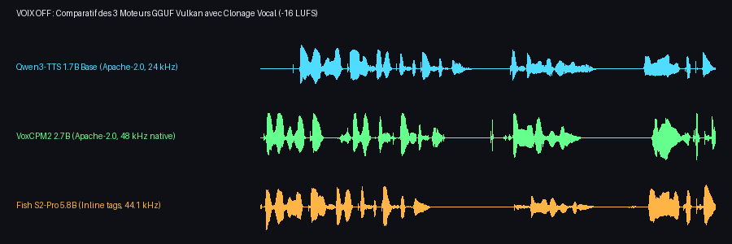 |
| *Tested and validated with a French voice reference: strict dynamics preservation and 2-pass YouTube normalization* |
* **Example**:
  ```bash
  # Cloned voice (reference = any recording) + expression instruction :
  uv run python main.py -w voix_off "Trois heures du matin, le serveur principal s'effondre." \
      --voix-ref "C:\musique\Enregistrement.m4a" --instruct "energetic YouTube narrator tone" -o incident_nuit
  # Long text from a file, inline Fish expression tags :
  uv run python main.py -w voix_off script_ep03.txt --moteur fish \
      --voix-ref "C:\musique\Enregistrement.m4a" -o episode_03
  # Native voice without cloning (VoxCPM2, Apache-2.0) :
  uv run python main.py -w voix_off "Bienvenue sur la chaîne !" -o intro_courte
  # Drama 3 cloning (MoE, Community License < USD 500k/yr) :
  uv run python main.py -w voix_off script_ep03.txt --moteur drama3 \
      --voix-ref "C:\musique\Enregistrement.m4a" --seed 42 -o episode_03_drama3
  ```
* **Status (2026-09-06)**: ✅ End-to-end validated with a real French voice reference on qwen3-tts (RTF 0.64 Vulkan) and Fish S2-Pro — auto level-gate (a −39 LUFS phone recording was auto-normalized), auto ASR transcript, cloning and −16 LUFS finalization all verified. ✅ **User listening validation: all 3 engines judged good** (*« franchement les 3 sont bien »*) — production choice therefore follows the license: **qwen3-tts / VoxCPM2 (Apache-2.0) production-safe**, Fish S2-Pro kept as quality reference (commercial use requires a Fish Audio license). Tie-breakers if needed: voxcpm2 = native 48 kHz, qwen3 = `--instruct` expression steering, fish = richest inline tags. Known engine constraints: qwen3-tts **Base** requires both reference audio AND transcript (hence the ASR step) and outputs 24 kHz mono; VoxCPM2 clones **without** transcript; Fish requires the transcript only when a reference is provided. ✅ **Drama 3 added 2026-10-19, user-validated** (*« c'est très bien »*): both workflow paths e2e PASS (cloning 6.3 s + zero-shot 4.5 s, seed 42, −18.7/−17.0 LUFS finals); engine legs measured RTF 3.32 (TTS) / 6.52 (clone) on the 16 GB profile (`cpu_expert_layers=24` — first real-16GB-card validation); the only **commercially usable Fish engine** (Community License < USD 500k/yr vs S2-Pro's paid research license).
* **Helpers**: `scripts/download_tts_gguf.py` planned — meanwhile download the q8_0 GGUFs from `audio-cpp/audio.cpp-gguf` (Qwen3-TTS-12Hz-1.7B-Base-GGUF, VoxCPM2-GGUF, Fish-Audio-S2-Pro-GGUF, Qwen3-ASR-0.6B-GGUF) via `scripts/telecharger_gros_fichier_parallele.py <url> <dest>`.

---

#### 4.10. `chanson` — Full Songs WITH LYRICS (ACE-Step 1.5 xl-turbo Vulkan)
* **Process**:
  1. Takes the lyrics — inline or from a `.txt` file — with structure tags (`[Intro]`, `[Verse]`, `[Chorus]`, `[Bridge]`, `[Outro]`) that the LM planner orchestrates.
  2. Generates the complete sung song on **ACE-Step 1.5 xl-turbo** (validated variant for vocal quality), French by default (`--langue`), 8 distilled steps, Vulkan with automatic CPU fallback.
  3. Exports WAV + MP3 224k. ⚠️ Clean any citation/annotation from the lyrics — otherwise it gets sung.
* **Inputs**: `prompt` (lyrics text or `.txt` path), `--style-musique` (EN style description, default: the user-validated Vent-Gris dark folk direction), `--duration` (default 180 s), `--variante` (default `xl-turbo`), `--langue` (default `fr`), `--seed`.
* **Engines**: audio.cpp (Vulkan) + ACE-Step 1.5 xl-turbo bf16 GGUF (14.2 Gio) — ~15 min for a 4-minute song (RTF ~3.5-3.9).
* **Outputs** (`output/music_chanson/`): `<name>.wav` + `<name>.mp3`.
* **Example**:
  ```bash
  # 4-minute song from a lyrics file :
  uv run python main.py -w chanson paroles_vers_le_nord.txt --duration 240 -o vers_le_nord
  ```
* **Status (2026-09-06)**: ✅ User-validated capability (« La Symphonie du Silence », « Le Neuvième Fils » — *« c'est incroyable »*) as script `scripts/generer_chanson_acestep.py`; workflow `chanson` wraps the exact validated recipe (same defaults). One Vulkan driver reset was survived by the auto CPU fallback during validation.

#### 4.11. `musique_adn` — New Music with a Reference's DNA (auto BPM + key, imposed on the planner)
* **Process**:
  1. Analyzes the reference audio (`-i <MP3/WAV>`): BPM by onset-envelope autocorrelation + key by Krumhansl chroma correlation (or force it with `--tonalite`).
  2. Builds a SOBER style description (your `prompt` in English) + the detected numbers, and **imposes BPM + key + a sober instrumental suffix on the ACE-Step 1.5 planner** — bar-aligned by construction.
  3. Optional lyrics via `--lyrics <fichier.txt>` (a chanson instead of an instrumental — the instrumental suffix is then omitted, unlike the legacy script).
* **Inputs**: `prompt` (EN style description — keep it sober, see pitfalls), `-i` reference audio (required), `--duration` (default 60 s), `--tonalite` (override), `--negatif`, `--lyrics` (.txt), `--variante` (default `xl-turbo`), `--langue`, `--seed`.
* **Engines**: audio.cpp (Vulkan) + ACE-Step 1.5 xl-turbo.
* **Outputs** (`output/music_chanson/`): `<name>.wav` + `<name>.mp3` (log shows the detected BPM/key).
* **Example**:
  ```bash
  uv run python main.py -w musique_adn "German gothic rock 1990, dark wave, hypnotic tribal groove, deep pulsing bass, chiming chorus guitars" \
      -i "C:\musique\reference.mp3" --duration 45 -o inspire_ref
  ```
* **Status (2026-09-06)**: ✅ User-validated recipe (`llb_xl_adn.mp3` — rendered BPM 83.3 vs 83.3 source). ⚠️ Honest card in `docs/MEMORY_BANK.md` §1.11: every "improvement" attempted beyond the sober recipe was rejected (major key → pop feel, "dominant bass" → 73% bass, punk push → 163 BPM). Rules: always check/impose MINOR for dark rock, sober descriptions, no superlatives.
* **Update (2026-09-09)**: SA3 `init_audio` essence mode is now **user-validated on SA3 Medium** → dedicated workflow `musique_essence` (§4.13). The ACE-Step `cover` route remains rejected (tested once, never listening-validated).

#### 4.12. `retrait_voix` — Vocal Removal & Stem Separation (HTDemucs GGUF Vulkan)
* **Process**:
  1. Takes any song (`-i <MP3/WAV>`, any sample rate) and auto-resamples to **44.1 kHz stereo** (HTDemucs requirement).
  2. Separates it into 4 stems on **audio.cpp Vulkan** (drums, bass, other, vocals) — ~1 min for a 4-minute track.
  3. Builds the **vocal-free instrumental** by summing drums+bass+other (`amix normalize=0` — levels preserved, no compression).
  4. Exports instrumental WAV + MP3, and keeps all 4 stems (including the isolated `vocals.wav` — useful for vocal-timeline mapping and future dubbing experiments).
* **Inputs**: `-i` song (required), `-o` output name, `--music-backend` (default `vulkan`).
* **Engines**: audio.cpp v0.9.2 (family `htdemucs`) + `htdemucs-f16.gguf` (only **84 Mo**, `C:\Modeles_LLM\HTDemucs-GGUF`).
* **Outputs** (`output/retrait_voix/<name>/`): `instrumental.wav` + `instrumental.mp3` (vocal-free), `stems/` (drums, bass, other, vocals), `source_44k.wav`.
* **Example**:
  ```bash
  uv run python main.py -w retrait_voix -i "C:\musique\morceau.mp3" -o mon_instrumental
  ```
* **Status (2026-09-06)**: ✅ **User-validated** (*« retrait de la voix : OK validé »*) on a full 4:07 track. Known pitfalls baked in: HTDemucs requires 44.1 kHz (auto-handled) and stem writing requires `--out-dir` (multi-output). Note: the related "cover" route (AI reinterpretation of a track) was **tested and definitively rejected** by the user — see `docs/MEMORY_BANK.md` §1.11.

#### 4.12b. `retrait_voix --music-backend sam` — Text-Prompted Separation (SAM Audio, CPU)
* **Process** (alternative engine, same workflow): SAM Audio (Meta) separates **any sound described in English text** (default `"the singing voice"`) from the track → `target.wav` (the described sound) + `residual.wav` (the rest). The source is fed **as-is** (SAM Audio has no input-rate requirement — it resamples itself to 48 kHz mono, unlike HTDemucs) and the output contract mirrors HTDemucs (`instrumental.wav/.mp3` = residual, `voix.wav` = target), engine outputs kept in `sam/`.
* **Engine**: audio.cpp family `sam_audio` — **CPU only** (the SAM encoder requests a fixed single 3.73 GB buffer above the AMD RDNA2 Vulkan driver limit). The installed release predates support (upstream PR #711): the binary defaults to the scratch master build (`SAM_AUDIO_ENGINE` env override), model = `sam-audio-small-q8_0.gguf` (`SAM_AUDIO_MODEL` env override, base available) in `C:\Modeles_LLM\SAM-Audio-GGUF`. Perf: ~87 s CPU for 30 s of audio (RTF ≈ 2.9; base ≈ 4.7).
* **Example**:
  ```bash
  uv run python main.py -w retrait_voix -i "C:\musique\morceau.mp3" --music-backend sam -o mon_instrumental
  ```
* **Status (2026-09-28)**: ✅ **User-validated** ("tout est bien") in A/B vs HTDemucs on a sung-voice excerpt (`output/test_sam_audio/ecoute/`). Any text target ("the guitar", "the drums") is technically isolable but **not yet user-validated** — the flag has no text option yet (fixed to vocals, the validated use).

---

#### 4.13. `musique_essence` — New Music Carrying a Reference's Essence (SA3 Medium `init_audio` + vocal removal)
* **Process**:
  1. Conditions **Stable Audio 3 Medium** on the reference audio (`-i <MP3/WAV>`, mode `init_audio`, scale `--scale`): the groove/timbre of the reference transfers to the generation — the one lever that beats the text-prompt pop drift on dark rock registers (validated on the LLB gothic rock quest, 2026-09-08/09).
  2. Fixed seed by default (**42**) — at scale ≥0.5 the essence capture becomes a seed lottery; the validated plateau is **0.40–0.45** (≤0.35 = near-copy with source-vocal bleed).
  3. The reference's singing bleeds into the raw generation → **HTDemucs vocal removal** delivers a clean instrumental (no cloned voice = no derivative-content risk for YouTube). `--keep-vocals` skips the removal.
* **Inputs**: `prompt` (EN style description — keep it sober), `-i` reference audio (required), `--duration` (default 30 s), `--scale` (default 0.45), `--seed` (default 42 = validated recipe), `--keep-vocals`.
* **Engines**: audio.cpp (Vulkan) — SA3 Medium f16 (**5.43 Gio**, `C:\Modeles_LLM\Stable-Audio-3-Medium-GGUF`) + HTDemucs. Perf: RTF ≈ 0.8–0.9 (a 30 s piece in ~25 s), + ~1 min vocal removal.
* **Outputs** (`output/musique_essence/<name>/`): `brut.wav`/`brut.mp3` (raw, with possible vocal bleed) + `instrumental.wav`/`instrumental.mp3` + `stems/` (drums, bass, other, vocals).
* **Example**:
  ```bash
  uv run python main.py -w musique_essence "German gothic rock 1990, dark wave, hypnotic tribal groove, deep pulsing bass, chiming chorus guitars"       -i "C:\musique
eference.wav" --duration 30 --scale 0.45 --seed 42
  ```
* **Status (2026-09-09)**: ✅ **User-validated** (*« c bien »* on the LLB reference, scales 0.40/0.45 with 30 s or 60 s references). Context: SA3 Medium **text-only** was rejected ("toujours pop") and the whole ACE-Step anti-pop text campaign is closed (all rejected — `docs/MEMORY_BANK.md` §1.11); SA3 Small is superseded by Medium.

#### 4.14. `voix_robot` — English Robot Voice (Kokoro-82M + ring modulation)
* **Process** (validated recipe, 2026-09-17):
  1. **TTS**: Kokoro-82M GGUF (audio.cpp Vulkan, 24 kHz mono, voice `af_heart`, `en-us`, normal rate) reads the English text.
  2. **"Small robot" FFmpeg effect**: pitch +30 % (`asetrate`), laid-back pacing (`atempo` 0.65 — pitch untouched), **ring modulation 120 Hz** (`aeval` — multiplying the voice by a sine removes its fundamental → metallic timbre), final gain −4 dB (the "calm" voice the user picked).
  3. Exports WAV (PCM 16-bit) + listening MP3; the raw TTS base is kept for effect retuning without regenerating.
* **Inputs**: `prompt` (English text or `.txt` path), `--robot-voice` (Kokoro voice, default `af_heart`), `--robot-pitch` (default 1.30), `--robot-ringmod` (Hz, default 120), `--robot-tempo` (default 0.65), `--robot-gain` (dB, default −4).
* **Engines**: Kokoro-82M q8_0 GGUF (`C:\Modeles_LLM\Kokoro-82M-GGUF`) + ffmpeg. ⚠️ The audio.cpp release zip cannot run `kokoro_tts` yet (eSpeak-ng not bundled — MEMORY_BANK §1.21): the workflow auto-resolves the scratch binary with embedded eSpeak (`AUDIOCPP_KOKORO_CLI` env override).
* **Outputs** (`output/voix_robot/<name>/`): `<name>.wav`, `<name>.mp3`, `<name>_brut.wav`.
* **Example**:
  ```bash
  uv run python main.py -w voix_robot "Greetings, human. I am your robot assistant. Beep. Boop." -o robot_hello
  ```
* **Status (2026-09-17)**: ✅ **User-validated** (*« c'est bien »*) after a 17-variant listening session (2 TTS engines × ring mod / pitch / flanger / bitcrush / vibrato chains + native qwentts VoiceDesign robot instructs); winner = Kokoro `af_heart` + the effect above. Alternatives kept in `output/test_voix_robot/`.

#### 4.15. `audio_upscale` — Audio Super-Resolution → 48 kHz (UniverSR)
* **Process** (validated recipe, 2026-09-18): declares the input bandwidth (8/12/16/24 kHz, auto-detected via ffprobe or forced with `--upsr-rate`), pre-resamples the file to that rate if needed (FFmpeg), then runs the UniverSR flow-matching ODE (4 steps, seed 42) to reconstruct a 48 kHz signal — genuine high-band extrapolation above the input Nyquist (attenuated: −11 dB @ 16 kHz, −19 dB @ 19.2 kHz on a sweep).
* **Variants**: `speech` (voice, default — the main use case) / `audio` (music).
* **Inputs**: `-i` WAV/MP3 at reduced bandwidth; `--upsr-variante {speech,audio}`; `--upsr-rate` (Hz, 0 = auto; entries above 24 kHz are refused as already full-band); `--seed`.
* **Engines**: UniverSR GGUF (`C:\Modeles_LLM\UniverSR-GGUF`, 229 MB per package) via audio.cpp **CPU only** — the Vulkan path is broken upstream (`unsupported backend op 'MUL_MAT'`), RTF ≈ 13 (28 s → ~6 min; a 3-min voice-off → ~40 min). ⚠️ Output is **mono** (stereo input is downmixed by the model).
* **Outputs** (`output/audio_upscale/<name>/`): `<name>_48k.wav` (48 kHz mono) + `<name>_48k.mp3`.
* **Example**:
  ```bash
  uv run python main.py -w audio_upscale -i voix_16k.wav --upsr-variante speech
  ```
* **Status (2026-09-18)**: ✅ **User-validated** — voice 16 kHz→48 kHz (*« copie sans bug, parfait même »*) and music 24 kHz→48 kHz (*« très bien, belle batterie »*). Re-test if audio.cpp ships a Vulkan path for this family (RTF would drop to ~1, opening music-bed upsampling). Apollo (compressed-music restoration, same release) was **rejected** (*« moins bonne qualité »* — no audible improvement); its GGUF stays in place, deletable on request.

#### 4.16. `animal_godot` — Game-Ready Animated Animal (Pack Blend → GLB for Godot)
* **Process** (validated recipe, 2026-09-18): opens a rigged animal pack `.blend` (e.g. Quaternius CC0 packs — mesh + armature + native mocap actions), removes the legacy placeholder objects (Camera/Cube/Light), renames every native action to the `AN_*` clip convention, then exports a single **GLB** with `export_animation_mode='ACTIONS'` (one clip per action, +Y up). The result is **verified by re-import** (bone/clip/mesh counts) before delivery.
* **Inputs**: `-i` rigged animal `.blend`; `--animal-prefixe` (clip prefix, default `AN_`); `--animal-actions` (optional whitelist of native actions to keep).
* **Outputs**: `<blend>_godot.glb` — drop into Godot: AnimationPlayer is generated automatically with all clips.
* **Example**:
  ```bash
  uv run python main.py -w animal_godot -i output/test_rig/meshes/quaternius_animaux/Wolf_rigge.blend -o loup_godot.glb
  ```
* **Status (2026-09-18)**: ✅ **User-validated** — native Quaternius gallop rendered from this exact chain graded *« parfait »* (the quality bar: native mocap on a textured character beats any procedural/retargeted motion). Full campaign details (agentique Rigify rigs, Kimodo text→mocap CPU, parked retarget): MEMORY_BANK §1.28 + skill `.agents/skills/blender-rig/`.
* **Quality rule of thumb**: native pack mocap on a textured character = best; procedural FK loops = ambient only; inter-rig retarget = parked (works, below the bar).

#### 4.17. `voix_perso` — English Character Voice (Kokoro preset or Qwen3 VoiceDesign + validated post chains)
* **Process** (recipes validated on the novel2video-ai pilot casting, 2026-09-27 — MEMORY_BANK §1.31):
  1. **Engine auto-selection**: `--kokoro-voice <id>` → raw HUMAN Kokoro-82M preset render (audio.cpp Vulkan — no robot effect; language auto-resolved from the voice prefix: `a*` → en-us, `b*` → en-gb, the engine rejecting `b*` voices with en-us); otherwise `--instruct "<EN>"` → **Qwen3-TTS 1.7B VoiceDesign** via qwentts.cpp (`--lang English`, text on stdin, seed 42 default) — the `voix_off` qwen3 path forces `--language French` + a mandatory voice reference and cannot do 100 % English instruct voices.
  2. **Composable post chains** (FFmpeg, 44.1 kHz PCM16): `--pitch-ratio` (duration-preserving, **source-rate aware** — engine outputs are 24 kHz, a 44100-based `asetrate` would apply ~1.8× the intended factor), `--whisper` (Elder treatment: lowpass 1800 Hz + 60 ms echo), `--hollow` (Void treatment: lowpass 900 Hz + 120 ms echo + **6 dB compensation** — a bare lowpass chain measures −35 dB mean = inaudible).
  3. Final normalization **−16 LUFS** (YouTube dialogue standard) + listening MP3; `--brut` skips it for raw comparison renders.
* **Inputs**: `prompt` (English text or `.txt`), `--kokoro-voice` (e.g. `am_onyx`, `bm_george`), `--instruct` (VoiceDesign instruction, reused flag from `voix_off`), `--pitch-ratio` (default 1.0), `--whisper`, `--hollow`, `--brut`, `--seed` (default 42), `--lufs-voix` (default −16).
* **Engines**: Kokoro-82M q8_0 (audio.cpp, same eSpeak binary resolution as `voix_robot`) + qwentts.cpp VoiceDesign talker Q8_0 (`C:\IA\qwentts.cpp`, health: `scripts/manage_qwentts.py --check`).
* **Outputs** (`output/voix_perso/<name>/`): `<name>_brut.wav` (engine render), `<name>.wav` (post chains), `<name>_final.wav` (−16 LUFS) + `<name>_final.mp3`.
* **Example** (the validated pilot cast):
  ```bash
  LINE="Empty ruins of a burnt medieval forge inside a decayed castle."
  uv run python main.py -w voix_perso "$LINE" --kokoro-voice am_onyx -o alaric          # Alaric (baron ~90)
  uv run python main.py -w voix_perso "$LINE" --kokoro-voice am_michael -o elder       # The Elder (hermit)
  uv run python main.py -w voix_perso "$LINE" --instruct "very young boy of exactly eight years old, extremely high pitched child voice, energetic bratty teasing, fast excited speech" --pitch-ratio 0.90 -o marc   # Marc (8 y.o.)
  uv run python main.py -w voix_perso "$LINE" --kokoro-voice am_onyx --pitch-ratio 0.85 --hollow -o void  # The Void
  ```
* **Status (2026-09-27)**: ✅ **User-validated** end-to-end — 5/5 roles of the novel2video-ai E01 pilot cast by ear in 2 rounds (Alaric `am_onyx`, Elder `am_michael`, Marc VoiceDesign ×0.90, Elian VoiceDesign natural, Void `am_onyx` + hollow). Children voices by instruction work (Marc/Elian); extreme-age adult instructs still lose to Kokoro presets. Batch dialogue rendering (line list + casting file) = future workflow when the pilot script is final.

#### 4.18. `acestep_cover` — Re-Style an Existing Track (ACE-Step 1.5 cover, duration locked)
* **Process** (validated 2026-10-02, MEMORY_BANK §1.34): runs the ACE-Step `cover` route on any source track (wav/mp3/ogg — auto-converted to the engine's 48 kHz stereo input layout): the model re-renders the whole timeline in the requested style while keeping the source's exact duration (loop-safe). The strength knobs (`audio_cover_strength`/`repaint_strength`) are proven inert on turbo (3-way A/B, same seed) — not exposed. ⚠️ CPU backend by construction (the VAE-encoder single buffer exceeds the AMD Vulkan 4 GiB limit — RTF ~2.6, a 45 s track ≈ 2 min).
* **Inputs**: `-p` (EN style description, required), `--audio` (source track, required — shared CLI flag with `voix_conversion`), `--seed` (default 42), `--cover-threads` (default 20 = validated recipe), `-o` (output base name, default `<source-stem>_cover`).
* **Outputs** (`output/music_cover/`): `<name>.wav` (48 kHz stereo, duration = source) + `<name>.mp3` 224k.
* **Example**:
  ```bash
  uv run python main.py -w acestep_cover --audio loop_gothique.wav -p "German gothic rock 1990, dark wave, hypnotic tribal groove, deep pulsing bass, chiming chorus guitars, 83 BPM, C# minor" --seed 42
  ```
* **Status (2026-10-02)**: ✅ **User-validated** (*« correct »* on 3 covers of the validated gothic reference `llb_xl_adn.mp3`) — first validated ACE-Step edit route (lego/extract rejected, repaint unjudged but same hard-preservation contract re-confirmed: 0.01 %FS outside the window, deterministic).

#### 4.19. `voix_conversion` — Re-Voice a Recording (Chatterbox voice conversion)
* **Process** (validated 2026-10-02): chatterbox `vc` task (audio.cpp, Vulkan, fast) renders an existing recording (speech/singing) in the voice of a reference sample — prosody and timing preserved. Successor of the rejected VeVo2 singing path for character voices. ⚠️ Output = **24 kHz mono** (dialogue-grade, not musical beds). ⚠️ The Turbo variant is TTS-only — the workflow pins the standard package.
* **Inputs**: `--audio` (source recording, required — shared CLI flag), `--voice-ref` (clean take of the target voice, required), `-o` (output base name, default `<source-stem>_vc_<ref-stem>`).
* **Outputs** (`output/voix_conversion/`): `<name>.wav` (24 kHz mono).
* **Example** (the validated E01 A/B pair):
  ```bash
  uv run python main.py -w voix_conversion --audio output/voix_off/ab_e01_l001_qwen_expr/voix_off_brut.wav --voice-ref output/voix_off/ab_e01_l001_voxcpm/ref_E01_L001.wav
  ```
* **Status (2026-10-02)**: ✅ **User-validated** (*« voix anglaise bien »*) — Chatterbox q8_0 (1.94 GiB, `C:\Modeles_LLM\Chatterbox-GGUF`).

---

#### 4.20. `open_water` — Procedural Storm-Sea Clips (open-water, MIT) + Perfect Xfade Loop
* **Process** (validated 2026-10-24, user « image ok » on the 4 Vent-Gris legs — MEMORY_BANK §1.47):
  1. Starts the open-water static server (`tools/serve.mjs`, hardcoded port 5173 — part of the validated chain), or reuses one already answering.
  2. Renders a fixed-camera, constant-weather clip via the LOCAL `tools/render_shot.mjs` addition (drives the interactive frame path; the upstream `render/render.mjs` plays a scripted, non-loopable 60 s film instead). Weather + camera are URL params (`--ow-params`): `preset wind rain clouds cloudDark elev yaw pitch h fov lightning float`.
  3. Optional `--ow-loop`: perfect infinite loop with the in-game-validated xfade recipe (fps=24 on BOTH branches, offset = post_duration − fade, 1.5 s fade) reused from `scripts/faire_boucle_menu_vent_gris.py`, then black-band audit (`scripts/audit_bande_noire.py --zero --raccord`) reported as CONFORMING / NON-CONFORMING.
  4. System-load pre-check runs automatically before the launch (busy machine = aborted).
* **Engine**: local clone (default `C:\GIT\open-water`, env `OPEN_WATER_DIR` / `--ow-dir`) + headless Chrome ANGLE/D3D11 (puppeteer-core → system Chrome, `npm install` once) + ffmpeg on PATH. Zero PyTorch, GPU-light.
* **Inputs**: `--ow-params` (default: validated storm-day recipe `preset=storm&float=0&yaw=200&pitch=6&h=6&fov=50`), `--ow-duration` (10 s), `--ow-warm` (10 s rendered warm-up), `--ow-crf` (15), `--ow-loop`, shared `--fps/--width/--height` (24 / 1920×1080), `-o`, `--output-dir`.
* **Pitfalls (measured 2026-10-24, enforced as warnings)**: the storm preset defaults to UNSEEDED `lightning=0.7` → multi-second exposure crushes, unloopable → pass `lightning=0` for loops; `elev=<negative>` eases from the day default and the sun→moon switch wipes the cloud history (rebuilt on RENDERED frames only) → keep `--ow-warm >= 10`.
* **Performance** (measured, RX 6950 XT): 1080p24 ≈ 0.17-0.19 s/frame → a 10 s leg ≈ 1.5 min total (warm-up + render).
* **Outputs**: `output/<name>.mp4` (silent 10 s master, bt709) + optional `<name>_boucle.mp4` (8.5 s loop) + `<name>_render.log`. SILENT on purpose: the game / channel lays its own music bed.
* **Style fit** (visual assessment): very dark gloomy twilight storm sea, credible foam streaks, plausibly in-family with the LTX Vent-Gris masters; open-sea framing only (no land in open-water). Use cases: silent backdrop loops (menu/transitions) + physics-grounded keyframes for LTX I2V.
* **Example** (validated leg1 + loop):
  ```bash
  uv run python main.py -w open_water --ow-loop -o open_water_storm_day
  # night no-lightning leg (validated leg2 recipe):
  uv run python main.py -w open_water --ow-loop \
    --ow-params "preset=storm&float=0&yaw=200&pitch=6&h=6&fov=50&elev=-14&lightning=0"
  ```
* **Status (2026-10-24)**: ✅ **User-validated** (*« image ok »* on the 4 night-test legs, `output/test_nuit_open_water/`) — workflow e2e re-validated the same evening (master + loop CONFORMING, joint L diff 1.42).

---

#### 4.21. `lfm3_tts` — Fast Local Voice Synthesis (LFM3-Audio-2B, llama.cpp Vulkan)
* **Process** (validated 2026-10-28, user « voix parfaite » on the EN/FR listening samples — MEMORY_BANK §1.48):
  1. System-load pre-check runs automatically before the launch (busy machine = aborted).
  2. Synthesizes speech from the prompt text via `llama-tts` (llama.cpp, arch `lfm3` — support since master `d05706b`; the official release b11936 predates the LFM3 merges, so the local build is kept until a release ≥ b11937).
* **Engine**: LiquidAI LFM3-Audio-2B Q8_0 + audio mmproj on `D:\Modeles_LLM` (user rule 2026-10-28: Liquid models stay on D:, too big for C:; env `LFM3_TTS_MODEL_PATH` / `LFM3_TTS_MMPROJ_PATH` / `LLAMA_TTS_PATH`).
* **Inputs**: text prompt (positional), `--tts-langue` (ISO 639-1, default `fr`), `--tts-voix` (`female` default / `male`), `-o`, `--output-dir`. No seed: the audio sampling parameters baked into the GGUF rule the generation.
* **Performance** (measured, RX 6950 XT): FASTER than real time — FR 2.1×, EN 1.1× wall clock, 24 kHz output; cold model load from D: ≈ 32 s (lesson 10-11).
* **Outputs**: `output/<name>.wav` (raw 24 kHz — no LUFS mastering; chain through `son_convertir`/ffmpeg downstream if a production level is needed).
* **Positioning**: fast drafts and short lines; the mastered production voices stay on the validated audio.cpp engines (`voix_off`).
* **Example** (validated):
  ```bash
  uv run python main.py -w lfm3_tts "Bienvenue dans l'Héritier du Vide, voyageur." -o intro_fr
  uv run python main.py -w lfm3_tts "System online." --tts-langue en --tts-voix male
  ```
* **Status (2026-10-28)**: ✅ **User-validated** (*« voix parfaite »*) — E2E FR + EN/male exit 0 same session (`output/test_lfm3/`). ASR (same model, llama-mtmd-cli) stays a smoke-tested exercise, not a workflow.

#### 4.22. `ocr_image` — Local OCR on Images & Screenshots (MiniCPM-OCR-1.0 via llama-server)
* **Process** (validated 2026-10-28, user « OK GO » on the 3/3 smoke results — MEMORY_BANK §1.49):
  1. System-load pre-check runs automatically before the launch (busy machine = aborted).
  2. Starts ONE llama-server session (model + mmproj, `-ngl 99`, free port, health-gated), OCRs every input image through `/v1/chat/completions` with `reasoning_effort: "none"`, then shuts the server down (VRAM released) — one model load for the whole batch.
  3. Server-only on purpose: the model transcribes inside its thinking block; only the request-level `reasoning_effort: "none"` routes the text to `content` (the mtmd-cli exposes no such flag — empty output measured).
* **Engine**: openbmb MiniCPM-OCR-1.0 Q8_0 + mmproj f16-4x on `C:\Modeles_LLM` (~1.6 GB files, ~2 GB VRAM, Apache-2.0; env `MINICPM_OCR_MODEL_PATH` / `MINICPM_OCR_MMPROJ_PATH` / `LLAMA_SERVER_PATH`).
* **Inputs**: `-i, --input` (one image or a directory: png/jpg/jpeg/webp/bmp), `--ocr-consigne` (custom instruction in English; default = exact transcription preserving layout), `-o`, `--output-dir`.
* **Performance** (measured, RX 6950 XT): ~4 s/page (image encoding 2.7-3.9 s + generation ~237 t/s, Q8_0).
* **Outputs**: `output/<name>_ocr.txt` (single image) or `output/ocr_resultat.md` (directory: one `##` section per image).
* **Positioning**: vision path for scans, screenshots and UI captures, FR included — distinct from `ocr_pdf` (pdfcraft, native PDF text + English-only OCR fallback). Measured quality: EN word-perfect, FR 1-char error on ~250 (off the EN/ZH training spec), UI screenshots word-perfect.
* **Example** (validated):
  ```bash
  uv run python main.py -w ocr_image -i output/test_minicpm_ocr/fixture_fr.png
  uv run python main.py -w ocr_image -i output/test_minicpm_ocr -o ocr_test_minicpm
  ```
* **Status (2026-10-28)**: ✅ **User-validated** (« OK GO ») — E2E single-image + directory exit 0 same session (`output/fixture_fr_ocr.txt`, `output/ocr_test_minicpm.md`).

---

### 🛠️ 5. Style Consistency, Upscaling & Batching

#### 5.1. `ip_adapter` — Art Style Locking & Godot Palettes
* **Process**:
  1. Takes a reference image representing your game's visual identity, palette, and materials.
  2. Extracts dominant color palettes, luminance ranges, and shading rules.
  3. Iterates across a requested list of items (e.g., `sword,shield,ring,helmet`) conditioning each generation on the reference image features.
  4. Assembles an interactive Consistency Board image comparing the reference against all derived items.
  5. Exports the extracted color scheme into a Godot 4 `.tres` palette, Aseprite `.gpl`, and JSON palette.
* **Inputs**: `-i, --input` (reference image), `--items` (comma-separated list of items), `-s, --size`.
* **Engines**: Style analysis extractor, Flux.1 / SDXL, Godot palette exporter.
* **Outputs**: Item `.png` files, `_consistency_board.png`, `.tres`, `.gpl`, `.json`.

##### 🖼️ Style Locking & Consistency Board (Godot Palettes)
| Style Reference (`-i` Input) → 4 Conditioned Derived Items (`_consistency_board.png`) |
| :---: |
| 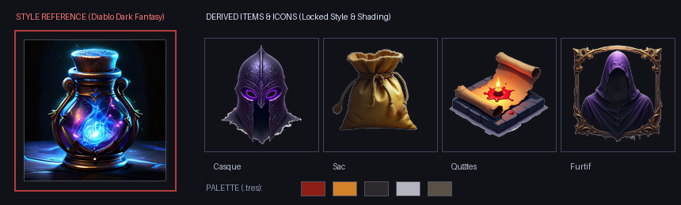 |
| *Helmet, bag, scrolls and shroud derived from the reference potion — dominant palette extracted and exported to `.tres` / `.gpl` / `.json`* |

* **Example**:
  ```bash
  uv run python main.py -w ip_adapter -i godot_assets/potion_diablo.png --items "sword,shield,ring,helmet" -o diablo_set
  ```

#### 5.2. `upscale` — 4K AI Super-Resolution (ESRGAN Vulkan)
* **Process**:
  1. Loads any 2D sprite, texture, or render.
  2. Passes the RGB channels through Real-ESRGAN Vulkan neural network (4x-UltraSharp or RealESRGAN Anime 6B) for super-sharp edge reconstruction.
  3. Separately processes and bilinearly scales the Alpha transparency channel, merging it back to guarantee zero alpha halos or border corruption.
* **Inputs**: `-i, --input` (source image), `--factor` (e.g., 2, 4), `--upscale-model` (`ultrasharp`, `anime`, `auto`).
* **Engines**: Real-ESRGAN Vulkan (`4x-UltraSharp.pth`, `RealESRGAN_x4plus_anime_6B.pth`).
* **Outputs**: `_upscaled_<WxH>.png`.

##### 🖼️ 4× Super-Resolution without Alpha Halo (Micro-Detail Zoom)
| Pixelized Original (×4 nearest zoom) vs 4x-UltraSharp Vulkan (`_upscaled_4096x4096.png`) |
| :---: |
| 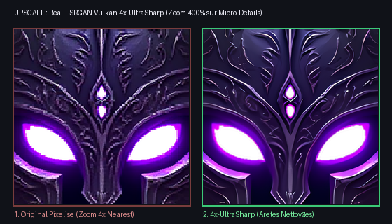 |
| *Sharp reconstruction of the helmet engravings — alpha channel processed separately then recombined (zero edge corrosion)* |

* **Example**:
  ```bash
  uv run python main.py -w upscale -i godot_assets/casque.png --factor 4 --upscale-model ultrasharp
  ```

#### 5.3. `batch` — Automated Batch Recipe Execution
* **Process**:
  1. Loads a JSON recipe file or text prompt list.
  2. Parses target workflows, prompts, and custom overrides per task.
  3. Sequentially executes each generation task while actively releasing VRAM between jobs.
  4. Produces a consolidated report of all exported assets.
* **Inputs**: `--file` / `--recipe` (JSON recipe path or newline-delimited text file); `--continue-on-error` (keep going after a failed asset).
* **Failure policy**: by default the batch stops at the first failed asset and exits with a non-zero code; with `--continue-on-error` the whole batch runs and the exit code is still non-zero when any asset failed (each failure listed with its prompt and error). Consumers calling with `check=True` can rely on exit code 0 = every asset generated.
* **Engines**: WorkflowRegistry dispatcher, JSON recipe parser.
* **Outputs**: Complete batch of generated game assets.

##### 🖼️ One Recipe → Multiple Heterogeneous Assets in a Single Run
| JSON Recipe (`recipes/pack_retro_demo.json`) + Real Outputs (2 pixel-art palettes + 2 parametrized flowmaps) |
| :---: |
| 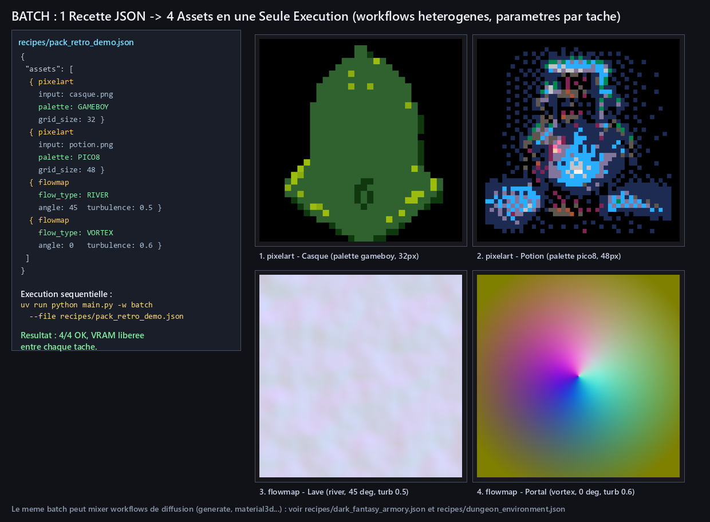 |
| *4 tasks executed sequentially (4/4 OK) with per-task workflow & parameter overrides; VRAM freed between jobs* |

* **Example**:
  ```bash
  # Demo pack: 2 pixel-art (different palettes/grids) + 2 flowmaps (different types/angles) in one run:
  uv run python main.py -w batch --file recipes/pack_retro_demo.json
  # Diffusion packs shipped with the repo:
  uv run python main.py -w batch --file recipes/dark_fantasy_armory.json
  uv run python main.py -w batch --file recipes/dungeon_environment.json
  ```

---

---

<span id="craft-suite-catalog"></span>
### 🧩 6. Craft Suite Integration — 12 Headless Rust Apps

Beyond diffusion engines, the factory drives the productive apps of the open-source [Craft App Suite](https://getartcraft.com/apps) (pure-Rust desktop apps by the ArtCraft team) through their headless CLIs and MCP servers — real typography, real documents, real spreadsheets, real decks, on top of the generated assets. Installed and version-pinned by the dedicated **craft-suite** manager (see [Optional: the Craft suite](#-optional-the-craft-suite-thumbnails-typography-mcp-apps)); automatic watch + changelog-first updates included.

Engine access patterns (why it matters for reliability): **PhotoCraft** = persistent `serve` JSON-lines session; **EffectCraft** = persistent MCP stdio server (compositions die between CLI invocations); all the others = stateless CLI per invocation. Every engine path resolves through `core/photocraft.py` with per-app environment overrides (`PHOTOCRAFT_CLI`, `PDFCRAFT_CLI`, `VECTORCRAFT_CLI`, `DECKCRAFT_CLI`, `WORDCRAFT_CLI`, `GRIDCRAFT_CLI`, `LIGHTCRAFT_CLI`, `SOUNDCRAFT_CLI`, `EFFECTCRAFT_CLI`, `DESIGNCRAFT_CLI`, `FIGCRAFT_CLI`, `FILMCRAFT_CLI`).

| Workflow | Craft app | Use | Key inputs | Output | Status |
| :--- | :--- | :--- | :--- | :--- | :--- |
| `miniature` | PhotoCraft | YouTube thumbnail: 16:9 crop, gradient band, real text layers | `-i`, `--titre`, `--sous-titre`, `--couleur-titre`, `--taille-titre`, `--bandeau` | `<name>_miniature.jpg` | ✅ VALIDATED |
| `prepa_i2v` | PhotoCraft | I2V keyframe prep: centered ratio crop + lanczos | `-i`, `--ratio` (16:9…21:9), `--width`/`--height` (long side) | `<name>_i2v.png` | ✅ VALIDATED |
| `carte_fin` | PhotoCraft | Subscribe end card: bg image + veil or solid, CTA typography | `--fond`, `--texte-principal`, `--texte-secondaire`, `--voile` | `<base>_carte_fin.jpg` | ✅ VALIDATED |
| `filigrane_batch` | PhotoCraft | Batch corner watermark (alpha) + format + resample | `-i`, `--filigrane`, `--position`, `--couleur-filigrane` | `<name>_filigrane.<fmt>` | ✅ VALIDATED |
| `ocr_pdf` | PdfCraft | PDF to UTF-8 text; OCR fallback for scans (en in 0.9.0) | `-i`, `--language`, `--forcer-ocr` | `<name>.txt` | ✅ VALIDATED |
| `icone_jeu` | VectorCraft | Flat-design vector icon, SVG + PNG (Godot UI scale-free) | `--forme` (cercle/carre/hexagone/etoile), colors, `--taille` | `icone_<forme>_<taille>.svg/.png` | ✅ VALIDATED |
| `rapport_deck` | DeckCraft | Benchmark JSON to PDF deck: title + **column-chart slide** + summaries | `--donnees`, `--titre`, `--sous-titre` | `rapport_<base>.pdf` | ✅ VALIDATED |
| `doc_texte` | WordCraft | Markdown/text/HTML to a styled PDF | `-i` (.md/.txt/.html/.tex/.rtf) | `<name>_wordcraft.pdf` | 🧪 tested — validation pending |
| `classeur_donnees` | GridCraft | CSV/TSV/JSON to a real XLSX workbook | `-i` (.csv/.tsv/.json) | `<name>.xlsx` | 🧪 tested — validation pending |
| `titre_anime` | EffectCraft | 1920×1080 title composition frame (bg + text layer) | `--texte`, `--teinte`, `--taille-texte`, `--couleur-fond-ecran` | `titre_<texte>.png` | 🧪 tested — validation pending |
| `maquette_ui` | FigCraft | Dark UI wireframe 1280×720 (header + zones + labels) | `--libelle` | `maquette_<libelle>.png` + `.fig` | 🧪 tested — validation pending |
| `photo_develop` | LightCraft | One-command photo develop: import, optional EV, auto, export | `-i`, `--exposition`, `--long-cote` | `<name>_developpe.jpg` | 🧪 tested — validation pending |
| `son_convertir` | SoundCraft | Audio convert + normalize/resample/bit-depth | `-i`, `--normaliser`, `--frequence`, `--profondeur-bits` | `<name>_conforme.wav` | 🧪 tested — validation pending |
| `planche_pdf` | DesignCraft | A4 print-ready proof sheet around one image | `-i` | `<name>_planche.pdf` | 🧪 tested — validation pending |
| `projet_montage` | FilmCraft | Rough-cut project bin with media imported, saved headless | `-i` (media file or directory) | `<name>_montage.fcproj` | 🧪 tested — validation pending |

CADCraft is the only suite app without a workflow: it ships no automation surface at all in 0.8.0 (no `mcp`/`serve`/`run` subcommand). The craft-suite watch re-screens it at every update; a workflow lands the day a surface ships.

<span id="cli"></span>
## 💻 CLI Reference & Cheat Sheet

```text
Usage: python main.py [prompt] [options]

Primary Options:
  prompt                    Asset description or design concept.
  -w, --workflow            Target workflow name (default: 'generate').
  -i, --input               Input image path (for Img2Img, upscale, variations, pixelart).
  -t, --type                2D asset category: item, character, prop, tile.
  --shape                   3D shape for mesh3d: tile, cube, pillar, cylinder, sphere, card, cutout.
  -o, --output              Output file basename (without extension).
  -d, --output-dir          Destination directory (default: 'godot_assets/').
  -s, --size                Square output resolution in pixels.

AI Engines & Models:
  --sd-model                Diffusion model: 'flux', 'juggernaut', 'sdxl' or file path.
  --use-llm                 Enable local LLM prompt expansion (default: direct prompt passthrough).
  --no-llm                  Disable local LLM prompt expansion (default behavior).
  --seed                    Random seed (-1 for automatic random).
  --strength                Denoising strength for Img2Img / guided diffusion (default: 0.55).
  --segmenter               Background remover: 'auto', 'birefnet', 'rmbg', 'floodfill', 'none'.
  --pbr-engine              PBR estimator: 'auto', 'deep' (DeepBump ONNX), 'sobel'.
  -l, --lora                Apply LoRA in 'name:weight' format (e.g. -l 'game_icon_diablo_style:0.8').
  --upscale                 Automatically trigger 4K ESRGAN AI upscaling after generation.
  --upscale-model           ESRGAN model ('ultrasharp', 'anime', 'auto').

Workflow-Specific Flags:
  --pose                    OpenPose preset for pose_control (idle, slash_attack, cast_spell, shield_block, jump, walk).
  --pitch                   Voice pitch in Hz for tts_dialogue (default: 160.0).
  --fps                     Framerate for anim_loop (default: 12.0).
  --items                   Comma-separated list of items for ip_adapter (e.g. 'sword,shield,ring,helmet').
  --angle                   Flow angle in degrees for flowmap (default: 90 = downwards).
  --flow-type               Flow type for flowmap ('river', 'vortex', 'radial', 'optical').
  --turbulence              Turbulence strength for flowmap (default: 0.35).
  --margin                  Fixed 9-slice margin in pixels for ui_9slice.
  --auto-margin             Automatic margin detection for ui_9slice.
  --voxel-depth             Extrusion thickness in voxels for voxel3d.
  --voxel-scale             Voxel size in Godot units for voxel3d.
  --biome-a, --biome-b      Biome prompts/textures for autotile_pack.
  --factor                  Multiplication factor for upscaling or RIFE interpolation (2x, 4x).
  --vfx-type                Effect preset for vfx_flipbook or anim_loop ('explosion', 'fire', 'portal').
  --emotions                Comma-separated emotions for rpg_portrait and tts_dialogue.
  --duration                Duration in seconds for sfx, audio_ambience and music_bg loop.
  --lufs                    Bed loudness target in LUFS for music_bg (default: -30).
  --loop-mode               Loop strategy for music_bg: 'percussive' (BPM-aligned, default) or 'ambient'.
  --music-backend           audio.cpp backend for music_bg: 'vulkan' (default), 'cpu' or 'auto'.
  --candidats               Number of music_bg candidates to generate and rank (default: 3).
  --lyrics                  Lyrics/structure conditioning for music_bg (default: '[Instrumental]').
  --analyse                 Enable optional Music Flamingo QA on the selected music_bg bed.
  --character               Target character name for character3d, character_makeup or outfit (e.g. 'elian', 'marc_novice').
  --portrait                Input 2D reference portrait image path for character3d or character_makeup.
  --skin                    MakeSkin base preset name (default: 'makeskin').
  --eye-color               Eye material/iris color (e.g. 'cyan', 'blue', 'brown').
  --blend-file              Target .blend file path when updating existing model.
  --render-modes            Render views for character3d ('head_front,head_three_quarters,full_front,full_three_quarters').
  --samples                 Cycles render sample count (default: 48).
  --age, --gender           MakeHuman anatomical macro factors (age: 0.0=child, 0.5=adult; gender: 0.0=male, 1.0=female).
  --makeup-only             Only generate MakeUp ink layer texture + manifest without building body.
  --top, --shoes            Materials description for outfit workflow.

Utility Flags:
  --interactive             Launch the interactive console menu (all 36 workflows).
  --check                   Verify system requirements, paths, and model checkpoints.
  --list-workflows          Display all registered workflows.
  --list-loras              Display detected LoRAs.
  --list-upscalers          Display detected ESRGAN models.
```

---

### ⚡ Practical CLI Quick Examples

```bash
# 1. Generate 2D item icon with auto 4K AI upscaling (4096×4096 px)
uv run python main.py -w generate "royal gold shield with an engraved lion" --upscale

# 2. Generate dark fantasy potion using Diablo LoRA (auto-switches to SDXL)
uv run python main.py -w generate "dark mana potion" -l game_icon_diablo_style:0.9 --upscale

# 3. Create complete PBR stone floor tile (.tres + OpenGL Normal + ORM + Albedo)
uv run python main.py -w material3d "ancient gothic stone tile with purple runes" -s 1024 -o sol_runique

# 4. Generate 3D mesh model with embedded PBR textures via Blender
uv run python main.py -w mesh3d "ancient iron wrought treasure chest" --shape cube -o coffre_3d

# 5. Generate 360° equirectangular skybox with space LoRA
uv run python main.py -w skybox "purple cosmic nebula with dark obsidian moons" -l space_backround-XL-7:1.0

# 6. Re-texture MakeHuman character outfit with custom medieval materials
uv run python main.py -w outfit --character marc_novice --top "rustic medieval beige burlap tunic" --shoes "dark worn leather boots"

# 7. Upscale existing image directly with 4x-UltraSharp
uv run python main.py -w upscale -i godot_assets/casque.png --factor 4 --upscale-model ultrasharp
```

---

